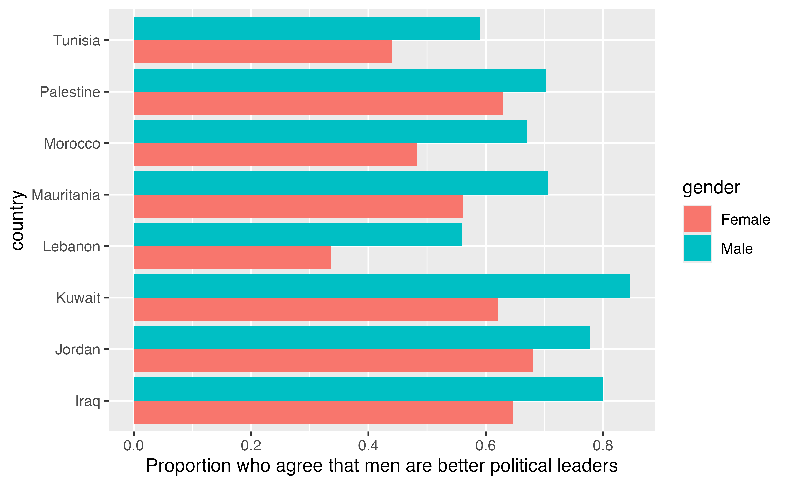
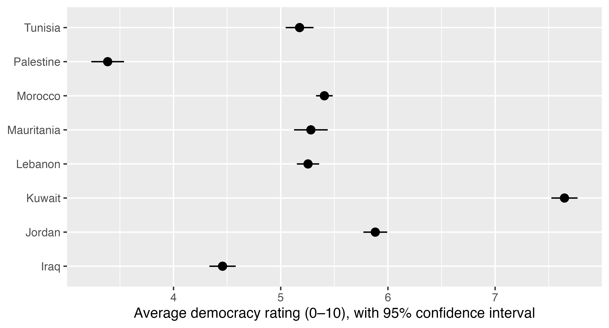

## Data description

For this exercise, you'll work with `barometer`, a trimmed-down version of Wave VIII (2023--2024) of the [Arab Barometer](https://www.arabbarometer.org/), the same survey we've been using in class. It has one row for each of the 15,627 people who were interviewed in 8 countries. Here are the columns I've given you:

- `id`: Respondent ID number
- `country`: Country where the person was interviewed
- `weight`: Survey weight (see the note below)
- `urban_rural`: Whether the person lives in an urban or rural area
- `age`: Age, in years
- `gender`: Gender (`"Male"` or `"Female"`)
- `trust_government`: "How much trust do you have in the government (Council of Ministers)?" (`"A great deal of trust"`, `"Quite a lot of trust"`, `"Not a lot of trust"`, or `"No trust at all"`)
- `trust_courts`: "How much trust do you have in the courts and legal system?" (same answers as `trust_government`)
- `trust_police`: "How much trust do you have in the police?" (same answers as `trust_government`)
- `men_better_leaders`: How much the person agrees with the statement "In general, men are better at political leadership than women" (`"Strongly agree"`, `"Agree"`, `"Disagree"`, or `"Strongly disagree"`)
- `democracy_rating`: "To what extent is [your country] democratic?" on a scale from 0 to 10, where 0 means not democratic at all and 10 means completely democratic
- `economy`: "How would you evaluate the current economic situation in [your country]?" (`"Very good"`, `"Good"`, `"Bad"`, or `"Very bad"`)
- `religious`: "Would you describe yourself as religious, somewhat religious, or not religious?"
- `thought_emigrating`: "Have you ever thought about emigrating from [your country]?" (`"Yes"` or `"No"`)

People who said "Don't know" or refused to answer are coded as missing (`NA`).

::: {.callout-warning}
In Kuwait, the Arab Barometer surveyors didn't ask questions about trust in the government, courts, or police, or the question about religiosity, so those columns are all `NA`.
:::

::: {.callout-note title="What about the `weight` column?"}
The Arab Barometer uses random sampling, but some kinds of people still end up a little over- or under-represented in each country's sample. Survey weights fix this by counting some people a little more and some people a little less so that the sample better matches each country's population. Real analyses of this survey should use the weights, but we're going to ignore them in this problem set to make things simple. (That means your numbers won't exactly match the official Arab Barometer reports.)
:::


## Task 0: Load data

Run the chunk below to load the data. You don't need to change any of the code here!

```{r}
#| label: load-libraries-data
#| warning: false
#| message: false

library(tidyverse)
library(moderndive)
library(infer)

barometer <- readRDS("data/arab_barometer.rds")
```


## Task 1: Explore the data

### Part 1

Several of these questions have four possible answers, but for this problem set you'll collapse them into two. Create a new dataset named `barometer_clean` that uses `mutate()` to add two new columns:

- `trust_gov`, which is `"Trust"` when `trust_government` is `"A great deal of trust"` or `"Quite a lot of trust"`, and `"No trust"` when it's `"Not a lot of trust"` or `"No trust at all"`
- `men_better`, which is `"Agree"` when `men_better_leaders` is `"Strongly agree"` or `"Agree"`, and `"Disagree"` when it's `"Disagree"` or `"Strongly disagree"`

::: {.callout-tip title="Hint!"}
In the past you used `ifelse()` to make two categories (like `is_africa` in the in-class examples). That doesn't work well here because (1) the logic for collapsing these multiple categories is a little more complex, and (2) the missing values get handled differently (`ifelse()` would put everyone who said "Don't know" into the second category). Instead, use `recode_values()`, which takes a column and lets you list which old values should turn into which new values. Anything that doesn't match any of the old values (like `NA`) becomes `NA`:

```r
mutate(new_column = recode_values(
  some_existing_column,
  c("Thing 1", "Thing 2") ~ "Group A",
  c("Thing 3", "Thing 4") ~ "Group B"
))
```
:::

Then use `count()` to check that `trust_gov` worked. You should have 4,287 people who trust the government, 9,818 who don't, and 1,522 `NA`s.

```{r}
#| label: make-barometer-clean

# Do stuff here
```

### Part 2

Use `group_by()` and `summarize()` to calculate these things for each country:

- The number of people interviewed (`n()`)
- The proportion of people who trust the government (hint: `mean(trust_gov == "Trust", na.rm = TRUE)`)
- The average `democracy_rating`

Store this as `country_summary`. It should look like this:

```
# A tibble: 8 × 4
  country    n_people prop_trust_gov avg_democracy_rating
  <chr>         <int>          <dbl>                <dbl>
1 Iraq           2408         0.340                  4.46
2 Jordan         2400         0.380                  5.88
3 Kuwait         1210       NaN                      7.65
4 Lebanon        2403         0.0723                 5.25
5 Mauritania     1200         0.380                  5.28
6 Morocco        2411         0.328                  5.41
7 Palestine      1189         0.239                  3.39
8 Tunisia        2406         0.387                  5.18
```

(Kuwait's `prop_trust_gov` is `NaN`, or "not a number," because the Kuwait survey didn't ask that question.)

Answer these questions:

- In which country do people trust the government the least? About what percent of people trust it there?
- In which country do people rate their own country as the most democratic? The least democratic?

```{r}
#| label: country-summary

# Do stuff here
```

**ANSWER HERE**

### Part 3

Run the code chunk below to see a plot. It shows the proportion of men and women in each country who agree that men are better at political leadership than women.

```{r}
#| label: recreate-me-1
#| echo: false

if (interactive()) {
  png::readPNG("images/recreate-me-1-1.png") |> grid::grid.raster()
} else {
  
}
```

Use `barometer_clean`, `group_by()`, `summarize()`, and `ggplot()` to recreate the plot above. You'll need to make a small summarized dataset first, with one row for each country and gender combination (so 16 rows).

::: {.callout-tip title="Hints!"}
- Use `drop_na(men_better, gender)` before you summarize so that the missing answers don't mess up your proportions
- You can group by two things at once with `group_by(country, gender)`
- Normally `geom_col()` stacks bars on top of each other. To put them side-by-side, use `geom_col(position = "dodge")`
:::

Then answer this question:

- What patterns do you see across countries and between men and women?

```{r}
#| label: make-plot-1

# Do stuff here
```

**ANSWER HERE**


## Task 2: Confidence intervals for a mean

In class, we saw that every random sample gives a slightly different estimate, and that we can use the standard error to measure how much estimates bounce around. But in real life, we only get one sample, and we don't know the true population parameter. The 2,400ish people interviewed in each country are a single random sample from a real population of millions of people.

In this task, you'll estimate the average democracy rating among *all* adults in Iraq, using the one sample of Iraqis in the Arab Barometer.

### Part 1

Before you calculate anything, define what you're measuring! What are the following? (Try to be brave and also include a mathematical symbol for the parameter and the statistic, like $p$ and $\hat{p}$ or $\mu$ and $\bar{x}$ like we did in class.)

- Population:
- Population parameter:
- Sample statistic:

**ANSWER HERE**

### Part 2

Create a dataset named `iraq` that filters `barometer_clean` to only include Iraq and then uses `drop_na(democracy_rating)` to remove people who didn't answer. It should have 2,407 rows.

Use `summarize()` to calculate the number of people, the average `democracy_rating` ($\bar{x}$), and the standard deviation of `democracy_rating`.

Then use `ggplot()` to make a histogram of `democracy_rating` (use `binwidth = 1`).

Answer these questions:

- What's the average democracy rating in the sample? How do you interpret this number?
- Does the distribution of individual answers look like a bell curve? Does it need to for the central limit theorem to work?

```{r}
#| label: iraq-sample

# Do stuff here
```

**ANSWER HERE**

### Part 3

We can't take 1,000 new samples from Iraq. But we *can* do the next best thing: the **bootstrap**. Bootstrapping means resampling *from our one sample* with replacement, over and over, to get a sense of how much the average would bounce around from sample to sample.

Use the {infer} package to make a bootstrap distribution of the average democracy rating with 1,000 bootstrap samples. Store it as `bootstrap_means`. Use `visualize()` to look at it.

::: {.callout-tip title="Hint!"}
The {infer} workflow from *ModernDive* section 8.2.3 looks like this:

```r
name_of_dataset |>
  specify(response = column_name) |>
  generate(reps = 1000, type = "bootstrap") |>
  calculate(stat = "mean")
```

:::

::: {.callout-important title="Seeds"}
Random samples are random, so everyone will get slightly different numbers. To make your results match mine (and to make sure your results are the same every time you render this document), include `set.seed(1234)` at the beginning of any chunk that uses `generate()`.
:::

Answer these questions:

- What does each of the 1,000 numbers in `bootstrap_means` represent?
- What shape is the bootstrap distribution? Where is it centered?

```{r}
#| label: bootstrap-means

# Do stuff here
```

**ANSWER HERE**

### Part 4

Use `get_confidence_interval()` with `type = "percentile"` to calculate a 95% confidence interval from `bootstrap_means` using the percentile method. Store this as `percentile_ci`.

Then use `visualize()` and `shade_confidence_interval()` to show the confidence interval on top of the bootstrap distribution (see *ModernDive* section 8.2.4 for an example).

Answer these questions:

- Interpret the confidence interval in plain language. What are you 95% confident about?
- Your friend looks at your confidence interval and says "There's a 95% chance that the true average democracy rating in Iraq is between [the lower number] and [the upper number]." Why isn't that quite right? What does the "95%" actually refer to?

```{r}
#| label: bootstrap-ci

# Do stuff here
```

**ANSWER HERE**

### Part 5

You can also make a confidence interval with math instead of the bootstrap, using the same ideas from class:

$$
\text{SE} = \frac{\text{SD}}{\sqrt{n}} \qquad \text{MOE} = 1.96 \times \text{SE} \qquad \text{CI} = \bar{x} \pm \text{MOE}
$$

Use `summarize()` to calculate the average rating, the standard error (`sd(democracy_rating) / sqrt(n())`), the margin of error, and the lower and upper ends of the confidence interval for `iraq`.

::: {.callout-note title="1.96 vs. the *t* distribution"}
*ModernDive* section 8.1.4 explains that when you use the sample's standard deviation instead of the population's, you should technically use a number from the *t* distribution instead of 1.96. With big samples like this, though, that number is basically 1.96 (it's 1.961 with 2,407 people), so you can just use 1.96.
:::

Answer these questions:

- How does this confidence interval compare to the bootstrapped one from Part 4?
- What's the margin of error? How would you report this result in a news story (e.g., "Iraqis rate their country's democracy at X out of 10, ± Y points")?

```{r}
#| label: formula-ci

# Do stuff here
```

**ANSWER HERE**

### Part 6

Now calculate a 95% confidence interval for the average democracy rating in *every* country at once. Use `drop_na(democracy_rating)`, `group_by(country)`, and `summarize()` with the formula from Part 5 to make a dataset named `democracy_cis` with one row per country.

Run the code chunk below to see a plot of these confidence intervals.

```{r}
#| label: recreate-me-2
#| echo: false

if (interactive()) {
  png::readPNG("images/recreate-me-2-1.png") |> grid::grid.raster()
} else {
  
}
```

Use `democracy_cis` and `ggplot()` to recreate it.

::: {.callout-tip title="Hint!"}
Use `geom_pointrange()`. It needs a point and the two ends of the line, like `geom_pointrange(aes(xmin = lower, xmax = upper))`.
:::

Answer these questions:

- Which countries have the widest confidence intervals? Look at the number of people in each country---why are their intervals wider?
- Tunisia, Lebanon, Mauritania, and Morocco all have pretty similar averages. Based on the confidence intervals, can you confidently say which of those four countries' citizens think their country is the most democratic? Why or why not?
- Can you confidently say that Jordanians rate their country as more democratic than Moroccans do? Why?

```{r}
#| label: make-plot-2

# Do stuff here
```

**ANSWER HERE**


## Task 3: Confidence intervals for a difference in proportions

In Task 1, you saw that men are more likely than women to agree that men are better political leaders in every country. But those are just samples. Is the gap between men and women in the *population* real, or could it just be sampling variation? Let's look at Lebanon, where the gap looked especially big.

### Part 1

Before you calculate anything, define what you're measuring! What are the following? (Try to be brave and also include a mathematical symbol for the parameter and the statistic, like $p$ and $\hat{p}$ or $\mu$ and $\bar{x}$.)

- Population:
- Population parameter:
- Sample statistic:

**ANSWER HERE**

### Part 2

Create a dataset named `lebanon` that filters `barometer_clean` to only include Lebanon and uses `drop_na(men_better, gender)` to remove people who didn't answer. It should have 2,380 rows.

Use `group_by()` and `summarize()` to calculate the proportion of men and women who agree that men are better political leaders, along with the number of people in each group.

Answer this question:

- What's the difference between the proportion of men and the proportion of women who agree? (Calculate men − women.)

```{r}
#| label: lebanon-props

# Do stuff here
```

**ANSWER HERE**

### Part 3

Use {infer} to make a bootstrap distribution of the difference in proportions between men and women, using 1,000 bootstrap samples. Store it as `bootstrap_diffs`. Then use `get_confidence_interval()` to find the 95% percentile confidence interval and use `visualize()` and `shade_confidence_interval()` to plot it.

::: {.callout-tip title="Hint!"}
This is like the yawning example in *ModernDive* section 8.4. With two groups, you need to `specify()` a formula (`outcome ~ group`) and tell it which answer counts as a "success." You also need to tell `calculate()` which order to subtract the groups in:

```r
whatever_data |>
  specify(outcome ~ group, success = "Agree") |>
  generate(reps = 1000, type = "bootstrap") |>
  calculate(stat = "diff in props", order = c("Male", "Female"))
```
:::

Answer these questions:

- Interpret the confidence interval in plain language.
- Does the confidence interval include 0? What would it mean if it did?

```{r}
#| label: lebanon-bootstrap

# Do stuff here
```

**ANSWER HERE**

### Part 4

Back in Problem Sets 4 and 5, you used regression with a categorical explanatory variable to compare groups. You can do the same thing here!

`lm()` needs a numeric outcome, so first use `mutate()` to add a new column to `lebanon` named `men_better_num` that is 1 when `men_better` is `"Agree"` and 0 when it's `"Disagree"` (you can use `ifelse()` here, since there aren't any missing values left). Then use `lm()` to create a model that explains `men_better_num` with `gender`. Store it as `model_leaders` and use `get_regression_table()` to look at the results.

Answer these questions:

- Interpret the intercept. Which group does it represent? Where have you seen that number before?
- Interpret the coefficient for `gender-Male`. Where have you seen that number before?
- Look at the `lower_ci` and `upper_ci` columns for `gender-Male`. What do you think they are? How do they compare to your bootstrapped confidence interval from Part 3?

```{r}
#| label: lebanon-regression

# Do stuff here
```

**ANSWER HERE**


## Task 4: Extension

Copy the code from a previous task and paste it into the chunk below. Do something extra to it. If you calculate a new confidence interval, start by defining the population, population parameter, and sample statistic, like you did in Tasks 2 and 3. Here are some ideas!

- Repeat Task 3 for a different country. Is there any country where the confidence interval for the gap between men and women gets close to 0? (Hint: look at the plot you made in Task 1, Part 3)
- Make bootstrapped confidence intervals for the proportion of people who trust the government, the courts, or the police in a few countries (hint: use `specify(response = trust_gov, success = "Trust")` and `calculate(stat = "prop")`)
- Look at the difference in the average `democracy_rating` between men and women, or between urban and rural people, in a country (hint: use `calculate(stat = "diff in means")`)
- Run a regression that explains `democracy_rating` with `age` and `gender` (or anything else) in a country, and interpret the `lower_ci` and `upper_ci` columns
- Anything else!

**This is your chance to play around and explore---have fun!**

```{r}
#| label: extension

# Do stuff here
```
