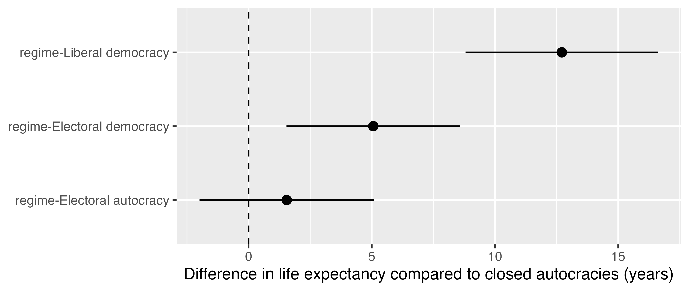
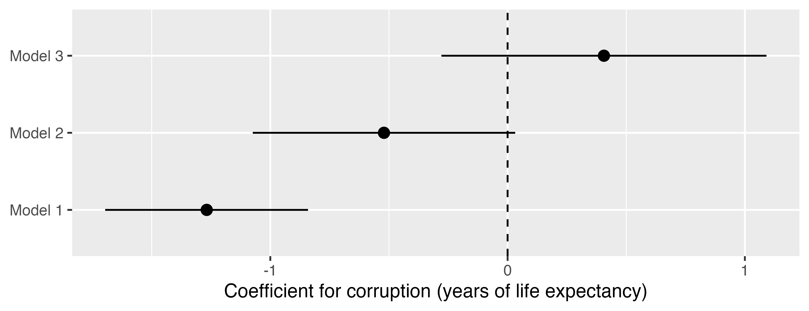

## Data description

For this problem set, you'll use the same two datasets that you'll use for your final project (and that we used in class for inference for regression):

- **`barometer`**: One row for each of the 15,627 people interviewed in Wave VIII (2023--2024) of the [Arab Barometer](https://www.arabbarometer.org/) in Iraq, Jordan, Kuwait, Lebanon, Mauritania, Morocco, Palestine, and Tunisia
- **`vdem`**: One row for each of the 179 countries in [V-Dem](https://www.v-dem.net/) in 2023

Both datasets have lots of columns. You can see all of them in the [final project codebook](https://quantf26.classes.andrewheiss.com/assignment/final-project-codebook.html). Here are the ones you'll need for this problem set:

**`barometer`**:

- `country`: Country where the person was interviewed
- `gender`: Gender (`"Male"` or `"Female"`)
- `age`: Age, in years
- `voted`: "Did you vote in the last parliamentary elections?" (`"Yes"` or `"No"`). This wasn't asked in Palestine, so it's all `NA` there.

**`vdem`**:

- `country_name`: Country name
- `region`: World Bank region
- `regime`: Regimes of the World category (`"Closed autocracy"`, `"Electoral autocracy"`, `"Electoral democracy"`, or `"Liberal democracy"`)
- `corruption_10`: Political corruption index, from 0 to 10, where higher numbers mean *more* corruption
- `polyarchy_10`: Electoral democracy index, from 0 to 10, where higher numbers mean more democracy
- `gdpPercap`: GDP per capita (in 2021 dollars, adjusted for purchasing power)
- `life_exp`: Life expectancy at birth, in years

In the Arab Barometer, people who said "Don't know" or refused to answer are coded as missing (`NA`). We'll ignore the survey weights again, like we did in Problem Set 6---that's too complicated for what we're doing here.


## Task 0: Load data

Run the chunk below to load the data. You don't need to change any of the code here!

```{r}
#| label: load-libraries-data
#| warning: false
#| message: false

library(tidyverse)
library(moderndive)
library(infer)
library(modelsummary)

barometer <- readRDS("data/barometer.rds")
vdem <- readRDS("data/vdem.rds")
```


## Task 1: The gender gap in voting

In many countries, men are more likely to vote than women. In class, we saw an example whether there's a gender gap in voting in Mauritania. In this task, you'll test whether that's the case in both Tunisia and Jordan using the simulation-based approach from *ModernDive* chapter 9 and the five steps from class:

1. Find δ
2. Invent a world where δ is null
3. Look at δ in the null world
4. Find the probability that δ could exist in the null world (the p-value)
5. Decide

### Part 1

Before looking at any data, write down your hypotheses and your evidentiary standard for this question: **In Tunisia, do women and men vote at different rates?** Write each hypothesis in words *and* with symbols (like $p_\text{women} - p_\text{men}$).

- $H_0$:
- $H_A$:
- $\alpha$:


**ANSWER HERE**


### Part 2

Create a dataset named `tunisia` that filters `barometer` to only include Tunisia and uses `drop_na(voted, gender)` to remove people who didn't answer. It should have 2,402 rows.

Use `group_by()` and `summarize()` to calculate the proportion of women and men who voted, along with the number of people in each group.

Then find δ---or the difference in proportions (women − men)---with {infer}. Store it as `obs_diff`.

::: {.callout-tip title="Hint!"}
To find δ, use `specify()` and `calculate()` without `hypothesize()` or `generate()`:

```r
whatever_data |>
  specify(outcome ~ group, success = "Yes") |>
  calculate(stat = "diff in props", order = c("Female", "Male"))
```
:::

Answer this question:

- What proportion of Tunisian women and men voted? What's δ? Explain it in regular, non-statsy language.

```{r}
#| label: tunisia-props

# Do stuff here
```

**ANSWER HERE**


### Part 3

Next, invent a world where δ is null (or 0ish, or all the values that are functionally equivalent to 0). Use {infer} to shuffle the `gender` column 1,000 times and calculate the difference in proportions in each shuffled dataset. Store this as `null_world`.

Then use `visualize()` and `shade_p_value()` to see where δ falls in the null world, and use `get_p_value()` to find the p-value.

::: {.callout-tip title="Hint!"}
This is the same pipeline from Part 2, but with `hypothesize()` and `generate()` added in the middle:

```r
whatever_data |>
  specify(outcome ~ group, success = "Yes") |>
  hypothesize(null = "independence") |>
  generate(reps = 1000, type = "permute") |>
  calculate(stat = "diff in props", order = c("Female", "Male"))
```

Remember to include `set.seed(1234)` at the beginning of any chunk that uses `generate()` so that your results match mine.
:::

::: {.callout-note title="p-values of 0"}
`get_p_value()` gives a warning when the p-value is 0. A simulated p-value of 0 just means that none of the 1,000 shuffles were as extreme as δ, so report it as p < 0.001.
:::

Answer these questions:

- What does each of the 1,000 numbers in `null_world` represent? Where is the null world centered, and why?
- Where does δ fall in the null world? How comfortably does it fit there?
- What's the p-value? Write a sentence explaining what it means using the null world template from class ("In a world where…").
- What do you decide? Is the gender gap in voting in Tunisia statistically significant?
- Is the gap big enough to matter? (Statistical significance and substantive importance aren't the same thing!)

```{r}
#| label: tunisia-null-world

# Do stuff here
```

**ANSWER HERE**


### Part 4

Now do the same thing for Jordan. Create a dataset named `jordan` (it should have 2,398 rows) and repeat Parts 2 and 3: calculate the proportions, find δ, make a null world, and find the p-value. Use the same hypotheses and α from Part 1, but for Jordan instead of Tunisia.

Answer these questions:

- What's δ in Jordan? What's the p-value? What do you decide?
- Your friend looks at your results and says "This proves that Jordanian women and men vote at the exact same rate." Why isn't that right?

```{r}
#| label: jordan

# Do stuff here
```

**ANSWER HERE**


### Part 5

For each of these statements, say whether it's right or wrong. If it's wrong, explain why.

A. "In Jordan, there's a 77% chance that the null hypothesis is true."

B. "If Jordanian women and men voted at exactly the same rate, we'd see a gap at least as big as the one in our sample in about 77% of samples."

C. "In Tunisia, there's less than a 0.1% chance that the gender gap is just because of random chance."

D. "In Tunisia, a gap as big as 11.5 percentage points would be really rare if women and men actually voted at the same rate, so we reject the null hypothesis."

E. "The gender gap in Tunisia is statistically significant, so it must be important."


**ANSWER HERE**


## Task 2: Are Middle Eastern countries more corrupt?

People often assume that countries in the Middle East and North Africa are especially corrupt. In this task, you'll use V-Dem to test whether the average level of political corruption in that region is different from the rest of the world.

### Part 1

Create a new dataset named `vdem_clean` that uses `mutate()` to add two new columns to `vdem`:

- `in_mena`, which is `"Yes"` if `region` is `"Middle East, North Africa, Afghanistan & Pakistan"` and `"No"` if it's not (hint: use `if_else()`)
- `gdp_1000`, which is `gdpPercap` divided by 1,000 (you'll use this in Task 4, so that a one-unit change in GDP per capita means \$1,000)

::: {.callout-note title="Who's in the region?"}
This is the World Bank's definition of the region, so it includes the Arab countries plus Afghanistan, Iran, Israel, Malta, and Pakistan (24 countries in total, since V-Dem treats the West Bank and Gaza as separate places).
:::

Then use `group_by()` and `summarize()` to calculate the average `corruption_10`, the standard deviation of `corruption_10`, and the number of countries in and out of the region.

Write down your hypotheses and α (with symbols, like $\mu_\text{MENA} - \mu_\text{rest}$):

- $H_0$:
- $H_A$:
- $\alpha$:

Answer this question:

- Which region is more corrupt on average? By how much?

```{r}
#| label: vdem-clean

# Do stuff here
```

**ANSWER HERE**


### Part 2

Test your hypotheses two ways:

1. **Simulation**: Use {infer} to find δ (`stat = "diff in means"`, with `order = c("Yes", "No")`), make a null world with 1,000 shuffles, use `visualize()` and `shade_p_value()` to look at δ in it, and find the p-value
2. **Regression**: Use `lm()` to make a model that explains `corruption_10` with `in_mena`, store it as `model_mena`, and use `get_regression_table()` to look at the results

::: {.callout-tip title="Hint!"}
This is exactly like the life expectancy example from the in-class project. Since `corruption_10` is a number, `specify()` doesn't need `success`:

```r
whatever_data |>
  specify(outcome ~ group) |>
  ...
```
:::

Then fill in this table:

| Method     | δ   | Statistic | p-value |
|:-----------|:----|:----------|:--------|
| Simulation |     | (none)    |         |
| Regression |     |           |         |

```{r}
#| label: mena-two-ways

# Do stuff here
```

**ANSWER HERE**


### Part 3

Answer these questions:

- Use the template from class to write a sentence about the `in_mena-Yes` coefficient in `model_mena`, including the confidence interval and whether it's statistically significant.
- Does this mean that Middle Eastern countries are no more corrupt than the rest of the world? Why or why not?
- In class we learned two rough shortcuts for reading a regression table without looking at the p-value. Use both of them to check your answer: Is the `statistic` bigger than ≈2 (or smaller than ≈-2)? Does the 95% confidence interval include 0?
- The confidence interval for this coefficient is pretty wide. Why do you think that is? (Hint: look at the number of countries in each group. You could also look at the corruption scores for each of the MENA countries with `vdem_clean |> filter(in_mena == "Yes") |> select(country_name, corruption_10) |> arrange(corruption_10)`.)

```{r}
#| label: mena-countries

# Do stuff here
```

**ANSWER HERE**


## Task 3: Corruption and life expectancy

Corruption doesn't just have political consequences. When officials steal money that should go to hospitals, clinics, and clean water, people suffer. In this task, you'll look at whether countries with more corruption have lower life expectancy.

### Part 1

Write down your hypotheses and α. This time, the thing you're testing is a regression slope, so use $\beta_1$:

- $H_0$:
- $H_A$:
- $\alpha$:

Then use `vdem_clean` and `ggplot()` to make a scatterplot with `corruption_10` on the x-axis and `life_exp` on the y-axis. Add a regression line with `geom_smooth(method = "lm")`.

Answer these questions:

- What kind of relationship do you see?
- `geom_smooth()` adds a gray band around the line. Based on what you've learned about confidence intervals, what do you think it shows?

```{r}
#| label: corruption-life-plot

# Do stuff here
```

**ANSWER HERE**


### Part 2

Use `lm()` to make a model that explains `life_exp` with `corruption_10`. Store it as `model_corruption` and use `get_regression_table()` to look at the results.

Answer these questions:

- Explain what each of these columns means for the `corruption_10` row, using the numbers from this model: `estimate`, `std_error`, `statistic`, `p_value`, and `lower_ci`/`upper_ci`.
- Use the template from class to write a sentence about the `corruption_10` coefficient, including the confidence interval and whether it's statistically significant.
- Is the relationship big enough to matter? Denmark has the lowest corruption score in the world (0.03), and Venezuela has the highest (9.69). Based on this model, about how much lower would you predict life expectancy to be in a country like Venezuela compared to a country like Denmark?

```{r}
#| label: model-corruption

# Do stuff here
```

**ANSWER HERE**


### Part 3

(This is trickier stuff that we haven't covered directly in class, but you know enough from previous classes and problem sets to do it! This is more like a bonus question.)

Regression can also compare lots of groups at once. Use `lm()` to make a model that explains `life_exp` with `regime`. Store it as `model_regime` and use `get_regression_table()` to look at the results.

Run the code chunk below to see a plot of the coefficients from this model. This kind of plot is called a coefficient plot, and it's a really common way to show regression results in research papers.

```{r}
#| label: recreate-me-1
#| echo: false

if (interactive()) {
  png::readPNG("images/recreate-me-1-1.png") |> grid::grid.raster()
} else {
  
}
```

Use `model_regime`, `get_regression_table()`, and `ggplot()` to recreate it.

::: {.callout-tip title="Hints!"}
- `get_regression_table()` makes a regular data frame, so you can use it with `filter()` and `ggplot()` like any other data. Use `filter(term != "intercept")` to get rid of the intercept row.
- Use `geom_pointrange()` with `aes(xmin = lower_ci, xmax = upper_ci)`
- Use `geom_vline(xintercept = 0, linetype = "dashed")` to add the vertical line at 0
:::

Answer these questions:

- Which regime type is the base case? How do you know?
- Use the template from class to write a sentence about each of the three coefficients.
- Look at the plot. How can you tell which coefficients are statistically significant just by looking at it?

```{r}
#| label: make-plot-1

# Do stuff here
```

**ANSWER HERE**


## Task 4: Corruption and life expectancy, controlling for other things

In Task 3, you found that more corrupt countries have lower life expectancy. But corruption isn't the only thing that's different about these countries. Rich countries and democracies tend to be less corrupt, and they tend to have better public health systems. Maybe corruption doesn't actually matter in isolation, and the relationship that we see is really because of wealth or democracy.

Multiple regression lets us explore this this by holding other things constant or controlling for other factors.

### Part 1

Some countries are missing data for GDP per capita, so if you used `vdem_clean` for all of these models, they'd each use a different set of countries. To make a fair comparison, first create a dataset named `vdem_complete` that uses `drop_na(life_exp, corruption_10, gdp_1000, polyarchy_10)` to only keep countries that have all four variables. It should have 167 rows.

Then use `vdem_complete` to make three models:

- `model_life_1`: `life_exp` explained by `corruption_10`
- `model_life_2`: `life_exp` explained by `corruption_10` and `gdp_1000`
- `model_life_3`: `life_exp` explained by `corruption_10`, `gdp_1000`, and `polyarchy_10`

Then use `modelsummary()` to show all three models side by side.

::: {.callout-tip title="Hint!"}
Here's the `modelsummary()` code from class. Use `coef_rename` to give the variables nicer names:

```r
modelsummary(
  list(
    "(1)" = model_1,
    "(2)" = model_2,
    "(3)" = model_3
  ),
  coef_rename = c(
    "variable_name" = "Nicer name",
    "other_variable_name" = "Other nicer name"
  ),
  stars = TRUE,
  gof_map = c("nobs", "r.squared")
)
```
:::

```{r}
#| label: life-models

# Do stuff here
```

### Part 2

Answer these questions using only your `modelsummary()` table:

1. What are the numbers in parentheses?
2. What do the stars next to the coefficients mean? (Look at the note at the bottom of the table.)
3. In model 2, the coefficient for corruption has a `+` next to it. Is it statistically significant at α = 0.05? At α = 0.10? Your friend says it's "almost significant." Is that a good way to describe it?
4. What happens to the coefficient for corruption from model 1 to model 2 to model 3? Why do you think that happens?
5. Use the templates from class to interpret all three coefficients in model 3. Make sure you mention that you're holding the other variables constant!


**ANSWER HERE**


### Part 3

(Again, this is more of a bonus question! But you should try it---these coefficient plots are really useful)

Run the code chunk below to see a coefficient plot that shows the coefficient for corruption in each of the three models.

```{r}
#| label: recreate-me-2
#| echo: false

if (interactive()) {
  png::readPNG("images/recreate-me-2-1.png") |> grid::grid.raster()
} else {
  
}
```

Use `get_regression_table()`, `bind_rows()`, `filter()`, and `ggplot()` to recreate it.

::: {.callout-tip title="Hint!"}
`bind_rows()` can stack several data frames on top of each other. If you give each data frame a name and use the `.id` argument, it'll add a column with those names, so you can tell which rows came from which model:

```r
all_models <- bind_rows(
  "Model 1" = get_regression_table(model_life_1),
  "Model 2" = get_regression_table(model_life_2),
  "Model 3" = get_regression_table(model_life_3),
  .id = "model"
)
```

Then use `filter()` to only keep the rows for `corruption_10`. (You'll use this same `bind_rows()` trick in the final project to combine models from different countries!)
:::

Answer this question:

- How does this plot tell the same story as your `modelsummary()` table?

```{r}
#| label: make-plot-2

# Do stuff here
```

**ANSWER HERE**


### Part 4

Published research almost never shows `get_regression_table()` output. Instead, papers show side-by-side tables like the one you made in Part 1, but they don't all follow the same rules.

Imagine you're reading a paper about voting in Tunisia that has this table. The outcome is whether a person voted in the last parliamentary election, coded as 1 for yes and 0 for no.

|                   | \(1\)     | \(2\)     | \(3\)     |
|:------------------|:----------|:----------|:----------|
| Woman             | -0.108*** | -0.063*** | -0.062*** |
|                   | (-5.256)  | (-3.180)  | (-3.120)  |
| Age (years)       |           | 0.009***  | 0.009***  |
|                   |           | (14.174)  | (14.450)  |
| University degree |           |           | 0.069***  |
|                   |           |           | (2.757)   |
| Constant          | 0.483***  | 0.074**   | 0.042     |
|                   | (33.284)  | (2.306)   | (1.220)   |
| N                 | 2,292     | 2,292     | 2,292     |
| R²                | 0.012     | 0.092     | 0.095     |

: *t* statistics in parentheses. \* p < 0.1, \*\* p < 0.05, \*\*\* p < 0.01

Answer these questions using only the table:

1. The numbers in parentheses here aren't the same kind of numbers as in your `modelsummary()` table. What are they? How do you know?
2. How are the stars different from your `modelsummary()` table? University degree has three stars here. Can you tell from this table whether its p-value is less than 0.001?
3. Interpret the coefficient for "Woman" in model 1. (Since the outcome is 0/1, multiply the coefficient by 100 to talk about it in percentage points.) Where have you seen a number like this before?
4. Once the authors hold age constant in model 2, the gender gap shrinks a lot. In the data, Tunisian women in this sample are about 5 years younger than Tunisian men, on average. Why might that explain why the coefficient shrinks?
5. Even without any stars, how could you tell that the coefficient for "Woman" is statistically significant at α = 0.05 in all three models?


**ANSWER HERE**


## Task 5: Extension

Copy the code from a previous task and paste it into the chunk below. Do something extra to it. If you test a new hypothesis, write down $H_0$, $H_A$, and α **before** you run anything, and make sure you interpret your results with the templates from class. Here are some ideas!

- Test the gender gap in voting in a different country, or test whether people under 30 vote at different rates than people who are 30 and older (hint: make a new column with `if_else(age < 30, "Under 30", "30 and older")`)
- Make a coefficient plot that shows the gender gap in voting in every Arab Barometer country at once (except Palestine, since `voted` wasn't asked there). Make a 0/1 version of `voted`, run a regression for each country, and combine them with `bind_rows(.id = "country")` like you did in Task 4, Part 3. This is great practice for the final project!
- Add more control variables to the life expectancy models from Task 4 (like `regime` or `in_mena`). Does anything change?
- Test whether something else is different in MENA countries, like `women_legislators`, `turnout`, or `polyarchy_10`
- Anything else!

**This is your chance to play around and explore---have fun!**

```{r}
#| label: extension

# Do stuff here
```
