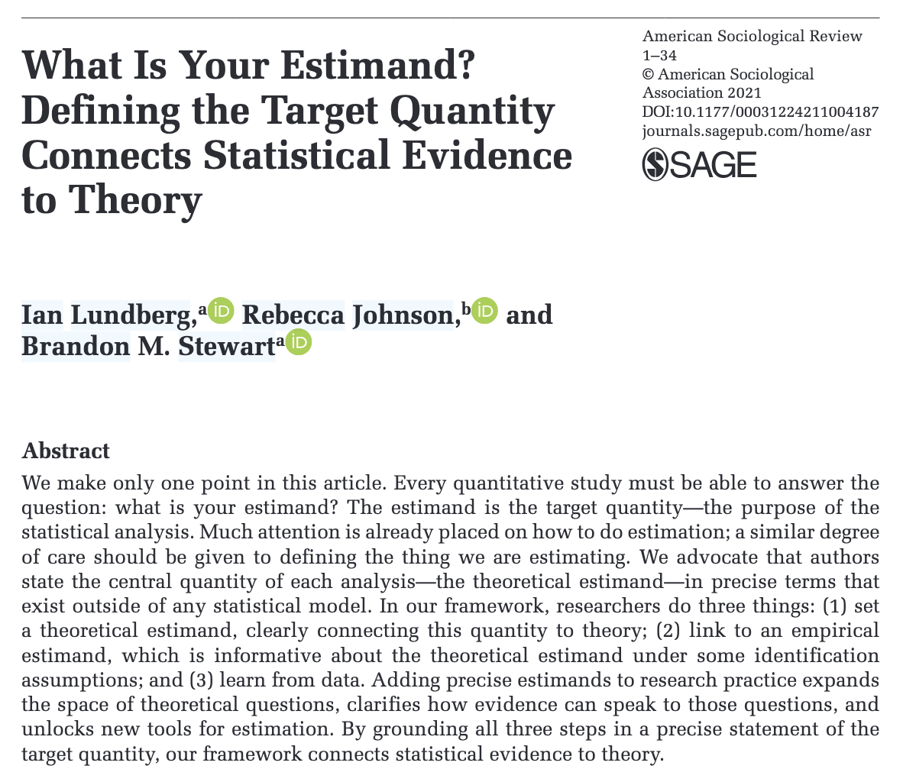
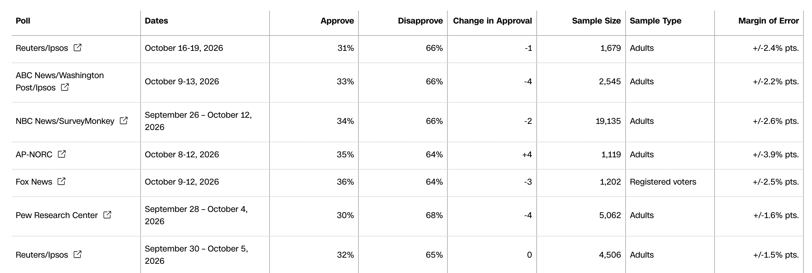

```{r}
#| label: setup
#| include: false

library(tidyverse)
library(tinytable)
library(moderndive)

# Colors from _brand.yml
clrs <- list(
  blue = "#2878B5",
  orange = "#E17C05",
  gold = "#F2B701",
  maroon = "#8A1538",
  purple = "#6F4C9B",
  green = "#2D934F",
  gray = "#696A6F"
)

theme_set(theme_grey(base_size = 14))

pct <- scales::label_percent(accuracy = 1)
comma <- scales::label_comma()
```

```{r}
#| label: make-data
#| include: false

barometer <- read_csv(
  here::here("data", "arab_barometer.csv"),
  show_col_types = FALSE
)

emigrate <- barometer |>
  drop_na(thought_emigrating) |>
  mutate(yes = thought_emigrating == "Yes")

# Proportion + margin of error in each country
country_props <- emigrate |>
  group_by(country) |>
  summarize(n = n(), p_hat = mean(yes)) |>
  mutate(
    se = sqrt(p_hat * (1 - p_hat) / n),
    moe = 1.96 * se
  )

# Tunisia as our pretend population
tunisia <- emigrate |> filter(country == "Tunisia")
tun_p <- mean(tunisia$yes)
tun_n <- nrow(tunisia)
tun_moe <- country_props |> filter(country == "Tunisia") |> pull(moe)

# What an online-only survey would see
tun_online <- tunisia |> filter(uses_internet == "Yes")
tun_offline <- tunisia |> filter(uses_internet == "No")

# Young Tunisians
tun_young <- tunisia |> filter(age <= 29)
tun_young_p <- mean(tun_young$yes)
tun_young_moe <- 1.96 * sqrt(tun_young_p * (1 - tun_young_p) / nrow(tun_young))

# A handful of samples of 100
set.seed(1234)
five_samples <- tunisia |>
  rep_slice_sample(n = 100, reps = 5) |>
  summarize(yes = sum(yes))

# Lots of samples at different sizes
set.seed(1234)
many_samples <- tibble(size = c(25, 100, 400)) |>
  mutate(
    sims = map(size, \(n) {
      tunisia |>
        rep_slice_sample(n = n, reps = 1000) |>
        summarize(p_hat = mean(yes))
    })
  ) |>
  unnest(sims) |>
  mutate(size_label = fct_inorder(paste0("n = ", size)))

sampling_se <- many_samples |>
  group_by(size) |>
  summarize(se = sd(p_hat))
```

## Plan for today {.clr-8 background-color="" background-image="/slides/img/background-hex-shapes.svg" background-opacity="0.25"}

[Populations and samples]{.box-clr-7 .medium .fragment}

[Sampling variation]{.box-clr-2 .medium .fragment}

# Populations<br>and samples {background-color="" background-image="/slides/img/background-hex-shapes.svg" background-opacity="0.25"}

## Data so far {.clr-7}

::: {.incremental}
- World happiness, Gapminder, V-Dem, UN data
- (Nearly) every country
- Regression coefficients describe entire countries
- We can (theoretically) measure every country
:::

::: {.fragment .sp-before}
[But often we can't measure everything we care about]{.box-clr-7-light .medium}
:::

## The Arab Barometer {.clr-7}

::::: {.columns}

:::: {.column width="48%"}
::: {.incremental}
- Huge public opinion survey in the Middle East and North Africa
- Wave 8 (2023–2024): `r comma(nrow(barometer))` people in 8 countries
- Face-to-face interviews in random households
:::
::::

:::: {.column width="4%"}
::::

:::: {.column width="48%"}
::: {.fragment}
> Some people decide to leave their countries to live somewhere else. **Have you ever thought about emigrating from [your country]?**
:::
::::

:::::

## Thought about emigrating? {.clr-7}

```{r}
#| label: plot-emigrate-countries
#| fig-width: 8
#| fig-height: 3.75
#| out-width: "100%"

country_props |>
  mutate(country = fct_reorder(country, p_hat)) |>
  ggplot(aes(x = p_hat, y = country)) +
  geom_col(fill = clrs$orange) +
  geom_text(
    aes(label = paste0(pct(p_hat), " (n = ", comma(n), ")")),
    hjust = -0.1, size = 4
  ) +
  scale_x_continuous(labels = pct, limits = c(0, 0.6)) +
  labs(x = "Proportion who have thought about emigrating", y = NULL)
```

::: {.fragment}
[`r pct(tun_p)` of *all Tunisians*? From only `r comma(tun_n)` people?]{.box-clr-7-light .small}
:::

## Population vocabulary {.clr-7}

:::::: {.columns}

::::: {.column width="50%"}
:::: {.fragment}
[Population]{.box-clr-7}

A collection of things in the world

::: {.small}
People, countries, voters, MPs, exports, aid projects, legislation

**All adults in Tunisia**
:::
::::
:::::

::::: {.column width="50%"}
:::: {.fragment}
[Population parameter]{.box-clr-7}

Something we want to know about the population

::: {.small}
- Average life expectancy in GCC countries
- Median commute time in Doha
- Relationship between poverty and fertility rates

**Proportion of all Tunisian adults who have thought about emigrating ($p$)**
:::
::::
:::::

::::::

## {.clr-7}

:::::: {.columns}

::::: {.column width="40%"}
[Parameters are what you measure to answer research questions]{.box-clr-7 .medium}

::: {.small}
Also called "estimands"---the thing you care about
:::
:::::

::::: {.column width="60%"}
{.shadow}
:::::

::::::


## Counting the population {.clr-7}

:::::: {.columns}

::::: {.column width="50%"}
:::: {.fragment}
[Census]{.box-clr-7 .medium}

Measure every single thing in the population

::: {.small}
Expensive, slow, often impossible
:::
::::
:::::

::::: {.column width="50%"}
:::: {.fragment}
[Sampling]{.box-clr-7 .medium}

Only measure a part of the population

::: {.small}
Interview `r comma(tun_n)` Tunisians
:::
::::
:::::

::::::

## Measuring the sample {.clr-7}

[Sample statistic<br>(or point estimate)]{.box-clr-7 .medium}

The population parameter (or estimand), but calculated from a sample of the population

::: {.fragment .sp-before}
Uses a hat! $\widehat{p}$ = `r round(tun_p, 3)`
:::

::: {.fragment .small}
Same hat as $\widehat{y}$ in regression: **hat = estimate**
:::

## Parameters and statistics {.clr-7}

::: {.list-table widths="1.5,1,1"}

- -
  - Population parameter
  - Sample statistic

- - Proportion
  - $p$
  - $\widehat{p}$

- - Mean
  - $\mu$
  - $\bar{x}$

- - Regression slope
  - $\beta_1$
  - $b_1$ or $\widehat{\beta}_1$

:::

::: {.fragment .sp-before}
[Every regression coefficient you calculate from a sample is an *estimate* of some unknown population value]{.box-clr-7-light .small}
:::

## Is the sample any good? {.clr-7}

::: {.incremental}
- **Representative**: Does the sample look like the population?
- **Unbiased**: Did every part of the population have the same chance of being picked?
- **Generalizable**: Is $\widehat{p}$ a good guess for $p$?
:::

::: {.fragment .sp-before}
[Random sampling fixes all these]{.box-clr-7 .medium}
:::

## {.clr-7}

[What if we want to save money<br>and we just run an online survey?]{.box-clr-7-light .medium}

::::: {.columns}

:::: {.column width="50%"}
::: {.incremental .small}
- `r pct(nrow(tun_offline) / tun_n)` of Tunisians don't use the internet
- They're much less likely to have thought about emigrating
- An online survey only sees internet users: `r pct(mean(tun_online$yes))` instead of `r pct(tun_p)`
:::
::::

:::: {.column width="50%"}
::: {.fragment}
```{r}
#| label: plot-online-bias
#| fig-width: 4.5
#| fig-height: 3.25
#| out-width: "100%"

by_internet <- tunisia |>
  drop_na(uses_internet) |>
  group_by(uses_internet) |>
  summarize(n = n(), p_hat = mean(yes)) |>
  mutate(
    share = n / sum(n),
    group = if_else(uses_internet == "Yes", "Internet", "No internet"),
    group = paste0(group, "\n(", pct(share), ")"),
    panel = "By internet use"
  )

tibble(group = "Everyone", p_hat = tun_p, panel = "Full sample") |>
  bind_rows(by_internet) |>
  mutate(
    panel = fct_inorder(panel),
    group = fct_inorder(group)
  ) |>
  ggplot(aes(x = group, y = p_hat, fill = group)) +
  geom_col(width = 0.6) +
  geom_text(aes(label = pct(p_hat)), vjust = -0.5, size = 5) +
  scale_y_continuous(labels = pct, limits = c(0, 0.6)) +
  scale_fill_manual(values = c(clrs$orange, clrs$gold, clrs$maroon), guide = "none") +
  facet_grid(cols = vars(panel), scales = "free_x", space = "free_x") +
  labs(x = NULL, y = "Thought about emigrating")
```
:::
::::

:::::

::: {.fragment}
[Even if we surveyed a million Tunisians online,<br>our parameter would be wrong!]{.box-clr-7 .small}
:::

# Sampling variation {background-color="" background-image="/slides/img/background-hex-shapes.svg" background-opacity="0.25"}

## {.clr-2}

[Pretend the `r comma(tun_n)` Tunisian respondents are the entire population]{.box-clr-2-light .medium}

::: {.fragment}
We know the true parameter: $p$ = `r round(tun_p, 3)`
:::

::: {.fragment}
What happens if we take random samples of 100 people from this population?
:::

## {.clr-2}

::::: {.columns}

::: {.column width="40%"}
```{r}
five_samples |>
  mutate(p_hat = yes / 100) |>
  select(Sample = replicate, Yes = yes, `$\\widehat{p}$` = p_hat) |>
  tt() |>
  format_tt(markdown = TRUE) |> 
  format_tt(j = 3, digits = 2, num_fmt = "decimal") |>
  theme_html(class = "tinytable shadow")
```
:::

:::: {.column width="10%"}
::::

:::: {.column width="50%"}
::: {.incremental}
- Every sample gives a different $\widehat{p}$
- None of them are exactly `r round(tun_p, 3)`
- That's fine! It's just **sampling variation**
:::
::::

:::::

## Repeat 1,000 times {.clr-2}

```{r}
#| label: plot-sampling-dist-100
#| fig-width: 8
#| fig-height: 4
#| out-width: "100%"

many_samples |>
  filter(size == 100) |>
  ggplot(aes(x = p_hat)) +
  geom_histogram(binwidth = 0.02, boundary = 0, color = "white", fill = clrs$maroon) +
  geom_vline(xintercept = tun_p, linewidth = 1.5, color = clrs$purple) +
  annotate(
    "label", x = tun_p, y = Inf, vjust = 1.5,
    label = paste0("True p = ", round(tun_p, 3)), color = clrs$purple
  ) +
  scale_x_continuous(labels = pct) +
  labs(x = "p̂ from each sample of 100 people", y = "Count")
```

::: {.fragment}
[The sampling distribution]{.box-clr-2-light .small}
:::

## Sample size is important! {.clr-2}

```{r}
#| label: plot-sampling-dist-sizes
#| fig-width: 9
#| fig-height: 4
#| out-width: "100%"

ggplot(many_samples, aes(x = p_hat)) +
  geom_histogram(binwidth = 0.04, boundary = 0, color = "white", fill = clrs$maroon) +
  geom_vline(xintercept = tun_p, linewidth = 1, color = clrs$purple) +
  scale_x_continuous(labels = pct) +
  facet_wrap(vars(size_label)) +
  labs(x = "p̂ from each sample", y = "Count")
```

::: {.fragment}
[Bigger samples → less sampling variation →<br>more precise estimates]{.box-clr-2-light .small}
:::

## Standard error {.clr-2}

::::: {.columns}

:::: {.column width="50%"}
The standard deviation of the sampling distribution

::: {.small .fragment}
"How much does $\widehat{p}$ typically bounce around from sample to sample?"
:::
::::

:::: {.column width="50%"}
::: {.fragment}
```{r}
sampling_se |>
  mutate(se = scales::label_percent(accuracy = 0.1, suffix = " points")(se)) |>
  select(`Sample size` = size, `Standard error` = se) |>
  tt() |>
  theme_html(class = "tinytable shadow")
```
:::

::: {.fragment .small}
4× the sample size = ½ the standard error
:::
::::

:::::

## {.clr-2}

::: {.box-center}
[Trump's approval rating is 34.9% (+/-2.1% pts.)]{.box-clr-2-light}
:::

{.shadow fig-align="center" width="100%"}

::: {.notes}

<https://fiftyplusone.news/polls/approval/president>

:::

## {.clr-2 .center}

{.shadow fig-align="center" width="100%"}

## How accurate is the estimate? {.clr-2}

::: {.incremental}
- In life we only get **one** sample
- We can't see the whole sampling distribution—we don't know what the true population parameter is
- The margin of error tells us how far off our one $\widehat{p}$ could plausibly be
:::

## Margin of error {.clr-2}

[Margin of error ≈ 2 × standard error]{.box-clr-2 .medium}

::: {.fragment}
If we took lots of samples, about 95% of them would land within one margin of error of the truth
:::

::: {.fragment .sp-before .small}
Quick rule of thumb for proportions: $\text{MOE} \approx \frac{1}{\sqrt{n}}$
:::

::: {.fragment .small}
$n$ = 1,000 → $\frac{1}{\sqrt{1000}}$ = ± 3.2 points
:::

::: {.fragment .small}
(More on this next week, with confidence intervals!)
:::

## Diminishing returns {.clr-2}

```{r}
#| label: plot-moe-n
#| fig-width: 8
#| fig-height: 4.25
#| out-width: "100%"

moe_labels <- tibble(n = c(100, 400, 1000, 2400, 5000)) |>
  mutate(moe = 1 / sqrt(n))

tibble(n = seq(50, 5000, by = 10)) |>
  mutate(moe = 1 / sqrt(n)) |>
  ggplot(aes(x = n, y = moe)) +
  geom_line(linewidth = 1.25, color = clrs$green) +
  geom_point(data = moe_labels, size = 3, color = clrs$green) +
  geom_label(
    data = moe_labels,
    aes(label = paste0("± ", round(moe * 100, 1))),
    nudge_y = 0.012, size = 4
  ) +
  scale_x_continuous(labels = comma) +
  scale_y_continuous(labels = \(x) paste0("± ", x * 100)) +
  labs(x = "Sample size", y = "Margin of error\n(percentage points)")
```

::: {.fragment}
[Most national surveys stop at ≈1,000–2,500 people]{.box-clr-2-light .small}
:::

## Emigration, with margins of error {.clr-2}

```{r}
#| label: plot-emigrate-moe
#| fig-width: 8
#| fig-height: 4.25
#| out-width: "100%"

country_props |>
  mutate(country = fct_reorder(country, p_hat)) |>
  ggplot(aes(x = p_hat, y = country)) +
  geom_pointrange(
    aes(xmin = p_hat - moe, xmax = p_hat + moe),
    color = clrs$green, size = 0.6, linewidth = 1.25
  ) +
  geom_text(
    aes(x = p_hat + moe, label = paste0("± ", round(moe * 100, 1), " (n = ", comma(n), ")")),
    hjust = -0.1, size = 3.5
  ) +
  scale_x_continuous(labels = pct, limits = c(0.1, 0.55)) +
  labs(x = "Proportion who have thought about emigrating", y = NULL)
```

## Main ideas {.clr-2}

::: {.incremental}
- We use a **sample** to estimate things about a **population**
- A sample **statistic** ($\widehat{p}$) estimates a population **parameter** ($p$) or **estimand**
- **Random** sampling keeps estimates unbiased; a bigger biased sample is still biased
- Every sample is a little different: **sampling variation**
- Bigger samples → smaller **standard errors** and **margins of error**
:::
