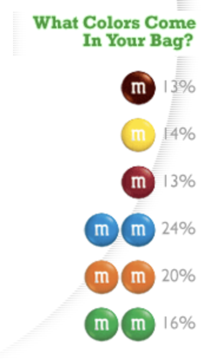
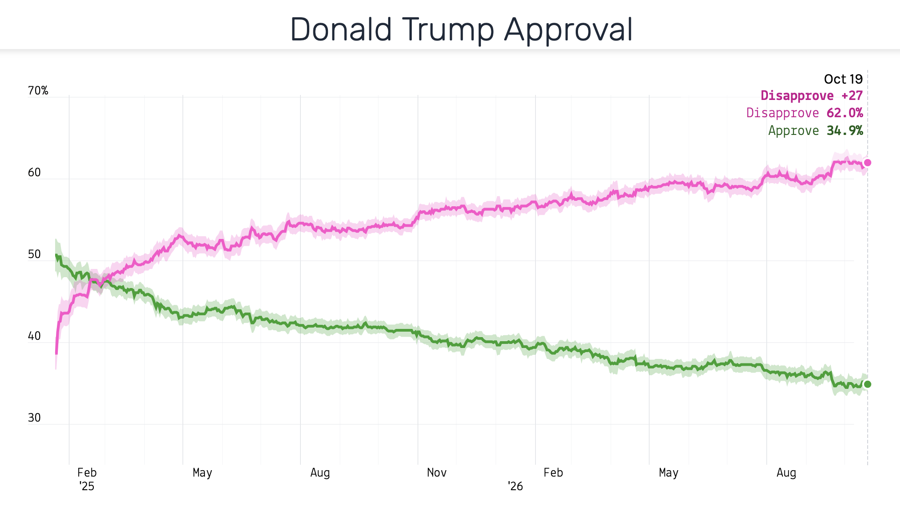

```{r}
#| label: setup
#| include: false

library(tidyverse)
library(tinytable)
library(moderndive)
library(countdown)
library(sf)
library(tigris)
library(rnaturalearth)

options(tigris_use_cache = TRUE)

# Colors from _brand.yml
clrs <- list(
  blue = "#2878B5",
  orange = "#E17C05",
  gold = "#F2B701",
  maroon = "#8A1538",
  purple = "#6F4C9B",
  green = "#2D934F",
  gray = "#696A6F"
)

theme_set(theme_grey(base_size = 14))

pct <- scales::label_percent(accuracy = 1)
comma <- scales::label_comma()
```

```{r}
#| label: make-data
#| include: false

barometer <- read_csv(
  here::here("data", "arab_barometer.csv"),
  show_col_types = FALSE
)

emigrate <- barometer |>
  drop_na(thought_emigrating) |>
  mutate(yes = thought_emigrating == "Yes")

# Proportion + margin of error in each country
country_props <- emigrate |>
  group_by(country) |>
  summarize(n = n(), p_hat = mean(yes)) |>
  mutate(
    se = sqrt(p_hat * (1 - p_hat) / n),
    moe = 1.96 * se
  )

# Tunisia as our pretend population
tunisia <- emigrate |> filter(country == "Tunisia")
tun_p <- mean(tunisia$yes)
tun_n <- nrow(tunisia)
tun_moe <- country_props |> filter(country == "Tunisia") |> pull(moe)

# What an online-only survey would see
tun_online <- tunisia |> filter(uses_internet == "Yes")
tun_offline <- tunisia |> filter(uses_internet == "No")

# Young Tunisians
tun_young <- tunisia |> filter(age <= 29)
tun_young_p <- mean(tun_young$yes)
tun_young_moe <- 1.96 * sqrt(tun_young_p * (1 - tun_young_p) / nrow(tun_young))

# A handful of samples of 100
set.seed(1234)
five_samples <- tunisia |>
  rep_slice_sample(n = 100, reps = 5) |>
  summarize(yes = sum(yes))

# Lots of samples at different sizes
set.seed(1234)
many_samples <- tibble(size = c(25, 100, 400)) |>
  mutate(
    sims = map(size, \(n) {
      tunisia |>
        rep_slice_sample(n = n, reps = 1000) |>
        summarize(p_hat = mean(yes))
    })
  ) |>
  unnest(sims) |>
  mutate(size_label = fct_inorder(paste0("n = ", size)))

# Standard deviation of individual (0/1) answers
tun_sd <- sqrt(tun_p * (1 - tun_p))

# Simulated standard errors vs. the formula
sampling_se <- many_samples |>
  group_by(size) |>
  summarize(se_sim = sd(p_hat)) |>
  mutate(se_formula = tun_sd / sqrt(size))

se_100 <- tun_sd / sqrt(100)

# Share of samples of 100 that land within 1 and 1.96 SEs of the truth
within_se <- many_samples |>
  filter(size == 100) |>
  summarize(
    within_1 = mean(abs(p_hat - tun_p) <= se_100),
    within_2 = mean(abs(p_hat - tun_p) <= 1.96 * se_100)
  )

# Margins of error for example samples: 40 out of 100 and 400 out of 1,000
moe_example <- function(yes, n) {
  tibble(yes = yes, n = n) |>
    mutate(
      p_hat = yes / n,
      se = sqrt(p_hat * (1 - p_hat) / n),
      moe = 1.96 * se,
      lower = p_hat - moe,
      upper = p_hat + moe
    )
}

moe_100 <- moe_example(40, 100)
moe_1000 <- moe_example(400, 1000)

# Virtual vat of 10,000 simulated M&Ms (see data/make-mms.R)
mm_vat <- read_csv(here::here("data", "mm_vat.csv"), show_col_types = FALSE)
vat_p_green <- mean(mm_vat$color == "green")

set.seed(1234)
virtual_bags <- mm_vat |>
  rep_slice_sample(n = 50, reps = 1000) |>
  summarize(p_hat = mean(color == "green"))

mm_red <- "#b11224"
mm_orange <- "#f26f22"
mm_yellow <- "#fff200"
mm_green <- "#31ac55"
mm_blue <- "#2f9fd7"
mm_brown <- "#603a34"

mms_population <- tribble(
  ~color   , ~clr      , ~prop_website , ~prop_clv , ~prop_hkp ,
  "Blue"   , mm_blue   , 0.24          , 0.207     , 0.25      ,
  "Brown"  , mm_brown  , 0.13          , 0.124     , 0.125     ,
  "Green"  , mm_green  , 0.16          , 0.198     , 0.125     ,
  "Orange" , mm_orange , 0.20          , 0.205     , 0.25      ,
  "Red"    , mm_red    , 0.13          , 0.131     , 0.125     ,
  "Yellow" , mm_yellow , 0.14          , 0.135     , 0.125
)

mms_population_long <- mms_population |> 
  pivot_longer(starts_with("prop"), names_to = "source", values_to = "prop") |> 
  mutate(source = recode_values(source, "prop_website" ~ "2007 website numbers", "prop_clv" ~ "Cleveland, TN", "prop_hkp" ~ "Hackettstown, NJ")) |> 
  arrange(source, prop) |> 
  mutate(color = fct_inorder(color))
```

## Plan for today {.clr-8 background-color="" background-image="/slides/img/background-hex-shapes.svg" background-opacity="0.25"}

[Populations and samples]{.box-clr-7 .medium .fragment}

[M&Ms]{.box-clr-3 .medium .fragment}

[Sampling variation]{.box-clr-2 .medium .fragment}

[Margins of error]{.box-clr-9 .medium .fragment}

# Populations<br>and samples {background-color="" background-image="/slides/img/background-hex-shapes.svg" background-opacity="0.25"}

## Data so far {.clr-7}

::: {.incremental}
- World happiness, Gapminder, V-Dem, UN data
- (Nearly) every country
- Regression coefficients describe entire countries
- We can (theoretically) measure every country
:::

::: {.fragment .sp-before}
[But often we can't measure everything we care about]{.box-clr-7-light .medium}
:::

## The Arab Barometer {.clr-7}

::::: {.columns}

:::: {.column width="48%"}
::: {.incremental}
- Huge public opinion survey in the Middle East and North Africa
- Wave 8 (2023–2024): `r comma(nrow(barometer))` people in 8 countries
- Face-to-face interviews in random households
:::
::::

:::: {.column width="4%"}
::::

:::: {.column width="48%"}
::: {.fragment}
> Some people decide to leave their countries to live somewhere else. **Have you ever thought about emigrating from [your country]?**
:::
::::

:::::

## Thought about emigrating? {.clr-7}

```{r}
#| label: plot-emigrate-countries
#| fig-width: 8
#| fig-height: 3.75
#| out-width: "100%"

country_props |>
  mutate(country = fct_reorder(country, p_hat)) |>
  ggplot(aes(x = p_hat, y = country)) +
  geom_col(fill = clrs$orange) +
  geom_text(
    aes(label = paste0(pct(p_hat), " (n = ", comma(n), ")")),
    hjust = -0.1, size = 4
  ) +
  scale_x_continuous(labels = pct, limits = c(0, 0.6)) +
  labs(x = "Proportion who have thought about emigrating", y = NULL)
```

::: {.fragment}
[`r pct(tun_p)` of *all Tunisians*? From only `r comma(tun_n)` people?]{.box-clr-7-light .small}
:::

## Population vocabulary {.clr-7}

:::::: {.columns}

::::: {.column width="50%"}
:::: {.fragment}
[Population]{.box-clr-7}

A collection of things in the world

::: {.small}
People, countries, voters, MPs, exports, aid projects, legislation

**All adults in Tunisia**
:::
::::
:::::

::::: {.column width="50%"}
:::: {.fragment}
[Population parameter]{.box-clr-7}

Something we want to know about the population

::: {.small}
- Average life expectancy in GCC countries
- Median commute time in Doha
- Relationship between poverty and fertility rates

**Proportion of all Tunisian adults who have thought about emigrating ($p$)**
:::
::::
:::::

::::::

## {.clr-7}

:::::: {.columns}

::::: {.column width="40%"}
[Parameters are what you measure to answer research questions]{.box-clr-7 .medium}

::: {.small}
Also called "estimands"---the thing you care about
:::
:::::

::::: {.column width="60%"}
{.shadow}
:::::

::::::


## Counting the population {.clr-7}

:::::: {.columns}

::::: {.column width="50%"}
:::: {.fragment}
[Census]{.box-clr-7 .medium}

Measure every single thing<br>in the population

::: {.small}
Expensive, slow, often impossible
:::
::::
:::::

::::: {.column width="50%"}
:::: {.fragment}
[Sampling]{.box-clr-7 .medium}

Only measure a part of the population

::: {.small}
Interview `r comma(tun_n)` Tunisians
:::
::::
:::::

::::::

## Measuring the sample {.clr-7}

[Sample statistic<br>(or point estimate)]{.box-clr-7 .medium}

The population parameter (or estimand), but calculated from a sample of the population

::: {.fragment .sp-before}
Uses a hat! $\widehat{p}$ = `r round(tun_p, 3)`
:::

::: {.fragment .small}
Same hat as $\widehat{y}$ in regression: **hat = estimate**
:::

## Parameters and statistics {.clr-7}

::: {.list-table widths="1.5,1,1"}

- -
  - Population parameter
  - Sample statistic

- - Proportion
  - $p$
  - $\widehat{p}$

- - Mean
  - $\mu$
  - $\bar{x}$

- - Regression slope
  - $\beta_1$
  - $b_1$ or $\widehat{\beta}_1$

:::

::: {.fragment .sp-before}
[Everything you calculate from a sample is an *estimate* of some unknown population value]{.box-clr-7-light .small}
:::

## Is the sample any good? {.clr-7}

::: {.incremental}
- **Representative**: Does the sample look like the population?
- **Unbiased**: Did every part of the population have the same chance of being picked?
- **Generalizable**: Is $\widehat{p}$ a good guess for $p$?
:::

::: {.fragment .sp-before}
[Random sampling fixes all these]{.box-clr-7 .medium}
:::

## {.clr-7}

[What if we want to save money<br>and we just run an online survey?]{.box-clr-7-light .medium}

::::: {.columns}

:::: {.column width="50%"}
::: {.incremental .small}
- `r pct(nrow(tun_offline) / tun_n)` of Tunisians don't use the internet
- They're much less likely to have thought about emigrating
- An online survey only sees internet users: `r pct(mean(tun_online$yes))` instead of `r pct(tun_p)`
:::
::::

:::: {.column width="50%"}
::: {.fragment}
```{r}
#| label: plot-online-bias
#| fig-width: 4.5
#| fig-height: 3.25
#| out-width: "100%"

by_internet <- tunisia |>
  drop_na(uses_internet) |>
  group_by(uses_internet) |>
  summarize(n = n(), p_hat = mean(yes)) |>
  mutate(
    share = n / sum(n),
    group = if_else(uses_internet == "Yes", "Internet", "No internet"),
    group = paste0(group, "\n(", pct(share), ")"),
    panel = "By internet use"
  )

tibble(group = "Everyone", p_hat = tun_p, panel = "Full sample") |>
  bind_rows(by_internet) |>
  mutate(
    panel = fct_inorder(panel),
    group = fct_inorder(group)
  ) |>
  ggplot(aes(x = group, y = p_hat, fill = group)) +
  geom_col(width = 0.6) +
  geom_text(aes(label = pct(p_hat)), vjust = -0.5, size = 5) +
  scale_y_continuous(labels = pct, limits = c(0, 0.6)) +
  scale_fill_manual(values = c(clrs$orange, clrs$gold, clrs$maroon), guide = "none") +
  facet_grid(cols = vars(panel), scales = "free_x", space = "free_x") +
  labs(x = NULL, y = "Thought about emigrating")
```
:::
::::

:::::

::: {.fragment}
[Even if we surveyed a million Tunisians online,<br>our parameter would be wrong!]{.box-clr-7 .small}
:::

# M&Ms {background-color="" background-image="/slides/img/background-hex-shapes.svg" background-opacity="0.25"}

## M&M colors! {.clr-3}

:::: {.columns}

::: {.column}
{.shadow fig-align="center" width="69%"}
:::

::: {.column}

```{r}
#| fig-width: 5
#| fig-height: 6

mms_population_long |> 
  filter(source == "2007 website numbers") |> 
  ggplot(aes(x = prop, y = color, fill = clr)) + 
  geom_col() + 
  scale_x_continuous(labels = scales::label_percent()) +
  scale_fill_identity() +
  labs(x = "Proportion", y = NULL) +
  facet_wrap(vars(source), ncol = 1) +
  theme_minimal(base_size = 18) + 
  theme(strip.text = element_text(face = "bold"))
```
:::

::::

##

:::: {.columns}

::: {.column}
```{r}
#| label: plot-factory-map
#| fig-width: 5
#| fig-height: 6

us_states <- states(cb = TRUE, resolution = "20m", progress_bar = FALSE)

factories <- tribble(
  ~factory           , ~lat     , ~lon      ,
  "Cleveland, TN"    , 35.15820 , -84.87558 ,
  "Hackettstown, NJ" , 40.85410 , -74.82951
) |>
  st_as_sf(coords = c("lon", "lat"), crs = 4326)

ggplot() +
  geom_sf(
    data = us_states,
    fill = "grey95",
    color = "grey60",
    linewidth = 0.25
  ) +
  geom_sf(data = factories, size = 4, color = clrs$maroon) +
  geom_sf_label(
    data = factories,
    aes(label = factory),
    nudge_y = 1.2,
    size = 4.5,
    fill = "white"
  ) +
  coord_sf(
    crs = st_crs("ESRI:102003"),
    xlim = c(-90, -69),
    ylim = c(25, 48.5),
    default_crs = st_crs("EPSG:4326")
  ) +
  theme_void()
```
:::

::: {.column}
```{r}
#| fig-width: 5
#| fig-height: 6

mms_population_long |> 
  filter(source != "2007 website numbers") |> 
  ggplot(aes(x = prop, y = color, fill = clr)) +
  geom_col() + 
  scale_x_continuous(labels = scales::label_percent()) +
  scale_fill_identity() +
  labs(x = "Proportion", y = NULL) +
  facet_wrap(vars(source), ncol = 1) +
  theme_minimal() + 
  theme(strip.text = element_text(face = "bold"))
```
:::

::::

## What about Qatar? {.clr-3}

```{r}
#| fig-width: 6
#| fig-height: 3
#| out-width: 100%

mms_population_long |> 
  ggplot(aes(x = prop, y = color, fill = clr)) +
  geom_col() + 
  scale_x_continuous(labels = scales::label_percent()) +
  scale_fill_identity() +
  labs(x = "Proportion", y = NULL) +
  facet_wrap(vars(source), ncol = 3) +
  theme_minimal() + 
  theme(strip.text = element_text(face = "bold"))
```

## Mars Polska {.clr-3}

:::: {.columns}

::: {.column}
```{r}
#| label: plot-poland-map
#| fig-width: 5
#| fig-height: 6

countries <- ne_countries(scale = 50, returnclass = "sf") |>
  mutate(is_poland = admin == "Poland")

poland_factory <- tibble(factory = "Janaszówek", lat = 52.25092, lon = 20.40430) |> 
  st_as_sf(coords = c("lon", "lat"), crs = 4326)

ggplot() +
  geom_sf(
    data = countries,
    aes(fill = is_poland),
    color = "grey60",
    linewidth = 0.25
  ) +
  geom_sf(data = poland_factory, size = 4, color = clrs$maroon) +
  geom_sf_label(
    data = poland_factory,
    aes(label = factory),
    nudge_y = 0.6,
    size = 4.5,
    fill = "white"
  ) +
  scale_fill_manual(values = c("grey95", "grey80"), guide = "none") +
  coord_sf(
    crs = st_crs("EPSG:3035"),
    xlim = c(8, 30),
    ylim = c(44, 60),
    default_crs = st_crs("EPSG:4326")
  ) +
  theme_void()
```
:::

:::: {.column}
::: {style="aspect-ratio: 16 / 9;"}

:::
::::

::::


## Your bag is a sample {.clr-3}

::: {.incremental}
- Every bag was filled from a giant vat (kind of) of M&Ms at the Mars factory in Janaszówek, Poland
- Each bag has ≈50 M&Ms
- We want to know what the factory makes, but we only have our bags
:::

## Define the population {.clr-3}

:::::: {.columns}

::::: {.column width="50%"}
:::: {.fragment}
[Population]{.box-clr-3}

Every plain M&M made in Janaszówek

::::
:::::

::::: {.column width="50%"}
:::: {.fragment}
[Population parameter]{.box-clr-3}

The proportion of each color in the vat

$p_\text{blue}$, $p_\text{brown}$, $p_\text{green}$,<br>$p_\text{orange}$, $p_\text{red}$, $p_\text{yellow}$
::::
:::::

::::::

## Census or sample? {.clr-3}

:::::: {.columns}

::::: {.column width="50%"}
:::: {.fragment}
[Census]{.box-clr-3 .medium}

Count every single M&M made in Poland (ever? on a specific day?)

::: {.small}
Impossible!
:::
::::
:::::

::::: {.column width="50%"}
:::: {.fragment}
[Sample]{.box-clr-3 .medium}

Count the M&Ms in one bag

::: {.small}
$\widehat{p}_\text{green}$ = green M&Ms in your bag ÷ all M&Ms in your bag
:::
::::
:::::

::::::

## Your turn: count your bag {.clr-8 background-color="" background-image="/slides/img/background-hex-shapes.svg" background-opacity="1"}

::::: {.columns}

:::: {.column width="55%"}
1. **Don't eat anything yet!**
2. Count how many M&Ms of each color are in your bag
3. Calculate $\widehat{p}$ for each color (count ÷ total)
4. Fill out the form here:

   [**andhs.co/mms**]{.box-clr-8 .medium}
::::

:::: {.column width="45%"}
::: {.small}
| Color  | Count | $\widehat{p}$ |
|:-------|:-----:|:-------------:|
| Blue   |       |               |
| Brown  |       |               |
| Green  |       |               |
| Orange |       |               |
| Red    |       |               |
| Yellow |       |               |
| Total  |       | 1.00          |
:::
::::

:::::

```{r}
#| label: clock-mms
#| echo: false

countdown(minutes = 5, seconds = 0, play_sound = TRUE, warn_when = 1 * 60)
```

## {background-image="img/mms.jpg" background-size="contain" background-position="center" background-color="white"}

## Is your bag a good sample? {.clr-3}

::: {.incremental}
- **Representative**: Does your bag look like the vat?
- **Unbiased**: Did every M&M have the same chance of ending up in your bag?
- **Generalizable**: Is your $\widehat{p}_\text{green}$ a good guess for $p_\text{green}$?
:::

## What could go wrong? {.clr-3}

::: {.incremental}
- All our bags came from the same two boxes at Carrefour
- Are our bags a random sample of *all* bags?
:::


## Who's right? {.clr-3}

::: {.incremental}
- Compare your $\widehat{p}_\text{green}$ with your neighbors
- Everyone's bag gives a different answer
- Nobody did anything wrong!
:::

::: {.fragment .sp-before}
[Every sample is a little different:<br>**sampling variation**]{.box-clr-3 .medium}
:::

## Getting a better estimate {.clr-3}

::: {.incremental}
- More bags?
- Bigger bags?
- Pool the whole class into one giant sample!
:::

::: {.fragment .sp-before}
[Bigger samples → better estimates]{.box-clr-3 .medium}
:::

## Our class's estimate {.clr-8 background-color="" background-image="/slides/img/background-hex-shapes.svg" background-opacity="1"}

Let's look at the data!

1. Everyone's $\widehat{p}_\text{green}$: how spread out are they?
2. Pool all our bags into one giant sample
3. Compare our pooled $\widehat{p}_\text{green}$ with Cleveland (19.8%), Hackettstown (12.5%), and the 2007 numbers (16%)

## What did we find? {.clr-3}

::: {.incremental}
- Whose bag was closest to the pooled estimate? Farthest?
- How different were the individual bags from each other?
- Is our pooled estimate closer to one of the US factories?
- Do you trust the pooled estimate more than your own bag? Why?
:::

# Sampling variation {background-color="" background-image="/slides/img/background-hex-shapes.svg" background-opacity="0.25"}

## We can't buy 1,000 bags {.clr-2}

::: {.incremental}
- Our class's bags give us a rough picture of sampling variation
- To really see it, we'd need *thousands* of bags (and stomachs)
- And we still wouldn't know the true $p_\text{green}$!
:::

::: {.fragment .sp-before}
[Computers to the rescue!]{.box-clr-2 .medium}
:::

## Simulation {.clr-2}

[Make a pretend population where we *know* the truth, then take lots of random samples from it]{.box-clr-2-light .medium}

::: {.incremental}
1. Build a population with a known parameter
2. Draw a random sample
3. Calculate the statistic ($\widehat{p}$)
4. Repeat thousands of times
5. Look at all the $\widehat{p}$s
:::

## A virtual vat {.clr-2}

::::: {.columns}

:::: {.column width="45%"}
::: {.incremental}
- `r comma(nrow(mm_vat))` simulated M&Ms (from Cleveland)
- True $p_\text{green}$ = `r round(vat_p_green, 3)`
- Each virtual bag = 50 random M&Ms from the vat
:::
::::

:::: {.column width="55%"}
::: {.fragment .small}
```{.r}
mm_vat |>
  rep_slice_sample(
    n = 50, reps = 1000
  ) |>
  summarize(
    p_hat = mean(color == "green")
  )
```
:::
::::

:::::

## 1,000 virtual bags {.clr-2}

```{r}
#| label: plot-virtual-bags
#| fig-width: 8
#| fig-height: 4
#| out-width: "100%"

ggplot(virtual_bags, aes(x = p_hat)) +
  geom_histogram(binwidth = 0.02, boundary = 0.01, color = "white", fill = mm_green) +
  geom_vline(xintercept = vat_p_green, linewidth = 1.5, color = clrs$maroon) +
  annotate(
    "label", x = vat_p_green, y = Inf, vjust = 1.5,
    label = paste0("True p = ", round(vat_p_green, 3)), color = clrs$maroon
  ) +
  scale_x_continuous(labels = pct) +
  labs(x = "p̂ from each virtual bag of 50 M&Ms", y = "Count")
```

::: {.fragment}
[Centered on the truth, but lots of bags are way off—just like our real bags!]{.box-clr-2-light .small}
:::

## {.clr-2 .center}

[Same idea, but with real survey data]{.box-clr-2 .large}

## {.clr-2}

[Pretend the `r comma(tun_n)` Tunisian respondents are the entire population]{.box-clr-2-light .medium}

::: {.fragment}
We know the true parameter: $p$ = `r round(tun_p, 3)`
:::

::: {.fragment}
What happens if we take random samples of 100 people from this population?
:::

## {.clr-2}

::::: {.columns}

::: {.column width="40%"}
```{r}
five_samples |>
  mutate(p_hat = yes / 100) |>
  select(Sample = replicate, Yes = yes, p_hat) |>
  # KaTeX only renders <span class="math"> elements, so build one by hand
  rename(`<span class="math inline">\\widehat{p}</span>` = p_hat) |>
  tt() |>
  format_tt(j = 3, digits = 2, num_fmt = "decimal") |>
  theme_html(class = "tinytable shadow")
```
:::

:::: {.column width="10%"}
::::

:::: {.column width="50%"}
::: {.incremental}
- Every sample gives a different $\widehat{p}$
- None of them are exactly `r round(tun_p, 3)`
- That's fine! It's just **sampling variation**
:::
::::

:::::

## Repeat 1,000 times {.clr-2}

```{r}
#| label: plot-sampling-dist-100
#| fig-width: 8
#| fig-height: 4
#| out-width: "100%"

many_samples |>
  filter(size == 100) |>
  ggplot(aes(x = p_hat)) +
  geom_histogram(binwidth = 0.02, boundary = 0, color = "white", fill = clrs$maroon) +
  geom_vline(xintercept = tun_p, linewidth = 1.5, color = clrs$purple) +
  annotate(
    "label", x = tun_p, y = Inf, vjust = 1.5,
    label = paste0("True p = ", round(tun_p, 3)), color = clrs$purple
  ) +
  scale_x_continuous(labels = pct) +
  labs(x = "p̂ from each sample of 100 people", y = "Count")
```

::: {.fragment}
[The sampling distribution]{.box-clr-2-light .small}
:::

## Central limit theorem {.clr-2}

[With random samples, the sampling distribution of a sample proportion (or mean) is approximately **normal**]{.box-clr-2 .medium}

::: {.incremental}
- …centered at the population parameter ($p$)
- …no matter what the population looks like
- …as long as the samples are big enough
:::

::: {.fragment .small .sp-before}
$$\widehat{p} \sim \cal{N}(p, \text{SE})$$
:::

## Sample size is important! {.clr-2}

```{r}
#| label: plot-sampling-dist-sizes
#| fig-width: 9
#| fig-height: 4
#| out-width: "100%"

normal_curves <- sampling_se |>
  mutate(size_label = factor(paste0("n = ", size), levels = levels(many_samples$size_label))) |>
  reframe(
    x = seq(0, 1, by = 0.002),
    density = dnorm(x, mean = tun_p, sd = se_formula),
    .by = size_label
  )

ggplot(many_samples, aes(x = p_hat)) +
  geom_histogram(
    aes(y = after_stat(density)),
    binwidth = 0.04, boundary = 0, color = "white", fill = clrs$maroon
  ) +
  geom_line(data = normal_curves, aes(x = x, y = density), linewidth = 1, color = clrs$purple) +
  scale_x_continuous(labels = pct) +
  coord_cartesian(xlim = c(0.1, 0.75)) +
  facet_wrap(vars(size_label)) +
  labs(x = "p̂ from each sample", y = "Density")
```

## Two kinds of spread {.clr-2}

:::::: {.columns}

::::: {.column width="50%"}
:::: {.fragment}
[Standard deviation]{.box-clr-2}

How much do *individual values* vary?

::: {.small}
How different is one Tunisian from another?

For yes/no data: 

$\sqrt{p(1 - p)}$ = `r round(tun_sd, 3)`
:::
::::
:::::

::::: {.column width="50%"}
:::: {.fragment}
[Standard error]{.box-clr-2}

How much do *sample statistics* vary?

::: {.small}
How different is one sample's $\widehat{p}$ from another's?

The standard deviation of the sampling distribution
:::
::::
:::::

::::::

## Standard error formula {.clr-2}

$$
\text{SE}(\widehat{p}) = \frac{\text{SD}}{\sqrt{n}} = \sqrt{\frac{p (1 - p)}{n}}
$$

::::: {.columns}

:::: {.column width="55%"}
::: {.fragment}
```{r}
sampling_se |>
  select(
    `Sample size` = size,
    `SE from 1,000 samples` = se_sim,
    `SE from formula` = se_formula
  ) |>
  tt() |>
  format_tt(j = 2:3, digits = 3, num_fmt = "decimal") |>
  theme_html(class = "tinytable shadow")
```
:::
::::

:::: {.column width="45%"}
::: {.incremental .small}
- The formula matches the simulations!
- Bigger $n$ → smaller SE
:::
::::

:::::

# Uncertainty {background-color="" background-image="/slides/img/background-hex-shapes.svg" background-opacity="0.25"}

## {.clr-9}

::: {.box-center}
[Trump's approval rating is 34.9% (+/-2.1% pts.)]{.box-clr-9-light}
:::

{.shadow fig-align="center" width="100%"}

::: {.notes}

<https://fiftyplusone.news/polls/approval/president>

:::

## {.clr-9 .center}

{.shadow fig-align="center" width="100%"}

## How accurate is the estimate? {.clr-9}

::: {.incremental}
- In real life we only get **one** sample
- We can't see the whole sampling distribution—we don't know the true population parameter
- But the CLT tells us what the sampling distribution *looks like*…
:::

## Normal curves have rules {.clr-9}

```{r}
#| label: plot-normal-rules
#| fig-width: 8
#| fig-height: 3.75
#| out-width: "100%"

normal_band <- tibble(x = seq(tun_p - 4 * se_100, tun_p + 4 * se_100, length.out = 500)) |>
  mutate(density = dnorm(x, mean = tun_p, sd = se_100))

ggplot(normal_band, aes(x = x, y = density)) +
  geom_ribbon(aes(ymin = 0, ymax = density), fill = clrs$gray, alpha = 0.2) +
  geom_ribbon(
    data = filter(normal_band, abs(x - tun_p) <= 1.96 * se_100),
    aes(ymin = 0, ymax = density), fill = clrs$purple, alpha = 0.4
  ) +
  geom_ribbon(
    data = filter(normal_band, abs(x - tun_p) <= se_100),
    aes(ymin = 0, ymax = density), fill = clrs$purple, alpha = 0.7
  ) +
  geom_line(linewidth = 1) +
  annotate("label", x = tun_p, y = 3, label = "68% within\n1 SE", size = 4.5) +
  annotate(
    "label", x = tun_p + 1.5 * se_100, y = 1.2,
    label = "95% within\n1.96 SEs", size = 4.5
  ) +
  scale_x_continuous(
    breaks = tun_p + c(-1.96, -1, 0, 1, 1.96) * se_100,
    labels = c("p − 1.96 SE", "p − 1 SE", "p", "p + 1 SE", "p + 1.96 SE")
  ) +
  labs(x = NULL, y = NULL) +
  theme(axis.text.y = element_blank(), axis.ticks.y = element_blank())
```

::: {.fragment .small}
Our 1,000 samples of 100: `r pct(within_se$within_1)` within 1 SE of $p$; `r scales::label_percent(accuracy = 0.1)(within_se$within_2)` within 1.96 SEs
:::

## Margin of error{.clr-9}

::: {.incremental}
- 95% of estimated $\widehat{p}$s are within 1.96 SEs of $p$
- For 95% of samples, the real $p$ is within 1.96 SEs of $\widehat{p}$
- That distance is the margin of error or confidence interval
:::

::: {.fragment .sp-before}
[1.96 × SE ≈ 2 × SE]{.box-clr-9 .medium}
:::

## {.clr-9}

$$
\text{SE} \approx \sqrt{\frac{\widehat{p} (1 - \widehat{p})}{n}}
$$

`r moe_100$yes` out of `r comma(moe_100$n)` Tunisians have thought about emigrating

::: {.incremental}
- $\widehat{p}$ = `r moe_100$p_hat`
- $\text{SE} \approx \sqrt{\frac{`r moe_100$p_hat` \times `r 1 - moe_100$p_hat`}{`r moe_100$n`}}$ = `r round(moe_100$se, 4)`
- $\text{MOE} = 1.96 \times `r round(moe_100$se, 4)`$ = `r round(moe_100$moe, 4)`
- `r pct(moe_100$p_hat)` ± `r scales::label_number(accuracy = 0.1)(moe_100$moe * 100)` points → `r scales::label_percent(accuracy = 0.1)(moe_100$lower)` to `r scales::label_percent(accuracy = 0.1)(moe_100$upper)`
:::

::: {.fragment}
[The true $p$ (`r scales::label_percent(accuracy = 0.1)(tun_p)`) is in there!]{.box-clr-9-light .small}
:::

## {.clr-9}

$$
\text{SE} \approx \sqrt{\frac{\widehat{p} (1 - \widehat{p})}{n}}
$$

`r comma(moe_1000$yes)` out of `r comma(moe_1000$n)` Tunisians have thought about emigrating

::: {.incremental}
- $\widehat{p}$ = `r moe_1000$p_hat`
- $\text{SE} \approx \sqrt{\frac{`r moe_1000$p_hat` \times `r 1 - moe_1000$p_hat`}{`r moe_1000$n`}}$ = `r round(moe_1000$se, 4)`
- $\text{MOE} = 1.96 \times `r round(moe_1000$se, 4)`$ = `r round(moe_1000$moe, 4)`
- `r pct(moe_1000$p_hat)` ± `r scales::label_number(accuracy = 0.1)(moe_1000$moe * 100)` points → `r scales::label_percent(accuracy = 0.1)(moe_1000$lower)` to `r scales::label_percent(accuracy = 0.1)(moe_1000$upper)`
:::

::: {.fragment}
[The true $p$ (`r scales::label_percent(accuracy = 0.1)(tun_p)`) is still in there!<br>(but now the estimate is narrower and more precise)]{.box-clr-9-light .small}
:::

## Quick rule of thumb {.clr-9}

The SE is biggest when $\widehat{p}$ = 0.5, so:

$$
\text{MOE} = 1.96 \times \sqrt{\frac{0.5 \times 0.5}{n}} \approx \frac{1}{\sqrt{n}}
$$

::: {.fragment}
$n$ = 1,000 → $\frac{1}{\sqrt{1000}}$ = ± 3.2 points
:::

## Diminishing returns {.clr-9}

```{r}
#| label: plot-moe-n
#| fig-width: 8
#| fig-height: 4.25
#| out-width: "100%"

moe_labels <- tibble(n = c(100, 400, 1000, 2400, 5000)) |>
  mutate(moe = 1 / sqrt(n))

tibble(n = seq(50, 5000, by = 10)) |>
  mutate(moe = 1 / sqrt(n)) |>
  ggplot(aes(x = n, y = moe)) +
  geom_line(linewidth = 1.25, color = clrs$purple) +
  geom_point(data = moe_labels, size = 3, color = clrs$purple) +
  geom_label(
    data = moe_labels,
    aes(label = paste0("± ", round(moe * 100, 1))),
    nudge_y = 0.012, size = 4
  ) +
  scale_x_continuous(labels = comma) +
  scale_y_continuous(labels = \(x) paste0("± ", x * 100)) +
  labs(x = "Sample size", y = "Margin of error\n(percentage points)")
```

::: {.fragment}
[Most national surveys stop at ≈1,000–2,500 people]{.box-clr-9-light .small}
:::

## Emigration, with margins of error {.clr-9}

```{r}
#| label: plot-emigrate-moe
#| fig-width: 8
#| fig-height: 4.25
#| out-width: "100%"

country_props |>
  mutate(country = fct_reorder(country, p_hat)) |>
  ggplot(aes(x = p_hat, y = country)) +
  geom_pointrange(
    aes(xmin = p_hat - moe, xmax = p_hat + moe),
    color = clrs$purple, size = 0.6, linewidth = 1.25
  ) +
  geom_text(
    aes(x = p_hat + moe, label = paste0("± ", round(moe * 100, 1), " (n = ", comma(n), ")")),
    hjust = -0.1, size = 3.5
  ) +
  scale_x_continuous(labels = pct, limits = c(0.1, 0.55)) +
  labs(x = "Proportion who have thought about emigrating", y = NULL)
```

## Our M&Ms, with a margin of error {.clr-8 background-color="" background-image="/slides/img/background-hex-shapes.svg" background-opacity="1"}

Back to Positron!

1. Calculate the SE and margin of error for your own bag's $\widehat{p}_\text{green}$
2. Calculate the SE and margin of error for the class's pooled $\widehat{p}_\text{green}$
3. Which one is more useful? Why?

## Main ideas {.clr-9}

::: {.incremental .small}
- We use a **sample** to estimate things about a **population**
- A sample **statistic** ($\widehat{p}$) estimates a population **parameter** ($p$) or **estimand**
- **Random** sampling keeps estimates unbiased; a bigger biased sample is still biased
- Every sample is a little different: **sampling variation**
- **Central limit theorem**: the sampling distribution is a bell curve centered at the parameter
- **Standard deviation** = spread of individuals; **standard error** = spread of sample statistics
- Bigger samples → smaller standard errors; **margin of error** ≈ 2 × SE
:::
