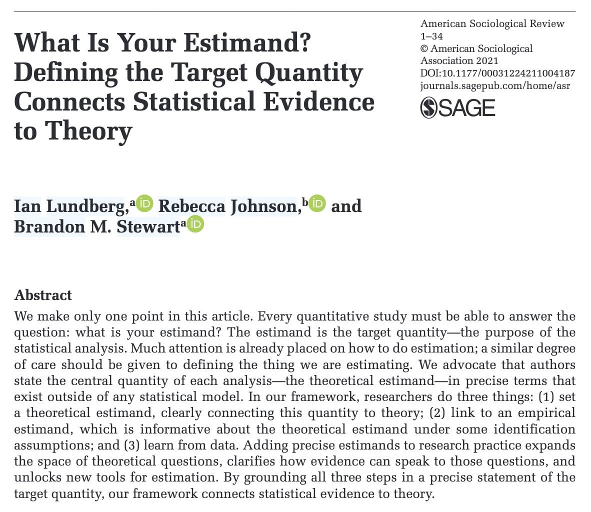

```{r}
#| label: setup
#| include: false

library(tidyverse)
library(tinytable)
library(moderndive)
library(infer)
library(countdown)
library(patchwork)

# Colors from _brand.yml
clrs <- list(
  blue = "#2878B5",
  orange = "#E17C05",
  gold = "#F2B701",
  maroon = "#8A1538",
  purple = "#6F4C9B",
  green = "#2D934F",
  gray = "#696A6F"
)

theme_set(theme_grey(base_size = 14))

pct <- scales::label_percent(accuracy = 1)
pct1 <- scales::label_percent(accuracy = 0.1)
comma <- scales::label_comma()
```

```{r}
#| label: make-data
#| include: false

barometer <- read_csv(
  here::here("data", "arab_barometer.csv"),
  show_col_types = FALSE
)

emigrate <- barometer |>
  drop_na(thought_emigrating) |>
  mutate(yes = thought_emigrating == "Yes")

# Tunisia as our pretend population, like last time
tunisia <- emigrate |> filter(country == "Tunisia")
tun_p <- mean(tunisia$yes)

# The same sample of 100 Tunisians as last time (p-hat = 0.40)
set.seed(1234)
one_sample <- tunisia |> slice_sample(n = 100)
p_hat_100 <- mean(one_sample$yes)

# The bootstrap distribution, which only needs one sample
set.seed(1234)
boot_100 <- one_sample |>
  rep_slice_sample(n = 100, replace = TRUE, reps = 1000) |>
  summarize(p_hat = mean(yes))

se_boot <- sd(boot_100$p_hat)
se_formula <- sqrt(p_hat_100 * (1 - p_hat_100) / 100)

ci_percentile <- quantile(boot_100$p_hat, c(0.025, 0.975), names = FALSE)
ci_se <- p_hat_100 + c(-1.96, 1.96) * se_boot
ci_formula <- p_hat_100 + c(-1.96, 1.96) * se_formula

# Medians don't have a friendly formula, but bootstrapping doesn't care
age_sample <- one_sample |> drop_na(age)

set.seed(1234)
boot_age <- age_sample |>
  rep_slice_sample(n = nrow(age_sample), replace = TRUE, reps = 1000) |>
  summarize(stat = median(age))

ci_age <- quantile(boot_age$stat, c(0.025, 0.975), names = FALSE)

# 100 samples of 100, each with a bootstrapped percentile confidence interval
set.seed(1234)
boot_cis <- tibble(sample_id = 1:100) |>
  mutate(
    sims = map(sample_id, \(i) {
      this_sample <- tunisia |> slice_sample(n = 100)
      p_hats <- this_sample |>
        rep_slice_sample(n = 100, replace = TRUE, reps = 1000) |>
        summarize(p_hat = mean(yes)) |>
        pull(p_hat)

      tibble(
        p_hat = mean(this_sample$yes),
        lower = quantile(p_hats, 0.025),
        upper = quantile(p_hats, 0.975)
      )
    })
  ) |>
  unnest(sims) |>
  mutate(catches = lower <= tun_p & tun_p <= upper)

# Median GDP per capita across UN members, since ages are whole numbers and
# their medians get stuck on just a couple values
set.seed(1234)
boot_gdp_median <- un_member_states_2024 |>
  specify(response = gdp_per_capita) |>
  generate(reps = 1000, type = "bootstrap") |>
  calculate(stat = "median")

obs_gdp_median <- un_member_states_2024 |>
  specify(response = gdp_per_capita) |>
  calculate(stat = "median")

obs_gdp_mean <- un_member_states_2024 |>
  specify(response = gdp_per_capita) |>
  calculate(stat = "mean")

# Same pipeline with different variables, using all of Tunisia's real sample,
# without dropping missing emigration answers so these match the code on the slides
tunisia_all <- barometer |> filter(country == "Tunisia")

set.seed(1234)
boot_tun_mean <- tunisia_all |>
  specify(response = age) |>
  generate(reps = 1000, type = "bootstrap") |>
  calculate(stat = "mean")

obs_tun_mean <- tunisia_all |>
  specify(response = age) |>
  calculate(stat = "mean")

set.seed(1234)
boot_tun_emigrate <- tunisia |>
  specify(response = thought_emigrating, success = "Yes") |>
  generate(reps = 1000, type = "bootstrap") |>
  calculate(stat = "prop")

obs_tun_emigrate <- tunisia |>
  specify(response = thought_emigrating, success = "Yes") |>
  calculate(stat = "prop")

# Same sample, different confidence levels
levels_ci <- tibble(level = c(0.90, 0.95, 0.99)) |>
  mutate(
    lower = map_dbl(level, \(x) quantile(boot_100$p_hat, (1 - x) / 2)),
    upper = map_dbl(level, \(x) quantile(boot_100$p_hat, 1 - (1 - x) / 2)),
    label = paste0(pct(level), " confidence"),
    label = fct_rev(fct_inorder(label))
  )

# Same confidence level, different sample sizes
set.seed(1234)
sizes_ci <- tibble(size = c(100, 400, 1000)) |>
  mutate(
    sims = map(size, \(n) {
      this_sample <- tunisia |> slice_sample(n = n)
      p_hats <- this_sample |>
        rep_slice_sample(n = n, replace = TRUE, reps = 1000) |>
        summarize(p_hat = mean(yes)) |>
        pull(p_hat)

      tibble(
        p_hat = mean(this_sample$yes),
        lower = quantile(p_hats, 0.025),
        upper = quantile(p_hats, 0.975)
      )
    })
  ) |>
  unnest(sims) |>
  mutate(
    label = paste0("n = ", comma(size)),
    label = fct_rev(fct_inorder(label))
  )

# Differences between groups in Tunisia
gender_props <- tunisia |> group_by(gender) |> summarize(p = mean(yes))
internet_props <- tunisia |>
  drop_na(uses_internet) |>
  group_by(uses_internet) |>
  summarize(p = mean(yes))

set.seed(1234)
boot_gender <- tunisia |>
  specify(thought_emigrating ~ gender, success = "Yes") |>
  generate(reps = 1000, type = "bootstrap") |>
  calculate(stat = "diff in props", order = c("Female", "Male"))

set.seed(1234)
boot_internet <- tunisia |>
  drop_na(uses_internet) |>
  specify(thought_emigrating ~ uses_internet, success = "Yes") |>
  generate(reps = 1000, type = "bootstrap") |>
  calculate(stat = "diff in props", order = c("Yes", "No"))

ci_gender <- get_ci(boot_gender, level = 0.95, type = "percentile")
ci_internet <- get_ci(boot_internet, level = 0.95, type = "percentile")

diff_gender <- diff(gender_props$p) * -1  # Female − Male
diff_internet <- diff(internet_props$p)   # Yes − No

# Regression slope
tun_ages <- tunisia |> drop_na(age) |> mutate(yes_num = as.numeric(yes))
age_model <- lm(yes_num ~ age, data = tun_ages)

set.seed(1234)
boot_slope <- tun_ages |>
  specify(yes_num ~ age) |>
  generate(reps = 1000, type = "bootstrap") |>
  calculate(stat = "slope")

ci_slope <- get_ci(boot_slope, level = 0.95, type = "percentile")

# Same question, different statistic: young vs. older Tunisians
young_props <- tun_ages |>
  mutate(young = age <= 29) |>
  group_by(young) |>
  summarize(p = mean(yes))

diff_young <- diff(young_props$p)  # Young − older

# Virtual vat of 10,000 simulated M&Ms (see data/make-mms.R)
mm_vat <- read_csv(here::here("data", "mm_vat.csv"), show_col_types = FALSE)

mm_colors <- c(
  blue = "#2f9fd7", brown = "#603a34", green = "#31ac55",
  orange = "#f26f22", red = "#b11224", yellow = "#fff200"
)

# Our class's 21 real bags, pooled, from the Google Sheet on 2026-11-01
class_mms <- tribble(
  ~color   , ~count ,
  "blue"   ,    172 ,
  "brown"  ,    194 ,
  "green"  ,    184 ,
  "orange" ,    187 ,
  "red"    ,    153 ,
  "yellow" ,    190
) |>
  uncount(count) |>
  mutate(is_green = if_else(color == "green", "yes", "no"))

class_p_green <- mean(class_mms$is_green == "yes")

set.seed(1234)
boot_green <- class_mms |>
  specify(response = is_green, success = "yes") |>
  generate(reps = 1000, type = "bootstrap") |>
  calculate(stat = "prop")

# A tiny bag and three bootstrap samples of it, for showing what resampling does
set.seed(1234)
tiny_bag <- mm_vat |> slice_sample(n = 20)

resamples <- bind_rows(
  "Original bag" = tiny_bag,
  "Bootstrap 1" = tiny_bag |> slice_sample(n = 20, replace = TRUE),
  "Bootstrap 2" = tiny_bag |> slice_sample(n = 20, replace = TRUE),
  "Bootstrap 3" = tiny_bag |> slice_sample(n = 20, replace = TRUE),
  .id = "draw"
) |>
  mutate(draw = fct_rev(fct_inorder(draw))) |>
  arrange(draw, color) |>
  group_by(draw) |>
  mutate(position = row_number(), p_hat = mean(color == "green")) |>
  ungroup()

# Countries visited by the 21 students in class on 2026-11-01
countries <- tibble(
  n_countries = c(8, 11, 21, 4, 23, 19, 16, 11, 5, 3, 4, 8, 8, 16, 30, 8, 9, 10, 11, 12, 13)
)
countries_median <- median(countries$n_countries)

set.seed(1234)
boot_countries <- countries |>
  rep_slice_sample(n = nrow(countries), replace = TRUE, reps = 1000) |>
  summarize(stat = median(n_countries))

ci_countries <- quantile(boot_countries$stat, c(0.025, 0.975), names = FALSE)

# Same population, different sample sizes: one sample of each size, bootstrapped
tun_age_mean <- tunisia |> drop_na(age) |> pull(age) |> mean()

set.seed(1234)
boot_by_n <- tibble(n = c(10, 50, 250, 1000)) |>
  mutate(
    sims = map(n, \(size) {
      this_sample <- tunisia |> drop_na(age) |> slice_sample(n = size)
      this_sample |>
        rep_slice_sample(n = size, replace = TRUE, reps = 1000) |>
        summarize(stat = mean(age))
    })
  ) |>
  unnest(sims) |>
  mutate(label = fct_inorder(paste0("n = ", comma(n))))

boot_by_n_se <- boot_by_n |>
  summarize(se = sd(stat), .by = label)

# Same n and same mean, different amounts of variation (two pretend classes + ours)
spread_classes <- tibble(
  class = c("Narrow range", "Our class", "Wide range"),
  n_countries = list(
    c(10, 10, 10, 11, 11, 11, 11, 12, 12, 12, 12, 12, 12, 12, 12, 13, 13, 13, 13, 14, 14),
    countries$n_countries,
    c(0, 0, 1, 1, 2, 2, 3, 3, 4, 5, 6, 8, 10, 12, 15, 20, 25, 30, 30, 35, 38)
  )
) |>
  mutate(class = fct_inorder(class))

set.seed(1234)
boot_spread <- spread_classes |>
  mutate(
    sims = map(n_countries, \(x) {
      tibble(n_countries = x) |>
        rep_slice_sample(n = length(x), replace = TRUE, reps = 1000) |>
        summarize(stat = mean(n_countries))
    })
  ) |>
  select(class, sims) |>
  unnest(sims)

spread_raw <- spread_classes |> unnest(n_countries)

# Every country's 95% interval for thinking about emigrating
set.seed(1234)
country_cis <- emigrate |>
  nest(.by = country) |>
  mutate(
    n = map_int(data, nrow),
    p_hat = map_dbl(data, \(d) mean(d$yes)),
    ci = map(data, \(d) {
      d |>
        specify(response = thought_emigrating, success = "Yes") |>
        generate(reps = 1000, type = "bootstrap") |>
        calculate(stat = "prop") |>
        get_ci(level = 0.95, type = "percentile")
    })
  ) |>
  unnest(ci) |>
  mutate(country = fct_reorder(country, p_hat))
```

## Plan for today {.clr-8 background-color="" background-image="/slides/img/background-hex-shapes.svg" background-opacity="0.25"}

[Quick review so far]{.box-clr-1 .medium .fragment}

[Estimands]{.box-clr-7 .medium .fragment}

[Bootstrapping]{.box-clr-2 .medium .fragment}

# Quick review {background-color="" background-image="/slides/img/background-hex-shapes.svg" background-opacity="0.25"}

## Inference stuff so far {.clr-1}

[Inference = using a sample to say something about the population]{.box-clr-1-light .medium}

::: {.fragment .sp-before}
[In the flavor of statistics we're doing, there's a true, fixed population parameter out in the world]{.box-clr-1}
:::

::: {.incremental}
- It exists whether or not we ever collect any data
- It doesn't move around—the *samples* do
- We can't measure it directly, so we make inferences
:::

## Bouncing values {.clr-1}

::: {.incremental}
- We can't measure everything, so we take one sample and calculate a statistic ($\widehat{p}$, $\bar{x}$, a median, a slope)
- Individual values in that sample vary and bounce around the average = **standard deviation**
- A different sample would give a different statistic = **sampling variation**
- So how far off might our statistic be from the population parameter?
:::

## SE and confidence {.clr-1}

::: {.incremental}
- With lots of samples, the statistics would form a **sampling distribution**
- The standard deviation of that distribution is the **standard error**
- Statistic ± 1.96 × SE gives a **95% confidence interval**
:::

## Sampling distributions {.clr-1}

::: {.fragment .sp-before}
[But we only have one sample, so we can't see the sampling distribution!]{.box-clr-1-light .medium}
:::

:::::: {.columns}

::::: {.column width="50%"}
:::: {.fragment}
[Assume its shape]{.box-clr-1}

::: {.small}
Math: CLT says it should be normal, so use SE formulas
:::
::::
:::::

::::: {.column width="50%"}
:::: {.fragment}
[Simulate it]{.box-clr-1}

::: {.small}
Bootstrapping: resample our sample a bunch of times
:::
::::
:::::

::::::

## Plan for this week {.clr-1}

::: {.incremental}
1. What do we actually measure? Which summary statistic answers our research question?
2. How do we get the standard error?
3. How do confidence intervals actually work? (next time!)
:::

# Estimands {background-color="" background-image="/slides/img/background-hex-shapes.svg" background-opacity="0.25"}

## {.clr-7}

:::::: {.columns}

::::: {.column width="40%"}
[Every quantitative study has to answer one question]{.box-clr-7 .medium}

::: {.small .sp-before}
What is your estimand?
:::
:::::

::::: {.column width="60%"}
{.shadow}
:::::

::::::

## {.clr-7}

:::::: {.columns}

::::: {.column width="33%"}
:::: {.fragment}
[Estimand]{.box-clr-7 .medium}

The thing you want to know

::: {.small}
The population parameter
:::


::::
:::::

::::: {.column width="33%"}
:::: {.fragment}
[Estimator]{.box-clr-7 .medium}

The method for guessing it

::: {.small}
A formula or procedure you apply to a sample
:::


::::
:::::

::::: {.column width="33%"}
:::: {.fragment}
[Estimate]{.box-clr-7 .medium}

The number you get

::: {.small}
The result from one specific sample
:::


::::
:::::

::::::


## You've already done this! {.clr-7}

::: {.list-table widths="1,1.5,1.5" .small}

- -
  - M&Ms
  - Tunisia

- - **Estimand**
  - $p_\text{green}$: proportion of green M&Ms made in Janaszówek
  - $p$: proportion of all Tunisian adults who have thought about emigrating

- - **Estimator**
  - Green M&Ms ÷ all M&Ms in a sample from Carrefour
  - "Yes" answers ÷ all answers in a random sample

- - **Estimate**
  - $\widehat{p}_\text{green}$ = `r round(class_p_green, 3)`
  - $\widehat{p}$ = `r round(tun_p, 3)`

:::

## Lots of possible estimands {.clr-7}

::: {.list-table widths="1.3,0.6,0.6,2.6" .smaller}

- - Estimand
  - Parameter
  - Statistic
  - Example

- - Proportion
  - $p$
  - $\widehat{p}$
  - Tunisians who have thought about emigrating

- - Mean
  - $\mu$
  - $\bar{x}$
  - Average age of Tunisian adults

- - Median
  - $m$
  - $\widehat{m}$
  - Typical number of countries visited

- - Difference in proportions
  - $p_1 - p_2$
  - $\widehat{p}_1 - \widehat{p}_2$
  - Emigration: internet users vs. non-users

- - Difference in means
  - $\mu_1 - \mu_2$
  - $\bar{x}_1 - \bar{x}_2$
  - Democracy score: GCC vs. non-GCC countries

- - Regression slope
  - $\beta_1$
  - $b_1$
  - Relationship between age and thinking about emigrating

:::

## Estimand = quantity + population {.clr-7}

["Do people in the Arab world<br>want to leave?"]{.box-clr-7-light .medium}

::: {.incremental .sp-before}
- **Who?** Adults? Young people? Which countries? When?
- **What?** Ever thought about it? Have plans? Actually applied for a visa?
- **What number?** Proportion? Difference between groups?
:::

::: {.fragment}
[Proportion of all Tunisian adults in 2023–24 who say they've thought about emigrating]{.box-clr-7}
:::

## No single correct estimand! {.clr-7}

[Is thinking about emigrating more common among young Tunisians?]{.box-clr-7-light}

::: {.fragment .sp-before}
::: {.list-table widths="1.3,1,1.6" .small}

- - Estimand
  - Estimate
  - What it tells us

- - $p_\text{young} - p_\text{older}$
  - `r round(diff_young * 100, 1)` points
  - Gap between people 18–29 and everyone older

- - Slope of age, $\beta_1$
  - `r round(coef(age_model)[["age"]] * 100, 1)` points per year
  - How the chance changes with each extra year of age

:::
:::

::: {.fragment .sp-before}
[Same question, different numbers! Decide which one matches your question before you calculate anything]{.box-clr-7 .small}
:::

## Your turn: define the estimand {.clr-8 background-color="" background-image="/slides/img/background-hex-shapes.svg" background-opacity="1"}

1. Do women trust their governments more than men do?
2. Do young people care more about democracy?
3. Does corruption lead to worse human rights?
4. Do mosquito nets improve public health?

For each one:

- **Population**: Who exactly are we talking about?
- **Quantity**: Proportion? Mean? Median? Difference?
- **Statistic**: What would you calculate?

```{r}
#| label: clock-estimand

countdown(minutes = 6, seconds = 0, play_sound = TRUE, warn_when = 1 * 60)
```


# Bootstrapping {background-color="" background-image="/slides/img/background-hex-shapes.svg" background-opacity="0.25"}

## Measuring sampling variation {.clr-2}

:::::: {.columns}

::::: {.column width="50%"}
:::: {.fragment}
[Simulation]{.box-clr-2}

::: {.small}
Our virtual vat of M&Ms, our pretend Tunisia

**But** you need the whole population. If you had it, you wouldn't need a sample!
:::
::::
:::::

::::: {.column width="50%"}
:::: {.fragment}
[Math]{.box-clr-2}

::: {.small}
$\text{SE} = \sqrt{\frac{\widehat{p} (1 - \widehat{p})}{n}}$

**But** you need a formula, and a friendly formula doesn't exist for everything
:::
::::
:::::

::::::

::: {.fragment .sp-before}
[What's the standard error of a median?]{.box-clr-2}

[(or any of these estimands, really?)]{.box-clr-2-light}
:::

## Improvise! {.clr-2}

::: {.incremental}
- We only have one sample
- Our best guess about the population is… our sample!
- So use the sample as a pretend population and take samples from *it*
:::

::: {.fragment .sp-before}
[**Bootstrapping**: using the sample you have to make lots of new samples]{.box-clr-2 .medium}
:::


## How to bootstrap {.clr-2}

::: {.incremental}
1. **Take a bootstrap sample**

   [Sample with replacement, same size as the original]{.small}

2. **Calculate a statistic from that bootstrap sample**

   [Mean, median, proportion, difference, slope, whatever]{.small}

3. **Repeat a bunch of times**

   [1,000 times or more]{.small}

4. **Look at all the statistics**

   [That's the **bootstrap distribution**]{.small}
:::

## What resampling looks like {.clr-2}

```{r}
#| label: plot-resamples
#| fig-width: 9
#| fig-height: 3.75
#| out-width: "100%"

resamples |>
  ggplot(aes(x = position, y = draw, fill = color)) +
  geom_point(shape = 21, size = 9, color = "grey30", stroke = 0.3) +
  geom_text(
    data = \(d) distinct(d, draw, p_hat),
    aes(x = 21.5, y = draw, label = paste0("p̂ = ", p_hat)),
    inherit.aes = FALSE, hjust = 0, size = 5
  ) +
  scale_fill_manual(values = mm_colors, guide = "none") +
  coord_cartesian(xlim = c(0.5, 24.5)) +
  labs(x = NULL, y = NULL) +
  theme_minimal(base_size = 16) +
  theme(
    panel.grid = element_blank(),
    axis.text.x = element_blank()
  )
```

::: {.fragment .small}
Some M&Ms show up twice or more and some don't show up at all, so $\widehat{p}$ changes from resample to resample
:::

## Our turn: class sample {.clr-8 background-color="" background-image="/slides/img/background-hex-shapes.svg" background-opacity="1"}

[How many countries has a typical GU-Q student been to?]{.box-clr-8 .medium}

- **Population**
- **Quantity**
- **Statistic**

::: {.fragment}
Write how many countries you've been to on the board
:::

## Our estimate {.clr-8 background-color="" background-image="/slides/img/background-hex-shapes.svg" background-opacity="1"}

::::: {.columns}

:::: {.column width="55%"}
::: {.smaller}
```{r}
#| echo: true
#| eval: false

library(tidyverse)
library(moderndive)

# Numbers from the board
countries <- tibble(
  n_countries = c(8, 11, 21, 4, 23, 19, 16,
                  11, 5, 3, 4, 8, 8, 16, 30,
                  8, 9, 10, 11, 12, 13)
)

countries |>
  summarize(stat = median(n_countries))

ggplot(countries, aes(x = n_countries)) +
  geom_histogram(binwidth = 1, color = "white")
```
:::
::::

:::: {.column width="45%"}
::: {.fragment}
```{r}
#| label: plot-countries
#| fig-width: 4.5
#| fig-height: 3.5
#| out-width: "100%"

ggplot(countries, aes(x = n_countries)) +
  geom_histogram(binwidth = 1, color = "white", fill = clrs$blue) +
  geom_vline(xintercept = countries_median, linewidth = 1.25, color = clrs$orange) +
  labs(x = "Countries visited", y = "Count")
```

[Median = `r countries_median`]{.box-clr-8 .small}
:::
::::

:::::

::: {.small}
Does this reflect all of GU-Q? How confident are we that this number is right? We don't know what the sampling distribution looks like!
:::

## Your turn: bootstrap by hand {.clr-8 background-color="" background-image="/slides/img/background-hex-shapes.svg" background-opacity="1"}

[How many countries has a typical GU-Q student been to?]{.box-clr-8 .medium}

::: {.small}
1. Go to random.org on your phone
2. Generate a random number between 1 and 21
3. Write down that observation's number of countries on your paper
4. Generate another random number, write that down, and repeat
5. Find the median of your random 21 numbers
6. Write that median on the board
:::

```{r}
#| label: clock-bootstrap-hand

countdown(minutes = 6, seconds = 0, play_sound = TRUE, warn_when = 1 * 60)
```

## Plan for today {.clr-8 background-color="" background-image="/slides/img/background-hex-shapes.svg" background-opacity="0.25"}

[Bootstrapping, continued]{.box-clr-2 .medium .fragment}

[Confidence intervals]{.box-clr-9 .medium .fragment}

[Comparing with intervals]{.box-clr-4 .medium .fragment}

## {.clr-2}

:::::: {.columns}

::::: {.column width="33%"}
:::: {.fragment}
[Estimand]{.box-clr-2 .medium}

The thing you want to know

::: {.small}
The population parameter
:::


::::
:::::

::::: {.column width="33%"}
:::: {.fragment}
[Estimator]{.box-clr-2 .medium}

The method for guessing it

::: {.small}
A formula or procedure you apply to a sample
:::


::::
:::::

::::: {.column width="33%"}
:::: {.fragment}
[Estimate]{.box-clr-2 .medium}

The number you get

::: {.small}
The result from one specific sample
:::


::::
:::::

::::::

## {.clr-2}

::: {.list-table widths="1,1.5,1.5" .small}

- -
  - M&Ms
  - Tunisia

- - **Estimand**
  - $p_\text{green}$: proportion of green M&Ms made in Janaszówek
  - $p$: proportion of all Tunisian adults who have thought about emigrating

- - **Estimator**
  - Green M&Ms ÷ all M&Ms in a sample from Carrefour
  - "Yes" answers ÷ all answers in a random sample

- - **Estimate**
  - $\widehat{p}_\text{green}$ = `r round(class_p_green, 3)`
  - $\widehat{p}$ = `r round(tun_p, 3)`

:::

## Goal of inference {.clr-2}

[Make a good enough guess about the true population parameter]{.box-clr-2 .medium}

[How do we know if the guess is good?]{.box-clr-2-light .fragment}

[How confident are we that we captured the actual population parameter?]{.box-clr-2-light .fragment}

## Variability {.clr-2}

[Every sample statistic (mean, median, correlation, slope, etc.) has some variability]{.box-clr-2 .medium}

[If we take a bunch of samples, that statistic will bounce around]{.box-clr-2-light .fragment}

[We can measure that variability with math or simulation]{.box-clr-2-light .fragment}

## Our sample {.clr-2}

```{r}
#| label: plot-countries-recap
#| fig-width: 8
#| fig-height: 3.5
#| out-width: "100%"

ggplot(countries, aes(x = n_countries)) +
  geom_histogram(binwidth = 1, boundary = 0.5, color = "white", fill = clrs$blue) +
  geom_vline(xintercept = countries_median, linewidth = 1.25, color = clrs$orange) +
  annotate(
    "label", x = countries_median, y = Inf, vjust = 1.3, size = 4.5,
    label = paste0("Median = ", countries_median), color = clrs$orange
  ) +
  scale_x_continuous(breaks = seq(0, 30, 5)) +
  scale_y_continuous(breaks = scales::breaks_width(1)) +
  labs(x = "Countries visited", y = "Students")
```

[`r nrow(countries)` students; typical student has been to `r countries_median` countries]{.box-clr-2-light .small}

## Our bootstrapped medians {.clr-2}

```{r}
#| label: plot-class-medians
#| fig-width: 8
#| fig-height: 2.75
#| out-width: "100%"

# Stand-ins for the medians from the board: the first 21 computer bootstraps
class_medians <- boot_countries |> slice_head(n = 21)

ggplot(class_medians, aes(x = stat)) +
  geom_histogram(binwidth = 1, boundary = 0.5, color = "white", fill = clrs$blue) +
  geom_vline(xintercept = countries_median, linewidth = 1.25, color = clrs$orange) +
  scale_x_continuous(breaks = seq(0, 30, 1)) +
  scale_y_continuous(breaks = scales::breaks_width(2)) +
  labs(x = "Median from each bootstrap sample", y = "Count")
```

::: {.incremental .small}
- What shape do our medians make? Where's the center?
- Does this range tell us about *all* GU-Q students?
:::

::: {.fragment}
[Bootstrapping tells us about sampling variation—<br>it doesn't create a random sample!]{.box-clr-2-light}
:::

## Lots of bootstraps {.clr-8 background-color="" background-image="/slides/img/background-hex-shapes.svg" background-opacity="1"}

::::: {.columns}

:::: {.column width="55%"}
::: {.smaller}
```{r}
#| echo: true
#| eval: false
#| flourish:
#|   - target: "replace = TRUE"
#|     style: "background-color: var(--hl-1);"
#|   - target: "median"
#|     style: "background-color: var(--hl-2);"

set.seed(1234)
boot_countries <- countries |>
  rep_slice_sample(
    n = nrow(countries),
    replace = TRUE,
    reps = 1000
  ) |>
  summarize(stat = median(n_countries))

ggplot(boot_countries, aes(x = stat)) +
  geom_histogram(binwidth = 1, color = "white")
```
:::
::::

:::: {.column width="45%"}
::: {.fragment}
```{r}
#| label: plot-boot-countries
#| fig-width: 4.5
#| fig-height: 3.5
#| out-width: "100%"

ggplot(boot_countries, aes(x = stat)) +
  geom_histogram(binwidth = 1, color = "white", fill = clrs$blue) +
  geom_vline(xintercept = countries_median, linewidth = 1.25, color = clrs$orange) +
  scale_x_continuous(breaks = seq(0, 30, 1)) +
  labs(x = "Bootstrapped medians", y = "Count")
```

::: {.small}
1,000 medians instead of our handful on the board. Lumpy, because a median of whole numbers can only land on a few values!
:::
:::
::::

:::::

## The {infer} way {.clr-2}

::::: {.columns}

:::: {.column width="60%"}
::: {.small}
```{r}
#| echo: true
#| eval: false
#| flourish:
#|   - target: "specify"
#|     style: "background-color: var(--hl-1);"
#|   - target: "generate"
#|     style: "background-color: var(--hl-2);"
#|   - target: "calculate"
#|     style: "background-color: var(--hl-3);"

library(infer)

boot_countries <- countries |>
  specify(response = n_countries) |>
  generate(
    reps = 1000,
    type = "bootstrap"
  ) |>
  calculate(stat = "median")
```
:::
::::

:::: {.column width="40%"}
::: {.incremental .small}
- [**`specify()`**]{.bg-hl-1}: What's the variable?
- [**`generate()`**]{.bg-hl-2}: Make the bootstrap samples
- [**`calculate()`**]{.bg-hl-3}: Find the statistic for each one
:::
::::

:::::

## The {infer} way {.clr-2}

```{r}
#| include: false

set.seed(1234)
boot_countries_infer <- countries |>
  specify(response = n_countries) |>
  generate(reps = 1000, type = "bootstrap") |>
  calculate(stat = "median")
```

::::: {.columns}

:::: {.column width="45%"}
::: {.small}
```{r}
#| echo: true
#| eval: false

boot_countries
```

```{r}
boot_countries_infer
```
:::
::::

:::: {.column width="55%"}
::: {.small}
```{r}
#| echo: true
#| eval: false

visualize(boot_countries)
```
:::

```{r}
#| label: plot-boot-countries-infer
#| fig-width: 5
#| fig-height: 3.5
#| out-width: "100%"

visualize(boot_countries_infer) +
  scale_x_continuous(breaks = seq(0, 30, 1)) +
  labs(title = NULL, x = "Bootstrapped medians", y = "Count")
```
::::

:::::

::: {.notes}
Same idea as the rep_slice_sample() version: one row per bootstrap sample, with its median in stat. visualize() is just a shortcut for a ggplot histogram.
:::


## Seeds {.clr-2}

```{r}
#| include: false

set.seed(12345)
```

```{r}
#| echo: true

# Choose 5 numbers between 1 and 100
sample(1:100, 5)
```

\ 

```{r}
#| echo: true

# Do it again
sample(1:100, 5)
```

## Seeds {.clr-2}

```{r}
#| include: false

set.seed(12345)
```

```{r}
#| echo: true

# Choose 5 numbers between 1 and 100
set.seed(1234)
sample(1:100, 5)
```

\ 

```{r}
#| echo: true

# Do it again
set.seed(1234)
sample(1:100, 5)
```

## Seeds {.clr-2}

[A seed lets you make the same random numbers every time you run your code]{.box-clr-2-light}

[Any whole number]{.box-clr-2}

```{.r}
set.seed(1)
set.seed(13)
set.seed(42)
set.seed(1234)
set.seed(12345)
set.seed(20261101)
```


## Median GDP per capita {.clr-8 background-color="" background-image="/slides/img/background-hex-shapes.svg" background-opacity="1"}

::::: {.columns}

:::: {.column width="58%"}
::: {.smaller}
```{r}
#| echo: true
#| eval: false
#| flourish:
#|   - target: "visualize"
#|     style: "background-color: var(--hl-1);"
#|   - target: "obs_median"
#|     style: "background-color: var(--hl-2);"

library(tidyverse)
library(moderndive)
library(infer)

# The statistic from our actual data
obs_median <- un_member_states_2024 |>
  specify(response = gdp_per_capita) |>
  calculate(stat = "median")

# The bootstrap distribution
set.seed(1234)
boot_median <- un_member_states_2024 |>
  specify(response = gdp_per_capita) |>
  generate(reps = 1000, type = "bootstrap") |>
  calculate(stat = "median")

visualize(boot_median) +
  geom_vline(xintercept = obs_median$stat)
```
:::
::::

:::: {.column width="42%"}
::: {.fragment}
```{r}
#| label: plot-boot-gdp-median
#| fig-width: 4.5
#| fig-height: 4
#| out-width: "100%"

visualize(boot_gdp_median) +
  geom_vline(xintercept = obs_gdp_median$stat, linewidth = 1.25, color = clrs$orange) +
  scale_x_continuous(labels = scales::label_comma(prefix = "$")) +
  labs(title = NULL, x = "Median GDP per capita", y = "Count")
```

::: {.small}
Mean: `r scales::label_comma(prefix = "$")(obs_gdp_mean$stat)`<br>Median: `r scales::label_comma(prefix = "$")(obs_gdp_median$stat)`
:::
:::
::::

:::::

::: {.notes}
GDP per capita is really skewed, so the median describes a typical country better than the mean, and there's no friendly SE formula for it. The warning about a removed row is just infer dropping a country with missing GDP.

This is every UN member, not a random sample, so it's worth asking what the population even is here. One answer: think of this year's countries as one draw from all the ways the world could have turned out. Ages from the Arab Barometer are a real sample, but their medians get stuck on one or two whole numbers.
:::

## Works for any estimand! {.clr-8 background-color="" background-image="/slides/img/background-hex-shapes.svg" background-opacity="1"}

::::: {.columns}

:::: {.column width="50%"}
::: {.small}
```{r}
#| echo: true
#| eval: false
#| flourish:
#|   - target: "mean"
#|     style: "background-color: var(--hl-1);"

# Mean age
boot_mean <- tunisia |>
  specify(response = age) |>
  generate(
    reps = 1000,
    type = "bootstrap"
  ) |>
  calculate(stat = "mean")
```
:::
::::

:::: {.column width="50%"}
::: {.small}
```{r}
#| echo: true
#| eval: false
#| flourish:
#|   - target: "drop_na"
#|     style: "background-color: var(--hl-2);"
#|   - target: "success"
#|     style: "background-color: var(--hl-2);"
#|   - target: "prop"
#|     style: "background-color: var(--hl-1);"

# Thought about emigrating
boot_emigrate <- tunisia |>
  drop_na(thought_emigrating) |>
  specify(
    response = thought_emigrating,
    success = "Yes"
  ) |>
  generate(
    reps = 1000,
    type = "bootstrap"
  ) |>
  calculate(stat = "prop")
```
:::
::::

:::::

::: {.notes}
drop_na() is required here. With missing values in a yes/no column, calculate() stops with an error saying a proportion isn't well defined for a "multinomial" response.
:::

## {.clr-2}

```{r}
#| label: plot-three-boots
#| fig-width: 9
#| fig-height: 3.5
#| out-width: "100%"

boot_plot <- function(boot, obs, title, x_labels = waiver()) {
  visualize(boot) +
    geom_vline(xintercept = obs$stat, linewidth = 1.25, color = clrs$orange) +
    scale_x_continuous(labels = x_labels) +
    labs(title = title, x = NULL, y = NULL)
}

boot_plot(boot_gdp_median, obs_gdp_median, "Median GDP per capita", scales::label_comma(prefix = "$")) |
  boot_plot(boot_tun_mean, obs_tun_mean, "Mean age, Tunisia") |
  boot_plot(boot_tun_emigrate, obs_tun_emigrate, "Emigration, Tunisia", pct1)
```

## {.clr-2}

[A bootstrap distribution only knows what's in your sample]{.box-clr-2-light .medium}

::: {.incremental}
- More observations → less bouncing around
- More spread in the sample → more bouncing around
:::


## More observations {.clr-2}

```{r}
#| label: plot-boot-by-n
#| fig-width: 9
#| fig-height: 4.25
#| out-width: "100%"

ggplot(boot_by_n, aes(x = stat)) +
  geom_histogram(binwidth = 0.5, boundary = 0, color = "white", fill = clrs$blue) +
  geom_vline(xintercept = tun_age_mean, linewidth = 1, color = clrs$purple) +
  geom_label(
    data = boot_by_n_se,
    aes(x = Inf, y = Inf, label = paste0("SE = ", round(se, 2))),
    hjust = 1.1, vjust = 1.3, size = 4
  ) +
  facet_wrap(vars(label), ncol = 1, strip.position = "left", scales = "free_y") +
  labs(x = "Bootstrapped mean age", y = NULL) +
  theme(
    axis.text.y = element_blank(),
    axis.ticks.y = element_blank(),
    strip.text.y.left = element_text(angle = 0, size = 12),
    panel.grid.minor = element_blank()
  )
```

::: {.notes}
n = 10 is wide and a little lopsided; n = 1,000 is a narrow bell. 4× the people → ½ the SE again (250 → 1,000).

The n = 10 sample happened to get young people, so its distribution is centered way below the truth. Bootstrapping can't fix an unlucky sample—it centers on whatever your sample says.
:::

## More spread {.clr-2}

```{r}
#| label: plot-boot-spread
#| fig-width: 9
#| fig-height: 4
#| out-width: "100%"

p_raw <- ggplot(spread_raw, aes(x = n_countries)) +
  geom_dotplot(binwidth = 1, method = "histodot", fill = clrs$orange, color = "white", stackratio = 1.1) +
  facet_wrap(vars(class), ncol = 1) +
  scale_y_continuous(NULL, breaks = NULL) +
  labs(x = "Countries visited", title = "21 students in each class") +
  theme(panel.grid.minor = element_blank())

p_boot <- ggplot(boot_spread, aes(x = stat)) +
  geom_histogram(binwidth = 0.5, boundary = 0, color = "white", fill = clrs$blue) +
  geom_vline(xintercept = mean(countries$n_countries), linewidth = 1, color = clrs$purple) +
  facet_wrap(vars(class), ncol = 1, scales = "free_y") +
  scale_y_continuous(NULL, breaks = NULL) +
  labs(x = "Bootstrapped mean", title = "1,000 bootstrapped means") +
  theme(panel.grid.minor = element_blank())

p_raw | p_boot
```

## Math or bootstrap? {.clr-2}

:::::: {.columns}

::::: {.column width="50%"}
:::: {.fragment}
[Math]{.box-clr-2}

::: {.small}
- Fast, built in to everything
- Needs a formula
- Needs assumptions (like normality) to be okay
- It's what you'll see in most published research
:::
::::
:::::

::::: {.column width="50%"}
:::: {.fragment}
[Bootstrap]{.box-clr-2}

::: {.small}
- Works for almost any statistic
- Needs a computer
- Still needs a good sample
- Struggles with tiny samples and statistics at the extremes
:::
::::
:::::

::::::

::: {.fragment .sp-before}
[When both work, they should give you about the same answer]{.box-clr-2-light .small}
:::

::: {.notes}
Quick demo if there's time: bootstrap the largest value with summarize(stat = max(age)). A resample can never beat the sample's maximum, so most of the bootstrap distribution piles up on one number.
:::

## So why even do this? {.clr-2}

[Most published research reports math-based standard errors]{.box-clr-2-light}

[Intuition!]{.box-clr-2 .medium}

::: {.incremental}
- Every math-based SE in a regression table is a shortcut for one of these histograms
- Formulas are the mathy way of guessing what the bootstrap distribution would look like
:::

# Confidence intervals {background-color="" background-image="/slides/img/background-hex-shapes.svg" background-opacity="0.25"}

## Spear or net? {.clr-9}

:::::: {.columns}

::::: {.column width="50%"}
:::: {.fragment}
[Point estimate]{.box-clr-9}

Fishing with a spear

::: {.small}
One number: $\widehat{p}$ = `r p_hat_100`

Almost certainly misses by a little
:::
::::
:::::

::::: {.column width="50%"}
:::: {.fragment}
[Interval estimate]{.box-clr-9}

Fishing with a net

::: {.small}
A range: `r pct(ci_formula[1])` to `r pct(ci_formula[2])`

Much better chance of catching the fish
:::
::::
:::::

::::::

::: {.fragment .sp-before}
[How wide should the net be? It depends on the sampling variation]{.box-clr-9-light .medium}
:::

## The Range Game {.clr-8 background-color="" background-image="/slides/img/background-hex-shapes.svg" background-opacity="1"}

::: {style="aspect-ratio: 16 / 9;"}

:::

## Round 1 {.clr-8 background-color="" background-image="/slides/img/background-hex-shapes.svg" background-opacity="1"}

[Write a range that's **exactly** as wide as your window. No phones!]{.box-clr-8 .small}

::: {.small}
Example: a window 10 years wide → (1630 to 1640)
:::

::: {.incremental .small}
1. How many time zones does Russia have? **Window: 2**
2. How many members does the Arab League have? **Window: 4**
3. How tall is the Burj Khalifa, in meters? **Window: 50 meters**
4. In what year did the Suez Canal open? **Window: 10 years**
5. How many goals were scored in the 2022 World Cup in Qatar? **Window: 20 goals**
:::

::: {.notes}
~20 seconds per question. Make sure people are actually using the exact width: (1630 to 1640), not (1600 to 1700).
:::

## Round 1 answers {.clr-8 background-color="" background-image="/slides/img/background-hex-shapes.svg" background-opacity="1"}

[1 point for each window that caught the answer]{.box-clr-8 .small}

::: {.incremental}
1. Russian time zones: **11**
2. Arab League: **22**
3. Burj Khalifa: **828 m**
4. Suez Canal: **1869**
5. 2022 World Cup goals: **172**
:::

## Round 2 {.clr-8 background-color="" background-image="/slides/img/background-hex-shapes.svg" background-opacity="1"}

::: {.incremental .small}
6. In what year was Georgetown University founded? **Window: 100 years**
7. How many members does the African Union have? **Window: 30**
8. How long is the Nile, in kilometers? **Window: 3,000 km**
9. How many members does the Organisation of Islamic Cooperation have? **Window: 30**
10. How tall is Mount Everest, in meters? **Window: 3,000 meters**
:::

## Round 2 answers {.clr-8 background-color="" background-image="/slides/img/background-hex-shapes.svg" background-opacity="1"}

::: {.incremental}
6. Georgetown: **1789**
7. African Union: **55**
8. Nile: **~6,650 km**
9. Organisation of Islamic Cooperation: **57**
10. Mount Everest: **8,849 m**
:::


## Round 3 {.clr-8 background-color="" background-image="/slides/img/background-hex-shapes.svg" background-opacity="1"}

[Choose your own range!]{.box-clr-8 .small}

::: {.smaller}
| Question                                                                     | 3 points if width ≤ | 2 points if width ≤ | 1 point if wider |
|:-----------------------------------------------------------------------------|:-------------------:|:-------------------:|:----------------:|
| 11\. In what year was the Universal Declaration of Human Rights adopted?     | 2 years            | 10 years            | ✓                |
| 12\. In what year was the Kingdom of Saudi Arabia founded?                | 2 years            | 10 years            | ✓                |
| 13\. How big is Qatar, in square kilometers?                                 | 1,000 km²           | 3,000 km²           | ✓                |
| 14\. How long is the Suez Canal, in kilometers?                              | 10 km               | 50 km              | ✓                |
| 15\. How many countries are parties to the Convention on the Rights of the Child? | 10 countries   | 50 countries        | ✓                |
:::

## Round 3 answers {.clr-8 background-color="" background-image="/slides/img/background-hex-shapes.svg" background-opacity="1"}

::: {.incremental}
11. Universal Declaration of Human Rights: **1948**
12. Kingdom of Saudi Arabia: **1932**
13. Qatar: **11,581 km²**
14. Suez Canal: **193 km**
15. Convention on the Rights of the Child: **196**
:::


## How did the windows do? {.clr-8 background-color="" background-image="/slides/img/background-hex-shapes.svg" background-opacity="1"}

::: {.incremental .small}
- Why did the wide windows catch more than the narrow windows?
- If you were a contestant on the show, what size window would you want? What about the show's producer?
- In Round 3, how did you decide your widths?
- Why not make every net as wide as possible?
:::

::: {.fragment .sp-before}
[Wider nets catch more<br>but tell you less!]{.box-clr-8 .medium}
:::

::: {.notes}
Possible answers (adapted from Grosofsky):

- Contestant: as wide as possible, so you always win. A window covering every possible price is 100% confident.
- Producer: narrow, so nobody wins and prizes are cheap; or medium, so enough people win to keep the show fun. Someone probably calculated the win rate for different widths.
- Round 3: people go narrow on questions they know well (UDHR? Saudi Arabia?) and wide on ones they don't (Suez length? Qatar's area?). Knowing less is like having a smaller or noisier sample—you need a wider net to catch the truth just as often.
- Widest possible: "the UDHR was adopted between 1000 and 2100" is never wrong and totally useless, like the Garfield forecast coming up.
:::

## From distribution to interval {.clr-9}

[A plausible range of values for the true population parameter]{.box-clr-9-light .medium}

::: {.incremental}
- We have a bootstrap distribution
- It shows how much a statistic bounces around
- Two ways to turn it into a range: the **standard error** method and the **percentile** method
:::

## Standard error method {.clr-9}

[The bootstrap distribution's standard deviation **is** the standard error, so plug it in to the same equation from last week]{.box-clr-9-light .small}

$$
\widehat{p} \pm 1.96 \times \text{SE}_\text{bootstrap}
$$

::: {.fragment}
$$
`r p_hat_100` \pm 1.96 \times `r round(se_boot, 3)`
$$

::: {.box-center}
`r pct1(ci_se[1])` to `r pct1(ci_se[2])`
:::
:::

::: {.fragment .sp-before}
[Only works when the bootstrap distribution is bell-shaped!]{.box-clr-9 .medium}
:::

## Percentile method {.clr-9}

[Skip the standard error: a 95% confidence interval is the middle 95% of the bootstrap distribution]{.box-clr-9-light .small}

```{r}
#| label: plot-ci-percentile
#| fig-width: 8
#| fig-height: 3.75
#| out-width: "100%"

ggplot(boot_100, aes(x = p_hat)) +
  geom_histogram(
    aes(fill = after_stat(x >= ci_percentile[1] & x <= ci_percentile[2])),
    binwidth = 0.01, center = 0, color = "white"
  ) +
  geom_vline(xintercept = ci_percentile, linewidth = 1, color = clrs$purple) +
  annotate(
    "label", x = ci_percentile, y = Inf, vjust = 1.3, size = 4,
    label = c(
      paste0("2.5th percentile\n", pct(ci_percentile[1])),
      paste0("97.5th percentile\n", pct(ci_percentile[2]))
    ),
    color = clrs$purple
  ) +
  scale_fill_manual(values = c(clrs$gray, clrs$purple), guide = "none") +
  scale_x_continuous(labels = pct) +
  labs(x = "p̂ from each bootstrap sample", y = "Count")
```

## How do they compare? {.clr-9}

```{r}
tribble(
  ~Method, ~Lower, ~Upper,
  "Bootstrap: standard error", ci_se[1], ci_se[2],
  "Bootstrap: percentile", ci_percentile[1], ci_percentile[2],
  "Last week: formula", ci_formula[1], ci_formula[2]
) |>
  mutate(across(c(Lower, Upper), pct1)) |>
  tt() |>
  style_tt(j = 2:3, align = "r") |>
  theme_html(class = "tinytable shadow")
```

::: {.fragment .sp-before}
[When the distribution is bell-shaped, they're basically identical!]{.box-clr-9-light .medium}
:::


## Which one should I use? {.clr-9}

:::::: {.columns}

::::: {.column width="50%"}
:::: {.fragment}
[Standard error]{.box-clr-9}

::: {.small}
Needs a bell-shaped distribution

Good for proportions, means, differences, and slopes

Helps show where the formulas come from
:::
::::
:::::

::::: {.column width="50%"}
:::: {.fragment}
[Percentile]{.box-clr-9}

::: {.small}
Works for almost any statistic

Good for lumpy or skewed distributions, like our medians

Median age: `r ci_age[1]` to `r ci_age[2]`

Our median countries: `r ci_countries[1]` to `r ci_countries[2]`
:::
::::
:::::

::::::

## With {infer} {.clr-9}

::: {.small}
```{r}
#| echo: true
#| eval: false
#| flourish:
#|   - target-rx: "type = \"percentile\""
#|     style: "background-color: var(--hl-1);"
#|   - target-rx: "type = \"se\""
#|     style: "background-color: var(--hl-2);"

boot_green |>
  get_ci(level = 0.95, type = "se", point_estimate = class_p_green)

boot_green |>
  get_ci(level = 0.95, type = "percentile")
```
:::

::: {.fragment}
```{r}
bind_rows(
  `Standard error` = get_ci(boot_green, level = 0.95, type = "se", point_estimate = class_p_green),
  Percentile = get_ci(boot_green, level = 0.95, type = "percentile"),
  .id = "Method"
) |>
  mutate(across(c(lower_ci, upper_ci), \(x) round(x, 3))) |>
  tt() |>
  theme_html(class = "tinytable shadow")
```

::: {.small .box-center}
95% confidence intervals for our M&Ms' $\widehat{p}_\text{green}$
:::
:::

## What does "95%" mean? {.clr-9}

::: {.incremental}
- The true $p$ is fixed; the *intervals* move around
- About 95% of intervals made this way catch the true $p$
- The 95% describes how we make the interval, not one specific interval
- A specific interval either caught $p$ or it didn't—we just can't tell which
:::


## {.clr-9}

```{r}
#| label: plot-boot-catch
#| fig-width: 9
#| fig-height: 4
#| out-width: "100%"

ggplot(boot_cis, aes(x = sample_id, y = p_hat, color = catches)) +
  geom_hline(yintercept = tun_p, linewidth = 1, color = clrs$purple) +
  geom_pointrange(aes(ymin = lower, ymax = upper), size = 0.2, linewidth = 0.6) +
  annotate(
    "label", x = Inf, y = tun_p, hjust = 1.1, size = 3.5,
    label = paste0("True p = ", round(tun_p, 3)), color = clrs$purple
  ) +
  scale_y_continuous(labels = pct) +
  scale_color_manual(
    values = c(`TRUE` = clrs$gray, `FALSE` = clrs$orange),
    labels = c(`TRUE` = "Catches the true p", `FALSE` = "Misses"),
    name = NULL
  ) +
  labs(x = "Sample", y = "p̂ and bootstrap\nconfidence interval") +
  theme(legend.position = "top")
```

## Don't be tempted! {.clr-9}

:::::: {.columns}

::::: {.column width="50%"}
:::: {.fragment}
[Tempting, but wrong]{.box-clr-2}

::: {.small}
"There's a 95% chance that the true $p$ is between `r pct(ci_percentile[1])` and `r pct(ci_percentile[2])`"

People do this all the time! People with PhDs! You will too!
:::
::::
:::::

::::: {.column width="50%"}
:::: {.fragment}
[Legal and correct]{.box-clr-9}

::: {.small}
"There's a 95% chance that the interval (`r pct(ci_percentile[1])`, `r pct(ci_percentile[2])`) captures the true $p$"

"We're 95% confident the interval (`r pct(ci_percentile[1])`, `r pct(ci_percentile[2])`) captures the true $p$"
:::
::::
:::::

::::::


## {.clr-9}

**One random sample of `r nrow(age_sample)` Tunisians gives a 95% confidence interval for the median age of `r ci_age[1]` to `r ci_age[2]`.**

::: {.incremental .small}
A. 95% of Tunisians in this sample have a median age between `r ci_age[1]` and `r ci_age[2]`

B. 95% of all Tunisians are between `r ci_age[1]` and `r ci_age[2]` years old

C. We're 95% confident that the median age of all Tunisians is between `r ci_age[1]` and `r ci_age[2]`

D. We're 95% confident that the median age in this sample is between `r ci_age[1]` and `r ci_age[2]`
:::

::: {.fragment}
[C! The interval is about the population's median, not individual people and not our sample]{.box-clr-9-light .small}
:::

## {.clr-9}

**A pollster surveys a random sample of 800 Jordanians and finds a 90% confidence interval for the proportion who trust their government.**

::: {.incremental .small}
A. If they ran many identical polls, about 90% of the intervals would capture the true proportion

B. About 90% of Jordanians who trust their government would respond to the poll

C. If they repeated the poll 20 times, about 18 of the intervals would capture the true proportion

D. There's a 90% chance that the true proportion is in this specific interval
:::

::: {.fragment}
[A and C! D is tempting, but wrong]{.box-clr-9-light .small}
:::

## {.clr-9}

**Imagine a planner takes a random sample of 200 apartment listings in Doha and calculates a 95% confidence interval for average rent: QAR 15,000 to QAR 27,000.**

::: {.incremental .small}
A. If they took another sample of 200, there's a 95% chance its mean would be between QAR 15,000 and QAR 27,000

B. About 95% of the apartments in the sample rent for QAR 15,000 to QAR 27,000

C. We're 95% confident that the interval captured the true average rent

D. There's a 95% chance that the true average rent is between QAR 15,000 and QAR 27,000
:::

::: {.fragment}
[C!]{.box-clr-9-light .small}
:::

## What level should I use? {.clr-9}

```{r}
#| label: plot-levels
#| fig-width: 8
#| fig-height: 2.75
#| out-width: "100%"

ggplot(levels_ci, aes(x = p_hat_100, y = label)) +
  geom_vline(xintercept = p_hat_100, color = "grey70") +
  geom_pointrange(aes(xmin = lower, xmax = upper), color = clrs$purple, size = 0.8, linewidth = 1.5) +
  geom_text(aes(x = upper, label = paste0(pct(lower), " to ", pct(upper))), hjust = -0.15, size = 4.5) +
  scale_x_continuous(labels = pct, expand = expansion(mult = c(0.05, 0.25))) +
  labs(x = "Our sample of 100 Tunisians", y = NULL)
```

::: {.incremental}
- 90%, 95%, and 99% are the most common
- Want to be more confident you got the $p$? Use a bigger net or wider window!
:::

## {.clr-9 .center}

{.shadow fig-align="center" width="85%"}


## Getting a narrower net {.clr-9}

```{r}
#| label: plot-sizes
#| fig-width: 8
#| fig-height: 2.75
#| out-width: "100%"

ggplot(sizes_ci, aes(x = p_hat, y = label)) +
  geom_vline(xintercept = tun_p, linewidth = 1, color = clrs$purple) +
  geom_pointrange(aes(xmin = lower, xmax = upper), color = clrs$purple, size = 0.8, linewidth = 1.5) +
  geom_text(aes(x = upper, label = paste0(pct(lower), " to ", pct(upper))), hjust = -0.15, size = 4.5) +
  scale_x_continuous(labels = pct, expand = expansion(mult = c(0.05, 0.25))) +
  labs(x = "95% confidence intervals from samples of different sizes", y = NULL)
```

::: {.incremental}
- Lower confidence → narrower, but more misses
- Bigger sample → narrower, with the same confidence
:::

# Comparing with intervals {background-color="" background-image="/slides/img/background-hex-shapes.svg" background-opacity="0.25"}

## {.clr-4}

```{r}
#| label: plot-country-cis
#| fig-width: 8
#| fig-height: 3.5
#| out-width: "100%"

ggplot(country_cis, aes(x = p_hat, y = country)) +
  geom_pointrange(aes(xmin = lower_ci, xmax = upper_ci), color = clrs$purple, size = 0.6, linewidth = 1.25) +
  geom_text(
    aes(x = upper_ci, label = paste0(pct1(lower_ci), " to ", pct1(upper_ci), " (n = ", comma(n), ")")),
    hjust = -0.1, size = 3.75
  ) +
  scale_x_continuous(labels = pct, expand = expansion(mult = c(0.05, 0.55))) +
  labs(x = "Thought about emigrating (95% confidence interval)", y = NULL)
```

::: {.incremental .small}
- Which countries are clearly higher or lower than Tunisia? Which ones can't we tell apart?
- Why are Mauritania's and Palestine's nets wider than Iraq's?
- Kuwait has a small sample too, but its net isn't wide. Why not?
:::

::: {.notes}
Mauritania and Palestine have half as many people as Iraq → wider. Kuwait has ~1,200 people too, but with p̂ near 0.14 there's less variation to bounce around (p(1 − p) is small near 0 or 1), so its width roughly matches Tunisia's.

Careful with overlap: nets that don't overlap are clearly different, but slightly overlapping nets can still be significantly different. The real way to check is an interval for the difference, coming up next.
:::

## Differences between groups {.clr-4}

[Are Tunisian women more likely to have thought about emigrating than men?]{.box-clr-4-light}

::: {.small}
```{r}
#| echo: true
#| eval: false
#| flourish:
#|   - target: "thought_emigrating ~ gender"
#|     style: "background-color: var(--hl-1);"
#|   - target: "diff in props"
#|     style: "background-color: var(--hl-2);"

boot_gender <- tunisia |>
  drop_na(thought_emigrating) |>
  specify(thought_emigrating ~ gender, success = "Yes") |>
  generate(reps = 1000, type = "bootstrap") |>
  calculate(stat = "diff in props", order = c("Female", "Male"))
```
:::

::: {.incremental .small}
- Estimand: $p_\text{women} - p_\text{men}$
- Works the same with `"diff in means"`
:::

## {.clr-4}

```{r}
#| label: plot-diffs
#| fig-width: 9
#| fig-height: 3.25
#| out-width: "100%"

diff_results <- bind_rows(
  "Women − men" = boot_gender,
  "Internet users − non-users" = boot_internet,
  .id = "comparison"
) |>
  mutate(comparison = fct_inorder(comparison))

diff_cis <- tibble(
  comparison = factor(levels(diff_results$comparison), levels = levels(diff_results$comparison)),
  lower = c(ci_gender$lower_ci, ci_internet$lower_ci),
  upper = c(ci_gender$upper_ci, ci_internet$upper_ci)
)

ggplot(diff_results, aes(x = stat)) +
  geom_histogram(bins = 30, color = "white", fill = clrs$blue) +
  geom_rect(
    data = diff_cis,
    aes(xmin = lower, xmax = upper, ymin = -Inf, ymax = Inf),
    inherit.aes = FALSE, fill = clrs$orange, alpha = 0.2
  ) +
  geom_vline(xintercept = 0, linewidth = 1, color = clrs$maroon) +
  scale_x_continuous(labels = scales::label_number(accuracy = 1, scale = 100, suffix = " pts")) +
  facet_wrap(vars(comparison), scales = "free_x") +
  labs(x = "Bootstrap differences in proportions", y = "Count")
```

::::: {.columns}

:::: {.column width="50%"}
::: {.fragment .small}
**`r round(diff_gender * 100, 1)` points** (`r round(ci_gender$lower_ci * 100, 1)` to `r round(ci_gender$upper_ci * 100, 1)`)

Includes 0: no difference is plausible
:::
::::

:::: {.column width="50%"}
::: {.fragment .small}
**`r round(diff_internet * 100, 1)` points** (`r round(ci_internet$lower_ci * 100, 1)` to `r round(ci_internet$upper_ci * 100, 1)`)

Way above 0: no difference is not plausible
:::
::::

:::::

::: {.notes}
Careful wording: an interval that includes 0 means 0 is plausible, NOT that the groups are equal. This is the setup for hypothesis testing next week.
:::

## We can stop ignoring these! {.clr-4}

::: {.small}
```{r}
#| echo: true
#| eval: false

model <- lm(yes_num ~ age, data = tun_ages)
get_regression_table(model)
```
:::

```{r}
get_regression_table(age_model, digits = 4) |>
  tt() |>
  style_tt(fontsize = 0.7) |>
  style_tt(j = c(3, 6:7), background = "#f7e896", bold = TRUE) |>
  theme_html(class = "tinytable shadow")
```

::: {.incremental .small .sp-before}
- Each extra year of age → `r abs(round(coef(age_model)[["age"]] * 100, 1))` point lower chance of having thought about emigrating
- `lower_ci` and `upper_ci` are a 95% confidence interval from a formula
- Bootstrapping with `calculate(stat = "slope")`: `r round(ci_slope$lower_ci, 4)` to `r round(ci_slope$upper_ci, 4)`
:::

## Moral of the story {.clr-4}

::: {.incremental}
- Always define an estimand: what do you want to know, and about whom?
- Sample statistic ≠ population parameter, but a good sample gets close
- We can't keep sampling from the population, so we bootstrap
- Bootstrapping measures uncertainty; it doesn't improve your estimate or fix a biased sample
- Report estimates with confidence intervals
:::
