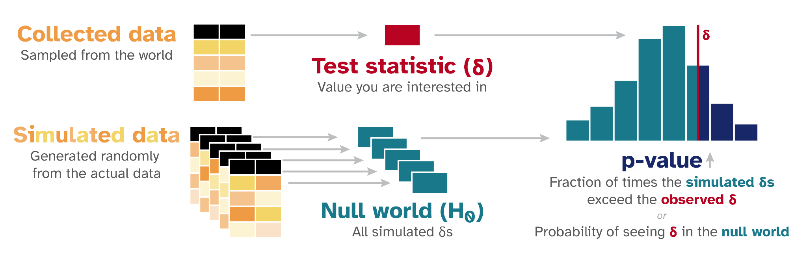
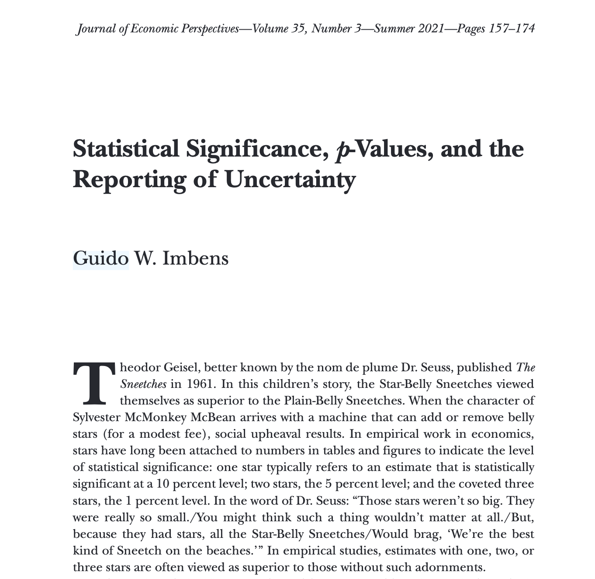
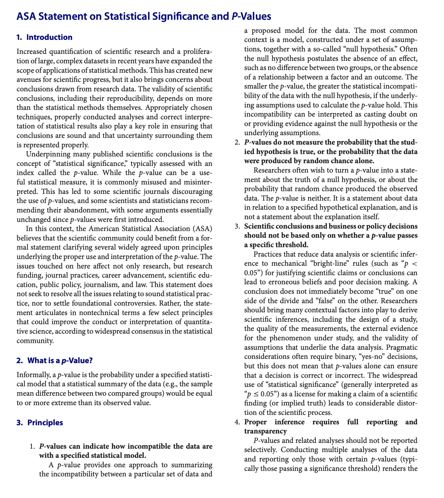

```{r}
#| label: setup
#| include: false

library(tidyverse)
library(tinytable)
library(moderndive)
library(infer)
library(countdown)

# Colors from _brand.yml
clrs <- list(
  blue = "#2878B5",
  orange = "#E17C05",
  gold = "#F2B701",
  maroon = "#8A1538",
  purple = "#6F4C9B",
  green = "#2D934F",
  gray = "#696A6F"
)

theme_set(theme_grey(base_size = 14))

pct <- scales::label_percent(accuracy = 1)
pct1 <- scales::label_percent(accuracy = 0.1)
comma <- scales::label_comma()
pts <- \(x) paste(round(x * 100, 1), "points")

# p-values that are 0 in a simulation really just mean "smaller than 1 in 1,000"
fmt_p <- \(p) case_when(
  p < 0.001 ~ "< 0.001",
  p > 0.999 ~ "≈ 1",
  .default = paste("=", format(round(p, 3), nsmall = 3))
)

# 2×2 grid of decisions vs. the actual truth (styled with the .error-grid CSS
# on the first "Two ways to be wrong" slide). With fragments = TRUE, the empty
# grid shows first, then both "Yay!" cells, then both "Oh no!" cells. The grid
# is centered and takes up `width` of whatever it's in (the slide or a column)
error_grid <- function(pos, neg, decision, fragments = TRUE, width = "100%") {
  place <- \(row, col) glue::glue("grid-row: {row}; grid-column: {col};")
  cell <- \(row, col, kind, big, small) {
    frag <- if (fragments) {
      glue::glue(' fragment" data-fragment-index="{if (kind == "yay") 1 else 2}')
    } else {
      ""
    }
    glue::glue(
      '<div class="eg-cell eg-{kind}{frag}" style="{place(row, col)}">',
      '<span class="eg-big">{big}</span><span class="eg-small">{small}</span></div>'
    )
  }

  htmltools::HTML(paste0(
    glue::glue('<div class="error-grid" style="width: {width};" role="img" aria-label="Grid comparing the actual truth ({pos} or {neg}) with the {tolower(decision)} ({pos} or {neg}). Matching cells are correct: true positive and true negative. Deciding {pos} when the truth is {neg} is a false positive, or Type I error. Deciding {neg} when the truth is {pos} is a false negative, or Type II error.">'),
    glue::glue('<div class="eg-label" style="{place(1, "3 / 5")}">Actual truth</div>'),
    glue::glue('<div class="eg-label eg-vertical" style="{place("3 / 5", 1)}">{decision}</div>'),
    glue::glue('<div class="eg-head eg-pos" style="{place(2, 3)}">{pos}</div>'),
    glue::glue('<div class="eg-head eg-neg" style="{place(2, 4)}">{neg}</div>'),
    glue::glue('<div class="eg-head eg-pos eg-vertical" style="{place(3, 2)}">{pos}</div>'),
    glue::glue('<div class="eg-head eg-neg eg-vertical" style="{place(4, 2)}">{neg}</div>'),
    cell(3, 3, "yay", "Yay!", "True positive"),
    cell(3, 4, "ohno", "Oh no!", "False positive (I)"),
    cell(4, 3, "ohno", "Oh no!", "False negative (II)"),
    cell(4, 4, "yay", "Yay!", "True negative"),
    "</div>"
  ))
}

# Null world histogram with the observed δ and two-sided p-value shading
plot_null <- function(null, obs, x_lab, labels = waiver()) {
  visualize(null) +
    shade_p_value(obs_stat = obs, direction = "two-sided", color = clrs$orange, fill = clrs$orange) +
    scale_x_continuous(labels = labels) +
    labs(title = NULL, x = x_lab, y = "Count")
}
```

```{r}
#| label: make-data
#| include: false

barometer <- read_csv(
  here::here("data", "arab_barometer.csv"),
  show_col_types = FALSE
)

emigrate <- barometer |>
  drop_na(thought_emigrating) |>
  mutate(yes = thought_emigrating == "Yes")

# Main example: the gender gap in thinking about emigrating in Lebanon
lebanon <- emigrate |> filter(country == "Lebanon")

leb_props <- lebanon |>
  group_by(gender) |>
  summarize(p = mean(yes), n = n())

obs_leb <- lebanon |>
  specify(thought_emigrating ~ gender, success = "Yes") |>
  calculate(stat = "diff in props", order = c("Female", "Male"))

set.seed(1234)
null_leb <- lebanon |>
  specify(thought_emigrating ~ gender, success = "Yes") |>
  hypothesize(null = "independence") |>
  generate(reps = 1000, type = "permute") |>
  calculate(stat = "diff in props", order = c("Female", "Male"))

p_leb <- get_p_value(null_leb, obs_stat = obs_leb, direction = "two-sided")$p_value

set.seed(1234)
ci_leb <- lebanon |>
  specify(thought_emigrating ~ gender, success = "Yes") |>
  generate(reps = 1000, type = "bootstrap") |>
  calculate(stat = "diff in props", order = c("Female", "Male")) |>
  get_ci(level = 0.95, type = "percentile")

theory_leb <- prop_test(
  lebanon, thought_emigrating ~ gender,
  success = "Yes", order = c("Female", "Male")
)

# Last week's intervals, now as tests
tunisia <- emigrate |> filter(country == "Tunisia")
tunisia_internet <- tunisia |> drop_na(uses_internet)

obs_tun_gender <- tunisia |>
  specify(thought_emigrating ~ gender, success = "Yes") |>
  calculate(stat = "diff in props", order = c("Female", "Male"))

obs_tun_internet <- tunisia_internet |>
  specify(thought_emigrating ~ uses_internet, success = "Yes") |>
  calculate(stat = "diff in props", order = c("Yes", "No"))

set.seed(1234)
null_tun_gender <- tunisia |>
  specify(thought_emigrating ~ gender, success = "Yes") |>
  hypothesize(null = "independence") |>
  generate(reps = 1000, type = "permute") |>
  calculate(stat = "diff in props", order = c("Female", "Male"))

set.seed(1234)
null_tun_internet <- tunisia_internet |>
  specify(thought_emigrating ~ uses_internet, success = "Yes") |>
  hypothesize(null = "independence") |>
  generate(reps = 1000, type = "permute") |>
  calculate(stat = "diff in props", order = c("Yes", "No"))

p_tun_gender <- get_p_value(null_tun_gender, obs_tun_gender, direction = "two-sided")$p_value
p_tun_internet <- suppressWarnings(
  get_p_value(null_tun_internet, obs_tun_internet, direction = "two-sided")$p_value
)

# Same seeds and code as last week, so the intervals match
set.seed(1234)
ci_tun_gender <- tunisia |>
  specify(thought_emigrating ~ gender, success = "Yes") |>
  generate(reps = 1000, type = "bootstrap") |>
  calculate(stat = "diff in props", order = c("Female", "Male")) |>
  get_ci(level = 0.95, type = "percentile")

set.seed(1234)
ci_tun_internet <- tunisia_internet |>
  specify(thought_emigrating ~ uses_internet, success = "Yes") |>
  generate(reps = 1000, type = "bootstrap") |>
  calculate(stat = "diff in props", order = c("Yes", "No")) |>
  get_ci(level = 0.95, type = "percentile")

# Tunisia's internet gap, for "do we even need a test?"
internet_props <- tunisia_internet |>
  group_by(uses_internet) |>
  summarize(p = mean(yes), n = n())

# Other δs: difference in proportions (Kuwait gender gap)
kuwait <- emigrate |> filter(country == "Kuwait")

obs_kw <- kuwait |>
  specify(thought_emigrating ~ gender, success = "Yes") |>
  calculate(stat = "diff in props", order = c("Female", "Male"))

set.seed(1234)
null_kw <- kuwait |>
  specify(thought_emigrating ~ gender, success = "Yes") |>
  hypothesize(null = "independence") |>
  generate(reps = 1000, type = "permute") |>
  calculate(stat = "diff in props", order = c("Female", "Male"))

p_kw <- get_p_value(null_kw, obs_kw, direction = "two-sided")$p_value

# Other δs: difference in means (urban vs. rural ages across all 8 countries);
# also the t-test and "significant ≠ substantive" example
urban_rural <- barometer |>
  filter(urban_rural %in% c("Urban", "Rural")) |>
  drop_na(age)

ur_means <- urban_rural |>
  group_by(urban_rural) |>
  summarize(avg_age = mean(age), n = n())

obs_ur <- urban_rural |>
  specify(age ~ urban_rural) |>
  calculate(stat = "diff in means", order = c("Urban", "Rural"))

set.seed(1234)
null_ur <- urban_rural |>
  specify(age ~ urban_rural) |>
  hypothesize(null = "independence") |>
  generate(reps = 1000, type = "permute") |>
  calculate(stat = "diff in means", order = c("Urban", "Rural"))

p_ur <- suppressWarnings(get_p_value(null_ur, obs_ur, direction = "two-sided")$p_value)

t_ur <- t_test(
  urban_rural, age ~ urban_rural,
  order = c("Urban", "Rural"), alternative = "two-sided"
)

# Other δs: one proportion, Tunisian internet use vs. the global rate
# (ITU Facts and Figures 2023: 67% of the world's population uses the internet)
tunisia_online <- barometer |>
  filter(country == "Tunisia") |>
  drop_na(uses_internet)

obs_online <- tunisia_online |>
  specify(response = uses_internet, success = "Yes") |>
  calculate(stat = "prop")

set.seed(1234)
null_online <- tunisia_online |>
  specify(response = uses_internet, success = "Yes") |>
  hypothesize(null = "point", p = 0.67) |>
  generate(reps = 1000, type = "draw") |>
  calculate(stat = "prop")

p_online <- get_p_value(null_online, obs_online, direction = "two-sided")$p_value

# Other δs: regression slope (same model as last week); also the regression table
tun_ages <- tunisia |> drop_na(age) |> mutate(yes_num = as.numeric(yes))
age_model <- lm(yes_num ~ age, data = tun_ages)

obs_slope <- tun_ages |>
  specify(yes_num ~ age) |>
  calculate(stat = "slope")

set.seed(1234)
null_slope <- tun_ages |>
  specify(yes_num ~ age) |>
  hypothesize(null = "independence") |>
  generate(reps = 1000, type = "permute") |>
  calculate(stat = "slope")

p_slope <- suppressWarnings(get_p_value(null_slope, obs_slope, direction = "two-sided")$p_value)
```

## Plan for today (and Tuesday) {.clr-8 background-color="" background-image="/slides/img/background-hex-shapes.svg" background-opacity="0.25"}

[Evidentiary standards]{.box-clr-3 .medium .fragment}

[How to test any hypothesis]{.box-clr-5 .medium .fragment}

[Interpreting tests]{.box-clr-7 .medium .fragment}

[Other δs]{.box-clr-4 .medium .fragment}

[Math-based tests]{.box-clr-9 .medium .fragment}

[Problems with p-values]{.box-clr-2 .medium .fragment}


# Quick review {background-color="" background-image="/slides/img/background-hex-shapes.svg" background-opacity="0.25"}

## Estimands {.clr-1}

[Parameters are the things we<br>want to know about the population]{.box-clr-1-light}

::: {.list-table widths="1.3,0.6,0.6,2.6" .smaller .sp-before}

- - Estimand
  - Parameter
  - Statistic
  - Example

- - Proportion
  - $p$
  - $\widehat{p}$
  - Tunisians who have thought about emigrating

- - Mean
  - $\mu$
  - $\bar{x}$
  - Average age of Tunisian adults

- - Difference in proportions
  - $p_1 - p_2$
  - $\widehat{p}_1 - \widehat{p}_2$
  - Emigration: internet users vs. non-users

- - Difference in means
  - $\mu_1 - \mu_2$
  - $\bar{x}_1 - \bar{x}_2$
  - Age: urban vs. rural residents

- - Regression slope
  - $\beta_1$
  - $b_1$
  - Relationship between age and thinking about emigrating

:::

## {.clr-1}

:::::: {.columns}

::::: {.column width="50%"}
::: {}
- $\widehat{p}$
- $\bar{x}$
- $\widehat{p}_1 - \widehat{p}_2$
- $\bar{x}_1 - \bar{x}_2$
- $b_1$
:::
:::::

::::: {.column width="50%"}
:::: {.fragment}
[$\delta$]{.huge}

[(delta)]{.medium}

::: {.small}
Your estimate

Whatever statistic answers your research question
:::
::::
:::::

::::::

## How do we know if δ is any good? {.clr-1}

:::::: {.columns}

::::: {.column width="33%"}
:::: {.fragment}
[Is it accurate?]{.box-clr-1}

::: {.small}
Is δ a good guess?

Did it pick up the population parameter?

[**Confidence intervals**]{.box-clr-1-light}
:::
::::
:::::

::::: {.column width="30%"}
:::: {.fragment}
[Is it real?]{.box-clr-1}

::: {.small}
Is δ real?

Could it maybe be zero?

[**Hypothesis tests and p-values**]{.box-clr-1-light}
:::
::::
:::::

::::: {.column width="36%"}
:::: {.fragment}
[Is it substantive?]{.box-clr-1}

::: {.small}
Does δ even matter?

&nbsp;<br>&nbsp;

[**Your knowledge of the world—no stats!**]{.box-clr-1-light}
:::
::::
:::::

::::::

## {.clr-1}

[Do different groups of Tunisians think about emigrating at different rates?]{.box-clr-1-light}

::: {.list-table widths="1.4,1,1.4" .small .sp-before}

- - Comparison
  - δ
  - 95% CI

- - Women − men
  - `r pts(obs_tun_gender$stat)`
  - `r round(ci_tun_gender$lower_ci * 100, 1)` to `r round(ci_tun_gender$upper_ci * 100, 1)`

- - Internet users − <br>non-users
  - `r pts(obs_tun_internet$stat)`
  - `r round(ci_tun_internet$lower_ci * 100, 1)` to `r round(ci_tun_internet$upper_ci * 100, 1)`

:::

::: {.incremental .small}
- The gender interval includes 0, so "no difference" is plausible
- The internet interval is way above 0
- Is there a more formal way to ask "could it be zero"?
:::

# Evidentiary standards {background-color="" background-image="/slides/img/background-hex-shapes.svg" background-opacity="0.25"}

## Common law legal process {.clr-3}

::: {.smaller}
UK, India, Canada, Australia, US, etc.
:::

::: {.incremental}
- **The accused must be judged**
- **Presumption of innocence**
- **Accuser has burden of proving guilt**
- **Judge/jury decides guilt based on the amount of evidence**
:::

::: {.fragment}
[We never prove innocence; we try (and fail) to reject innocence]{.box-clr-3-light}
:::

## Common law evidentiary standards {.clr-3}

::: {.incremental}
- **Preponderance of the evidence** (civil)
- **Clear and convincing evidence** (civil)
- **Beyond a reasonable doubt** (criminal)
:::

## Sharia court evidentiary standards {.clr-3}

::: {.incremental}
- **غلبة الظن / preponderance of assumption** (*ta'zir* and family matters)
- **اليقين / certainty** (*hudud* and *qisas* cases)
:::

## {.clr-3}

::: {.incremental}
- **Why do we have all these levels?**
- **Why is the burden different for different types of cases?**
- **Why is it so high for criminal cases?**
:::

::: {.fragment .sp-before}
[We're afraid of punishing an innocent person!]{.box-clr-3}
:::

:::: {.columns .fragment}

::: {.column .small}
"For if the Imam makes a mistake in forgiving it would be better than making mistake in punishment"

*Jamiʿ at-Tirmidhi* 1424
:::

::: {.column}
فَإِنَّ الإِمَامَ أَنْ يُخْطِئَ فِي الْعَفْوِ خَيْرٌ مِنْ أَنْ يُخْطِئَ فِي الْعُقُوبَةِ

جامع الترمذي 1424 
:::

::::


## {.clr-3}

```{=html}
<style>
.error-grid {
  display: grid;
  grid-template-columns: 1.1em 1.6em 1fr 1fr;
  grid-template-rows: auto 1.6em 4.6em 4.6em;
  gap: 0.25em;
  margin-inline: auto;
  font-weight: 700;
  line-height: 1.1;
}
.error-grid > div {
  display: flex;
  align-items: center;
  justify-content: center;
  text-align: center;
}
.error-grid .eg-label { color: #2878B5; font-size: 0.8em; }
.error-grid .eg-vertical { writing-mode: vertical-rl; transform: rotate(180deg); }
.error-grid .eg-head { color: #fff; font-size: 0.75em; }
.error-grid .eg-pos { background-color: #CC503E; }
.error-grid .eg-neg { background-color: #041E42; }
.error-grid .eg-cell { flex-direction: column; gap: 0.3em; color: #fff; }
.error-grid .eg-yay { background-color: #E17C05; }
.error-grid .eg-ohno { background-color: #972844; }
.error-grid .eg-big { font-size: 1.3em; }
.error-grid .eg-small { font-size: 0.55em; }
</style>
```

```{r}
error_grid("Guilty", "Not guilty", "Judge/jury decision", width = "65%")
```

## Statistical "legal" system {.clr-3}

::: {.incremental}
- **Sample statistic δ must be judged**
- **Presumption of no effect** (null hypothesis, $H_0$)
- **You have the burden of proving δ is "real"**
- **You decide δ's "guilt" based on the amount of evidence**
:::

::: {.fragment .sp-before}
[We never prove that the null is true;<br>we try (and fail) to reject the null]{.box-clr-3}
:::

## Two possible hypotheses {.clr-3}

[Is there a difference between men's and women's attitudes toward emigration in Lebanon?]{.box-clr-3-light}

:::::: {.columns .sp-before}

::::: {.column width="50%"}
:::: {.fragment}
[Null hypothesis]{.box-clr-3}

$H_0: p_\text{women} - p_\text{men} = 0$

::: {.small .sp-before}
No difference ("innocent")
:::
::::
:::::

::::: {.column width="50%"}
:::: {.fragment}
[Alternative hypothesis]{.box-clr-3}

$H_A: p_\text{women} - p_\text{men} \neq 0$

::: {.small .sp-before}
Some difference ("guilty")
:::
::::
:::::

::::::

## {.clr-3}

:::::: {.columns}

::::: {.column width="65%"}
```{r}
error_grid("Yes δ", "No δ", "Test result")
```
:::::

::::: {.column width="35%"}
:::: {.fragment .small fragment-index="3" .box-center}
[α (alpha)]{.box-clr-3 .medium}

::: {.medium .box-center}
0.10<br>0.05<br>0.01
:::

Your evidentiary standard: how often you're willing to make a Type I error
::::
:::::

::::::

::: {.notes}
Test result = the result of the hypothesis test. "Yes δ" = reject $H_0$; "No δ" = fail to reject $H_0$.
:::

## Statistical significance {.clr-3}

[There's enough evidence to safely declare that δ is "real" and not zero]{.box-clr-3 .medium}

::: {.fragment .sp-before}
["Rejecting the null hypothesis"]{.box-clr-3-light .medium}
:::

## p-values {.clr-3}

[The probability of seeing a δ at least that extreme in a world where there's no effect]{.box-clr-3 .medium}

::: {.fragment .sp-before .medium}
*Wildly misunderstood—by everyone!*
:::

# How to test<br>any hypothesis {background-color="" background-image="/slides/img/background-hex-shapes.svg" background-opacity="0.25"}

## {background-image="img/flowchart-colostate.png" background-size="contain" background-position="center" background-color="white"}

::: {.notes}
https://onishlab.colostate.edu/wp-content/uploads/2019/07/which_test_flowchart.png
:::

## {background-image="img/flowchart-soton.png" background-size="contain" background-position="center" background-color="white"}

::: {.notes}
https://www.med.soton.ac.uk/resmethods/statisticalnotes/which_test_flow.htm
:::

## {background-image="img/chi-squared-table.png" background-size="contain" background-position="center" background-color="white"}

## There is only one test! {.clr-5}

[Simulations and null worlds]{.box-clr-5 .medium}

{fig-alt="Diagram of the one test: collected data gives a test statistic δ; simulated data gives a null world of many δs; the p-value is the fraction of simulated δs that exceed the observed δ" fig-align="center" width="100%"}

::: {.notes}
Based on Allen Downey, ["There is still only one test"](http://allendowney.blogspot.com/2016/06/there-is-still-only-one-test.html)
:::

## {.clr-5 .center background-color="white"}

```{=html}
<style>
.nw-build { position: relative; margin-top: 0em; }
.nw-build p { margin: 0; }
.reveal .nw-build img { display: block; width: 100%; max-width: 100%; margin: 0; }
.reveal .nw-build .nw-cover { position: absolute; background-color: #fff; display: block; }
</style>
```

::: {.nw-build}
{fig-alt="Diagram of the one test, revealed one piece at a time: collected data, then the test statistic δ, then simulated data, then the null world of simulated δs, then the histogram of the null world with δ marked, then the p-value"}

[]{.nw-cover .fragment .fade-out fragment-index="1" style="left: 30.5%; top: 0%; width: 31.5%; height: 43%;"}
[]{.nw-cover .fragment .fade-out fragment-index="2" style="left: 0%; top: 43%; width: 35%; height: 57%;"}
[]{.nw-cover .fragment .fade-out fragment-index="3" style="left: 35%; top: 43%; width: 26%; height: 57%;"}
[]{.nw-cover .fragment .fade-out fragment-index="4" style="left: 52.5%; top: 9%; width: 9.5%; height: 9%;"}
[]{.nw-cover .fragment .fade-out fragment-index="4" style="left: 62%; top: 0%; width: 38%; height: 43.5%;"}
[]{.nw-cover .fragment .fade-out fragment-index="4" style="left: 51%; top: 43%; width: 49%; height: 11.5%;"}
[]{.nw-cover .fragment .fade-out fragment-index="5" style="left: 61%; top: 54.5%; width: 39%; height: 45.5%;"}
:::

## {.clr-5}

[1: **Find δ**]{.box-clr-5 .fragment .medium}

[2: **Invent a world where δ is null**]{.box-clr-5 .fragment .medium}

[3: **Look at δ in the null world**]{.box-clr-5 .fragment .medium}

[4: **Find the probability that δ could exist in the null world**]{.box-clr-5 .fragment .medium}

[5. **Decide!**]{.box-clr-5 .fragment .medium}


## 1: Calculate δ {.clr-5}

[Do Lebanese women and men think about emigrating at different rates?]{.box-clr-5-light}

::::: {.columns .sp-before}

:::: {.column width="50%"}
::: {.incremental .small}
- **Estimand**: $p_\text{women} - p_\text{men}$
- $H_0$: $p_\text{women} - p_\text{men} = 0$
- $H_A$: $p_\text{women} - p_\text{men} \neq 0$
- α = 0.05
:::
::::

:::: {.column width="50%"}
::: {.fragment}
```{r}
leb_props |>
  mutate(
    gender = recode_values(gender, "Female" ~ "Women", "Male" ~ "Men"),
    p = pct1(p),
    n = comma(n)
  ) |>
  rename(Gender = gender, `% yes` = p) |>
  tt() |>
  theme_html(class = "tinytable shadow")
```

::: {.box-center}
[δ = `r pts(obs_leb$stat)`]{.box-clr-5 .small}
:::
:::
::::

:::::

::: {.fragment .small}
Is that real though? Could it be positive? Could it be zero?
:::

## 2: Invent a world where δ is null {.clr-5}

[If gender doesn't matter, the categories "woman" and "man" are meaningless]{.box-clr-5-light}

::: {.incremental}
- Shuffle them!
  - Keep everyone's answers, but randomly reassign who's a woman and who's a man 
  - ("permutation shuffling" breaks any connection between the variables)
- Calculate δ for the shuffled data
- Repeat a bunch of times
:::

## Bootstrapping vs. permuting {.clr-5}

:::::: {.columns}

::::: {.column width="50%"}
:::: {.fragment}
[Bootstrap]{.box-clr-5}

::: {.small}
Resample **with** replacement

Shows how much δ bounces around

`type = "bootstrap"`

→ Confidence intervals
:::
::::
:::::

::::: {.column width="50%"}
:::: {.fragment}
[Permutation]{.box-clr-5}

::: {.small}
Shuffle **without** replacement

Shows what δ looks like when there's no effect

`type = "permute"`

→ Hypothesis tests
:::
::::
:::::

::::::

## {.clr-5}

::::: {.columns}

:::: {.column width="58%"}

```{r}
#| include: false

set.seed(1234)
```

```{=html}
<style>
.reveal .tall-code pre code { max-height: none; }
</style>
```

::: {.smaller .tall-code}
```{r}
#| echo: true
#| flourish:
#|   - target: "specify"
#|     style: "background-color: var(--hl-1);"
#|   - target: "hypothesize"
#|     style: "background-color: var(--hl-2);"
#|   - target: "generate"
#|     style: "background-color: var(--hl-3);"
#|   - target: "calculate"
#|     style: "background-color: var(--hl-4);"

library(infer)

# δ from the actual data
obs_diff <- lebanon |>
  specify(
    thought_emigrating ~ gender,
    success = "Yes"
  ) |>
  calculate(
    stat = "diff in props",
    order = c("Female", "Male")
  )

# Simulate null world
null_world <- lebanon |>
  specify(
    thought_emigrating ~ gender,
    success = "Yes"
  ) |>
  hypothesize(null = "independence") |>
  generate(reps = 1000, type = "permute") |>
  calculate(
    stat = "diff in props",
    order = c("Female", "Male")
  )
```
:::
::::

:::: {.column width="42%"}
::: {.incremental .small}
- [**`specify()`**]{.bg-hl-1}: What are the variables?
- [**`hypothesize()`**]{.bg-hl-2}: What does the null world look like? (`"independence"` = gender and emigration aren't related)
- [**`generate()`**]{.bg-hl-3}: Make the null world by shuffling (`"permute"`)
- [**`calculate()`**]{.bg-hl-4}: Find δ in each shuffled dataset
:::
::::

:::::


## {.clr-5}

:::: {.columns}

::: {.column}
```{r}
#| echo: true

null_world
```
:::

::: {.column}
```{r}
#| echo: true
#| fig-width: 5
#| fig-height: 5

visualize(null_world)
```
:::

::::

## 3: Look at δ in the null world {.clr-5}

::: {.small}
```{r}
#| echo: true
#| eval: false

visualize(null_world) +
  shade_p_value(obs_stat = obs_diff, direction = NULL)
```
:::

```{r}
#| label: plot-leb-null
#| fig-width: 8
#| fig-height: 3.5
#| out-width: "100%"

visualize(null_leb) +
  shade_p_value(obs_stat = obs_leb, direction = NULL, color = clrs$orange, fill = clrs$orange) +
  scale_x_continuous(labels = scales::label_number(accuracy = 1, scale = 100, suffix = " pts")) +
  labs(title = NULL, x = "Simulated δs in a world where gender doesn't matter", y = "Count")
```

## 3: Look at δ in the null world {.clr-5}

::: {.small}
```{r}
#| echo: true
#| eval: false

visualize(null_world) +
  shade_p_value(obs_stat = obs_diff, direction = "two-sided")
```
:::

```{r}
#| label: plot-leb-null1
#| fig-width: 8
#| fig-height: 3.5
#| out-width: "100%"

visualize(null_leb) +
  shade_p_value(obs_stat = obs_leb, direction = "two-sided", color = clrs$orange, fill = clrs$orange) +
  scale_x_continuous(labels = scales::label_number(accuracy = 1, scale = 100, suffix = " pts")) +
  labs(title = NULL, x = "Simulated δs in a world where gender doesn't matter", y = "Count")
```


## 4: Find the p-value {.clr-5}

[Probability of seeing a δ at least as extreme as ours in this null world]{.box-clr-5}

::: {.small}
```{r}
#| echo: true
#| eval: false

null_world |>
  get_p_value(obs_stat = obs_diff, direction = "two-sided")
```

```{r}
get_p_value(null_leb, obs_stat = obs_leb, direction = "two-sided")
```
:::

::: {.fragment .sp-before}
[In a world where Lebanese women and men think about emigrating at the same rate, there's a `r pct1(p_leb)` chance that we'd see a difference at least as big as `r abs(round(obs_leb$stat * 100, 1))` percentage points]{.box-clr-5-light .small}
:::

## 5: Decide! {.clr-5}

[p `r fmt_p(p_leb)`]{.box-clr-5 .large}

::: {.fragment}
Do we have enough evidence to say that we don't live in the null world (i.e. to "convict", or to "reject the null hypothesis")?
:::

::: {.incremental .sp-before}
- Is that below α = 0.05?
- Is that below α = 0.10?
- Is that below α = 0.01?
:::

## {.clr-5 .center}

[andhs.co/nullworlds]{.box-clr-5 .huge}

## p-values and confidence intervals {.clr-5}

::::: {.columns}

:::: {.column width="50%"}
::: {.small}
```{r}
#| echo: true
#| eval: false
#| flourish:
#|   - target-rx: "type = \"bootstrap\""
#|     style: "background-color: var(--hl-1);"

lebanon |>
  specify(
    thought_emigrating ~ gender,
    success = "Yes"
  ) |>
  generate(
    reps = 1000,
    type = "bootstrap"
  ) |>
  calculate(
    stat = "diff in props",
    order = c("Female", "Male")
  ) |>
  get_ci(level = 0.95)
```
:::
::::

:::: {.column width="50%"}
::: {.fragment}
```{r}
ci_leb |>
  mutate(across(everything(), \(x) round(x, 4))) |>
  tt() |>
  theme_html(class = "tinytable shadow")
```

::: {.small .sp-before .box-center}
The 95% confidence interval includes 0

*p* is above 0.05
:::
:::
::::

:::::

::: {.fragment}
[*KINDA SORTA SHORTCUT*: If a 95% CI includes 0, p > 0.05; if it excludes 0, p < 0.05]{.box-clr-5-light .small}
:::

::: {.notes}
Same pipeline as last week, minus hypothesize(), and with "bootstrap" instead of "permute". The match is for two-sided tests: a 95% interval ↔ α = 0.05, a 90% interval ↔ α = 0.10.
:::

## {.clr-5}

:::: {.columns}

::: {.column}
`thought_emigrating ~ gender`

```{r}
#| label: plot-tunisia-null-gender
#| fig-width: 4.5
#| fig-height: 3.5
#| out-width: "100%"

null_plot <- function(null, obs, title) {
  visualize(null) +
    shade_p_value(obs_stat = obs, direction = NULL, color = clrs$orange, fill = clrs$orange) +
    scale_x_continuous(labels = scales::label_number(accuracy = 1, scale = 100, suffix = " pts")) +
    labs(title = title, x = NULL, y = NULL)
}

null_plot(null_tun_gender, obs_tun_gender, "Women − men (Tunisia)")
```
:::

::: {.column}
`thought_emigrating ~ uses_internet`

```{r}
#| label: plot-tunisia-null-internet
#| fig-width: 4.5
#| fig-height: 3.5
#| out-width: "100%"

null_plot(null_tun_internet, obs_tun_internet, "Internet users − non-users (Tunisia)")
```
:::

::::


::::: {.columns}

:::: {.column width="50%"}
::: {.fragment .small}
δ = `r pts(obs_tun_gender$stat)`; **p `r fmt_p(p_tun_gender)`**

Totally normal in the null world
:::
::::

:::: {.column width="50%"}
::: {.fragment .small}
δ = `r pts(obs_tun_internet$stat)`; **p `r fmt_p(p_tun_internet)`**

Way off the chart!
:::
::::

:::::

## Our turn: test some hypotheses {.clr-8 background-color="" background-image="/slides/img/background-hex-shapes.svg" background-opacity="1"}

[Open `hypothesis-testing.qmd` in the project]{.box-clr-8 .small}

::: {.small}
1. Pick a country and a yes/no question and a comparison group
2. Write down $H_0$, $H_A$, and α *before* we look at the data
3. Go through all 5 steps
4. Interpret results
:::

```{r}
#| label: clock-test-something

countdown(minutes = 12, seconds = 0, play_sound = TRUE, warn_when = 2 * 60)
```

## {#hypothesis-testing-ii .clr-5}

{fig-alt="Diagram of the one test: collected data gives a test statistic δ; simulated data gives a null world of many δs; the p-value is the fraction of simulated δs that exceed the observed δ" fig-align="center" width="100%"}

::: {.small}
1. Find δ
2. Invent a world where δ is null
3. Look at δ in the null world
4. Find the probability that δ could exist in the null world
5. Decide!
:::

# Interpreting tests {background-color="" background-image="/slides/img/background-hex-shapes.svg" background-opacity="0.25"}

## Only two possible outcomes {.clr-7}

:::::: {.columns}

::::: {.column width="50%"}
:::: {.fragment}
[Reject $H_0$]{.box-clr-7}

::: {.small}
*p* < α

δ doesn't fit comfortably in the null world, so we're pretty sure we're not in it, so δ is probably not 0

"Statistically significant"
:::
::::
:::::

::::: {.column width="50%"}
:::: {.fragment}
[Fail to reject $H_0$]{.box-clr-7}

::: {.small}
*p* ≥ α

δ could plausibly show up in the null world

"Not statistically significant"
:::
::::
:::::

::::::

## Temptations! {.clr-7}

:::: {.columns}

::: {.column}
[If *p* ≥ α (like *p* = 0.387), you'll want to say there's no difference, or that δ is 0]{.fragment}

[**No! Don't! Bad!**]{.fragment}

::: {.fragment .sp-before}
[You never "accept" the null hypothesis!]{.box-clr-7}
:::

::: {.fragment .smaller .sp-before}
~~"We find the defendant innocent"~~  
"We find the defendant not guilty"
:::

:::

::: {.column}
[If *p* is really close to α (like *p* = 0.052), you'll want to say that δ is *almost* significant]{.fragment}

[**No! Don't! Bad!**]{.fragment}

::: {.fragment .sp-before}
[It's either "guilty"<br>or not!]{.box-clr-7}
:::

::: {.fragment .smaller .sp-before}
~~"We find the defendant almost guilty"~~  
"We find the defendant not guilty"
:::
:::

::::

## The p-value template {.clr-7}

[In a world where there is no δ, the probability of seeing a δ at least as extreme as ours is p]{.box-clr-7 .medium}

::: {.fragment .sp-before}
[Then you judge if p is below your evidentiary threshold (0.10, 0.05, 0.01, etc.)]{.box-clr-7-light}
:::

## Which is right? {.clr-7}

**A study finds that a 5-point difference has p = 0.032.**

::: {.incremental .small}
A. There's a 3.2% chance that the difference is just random

B. There's a 3.2% chance that our hypothesis is wrong

C. In a world where there's no difference, there's a 3.2% chance of seeing a difference at least as extreme as 5 points. That's below 0.05, so we say it's statistically significant and reject the null.
:::

::: {.fragment}
[C! A p-value is about the data in a null world, not about whether your hypothesis is true]{.box-clr-7-light .small}
:::

## {.clr-7}

**In Lebanon, women are `r abs(round(obs_leb$stat * 100, 1))` points less likely than men to have thought about emigrating (p `r fmt_p(p_leb)`).**

::: {.incremental .small}
A. There's a `r pct1(p_leb)` chance that the null hypothesis is true

B. If there were no gender gap among all Lebanese adults, we'd see a gap at least this big in about `r pct1(p_leb)` of samples

C. Since p > 0.05, we've shown that Lebanese women and men think about emigrating at the same rate

D. With α = 0.10, we'd reject the null hypothesis
:::

::: {.fragment}
[B and D! C is "accepting" the null]{.box-clr-7-light .small}
:::

## Choosing a threshold {.clr-7}

::: {.incremental}
- Smaller α → fewer false positives, but more false negatives
- Bigger α → fewer false negatives, but more false positives
- Pick it before you see the data, based on how bad each mistake would be
:::

::: {.fragment .sp-before}
[Everyone uses 0.05, but it's not magical!]{.box-clr-7 .medium}
:::


# Other δs {background-color="" background-image="/slides/img/background-hex-shapes.svg" background-opacity="0.25"}

## Difference in proportions {.clr-4}

[Do Kuwaiti women and men think about emigrating at different rates?]{.box-clr-4-light .small}

::::: {.columns}

:::: {.column width="55%"}
::: {.smaller}
$H_0: p_\text{women} - p_\text{men} = 0$

```{r}
#| echo: true
#| eval: false
#| flourish:
#|   - target: "independence"
#|     style: "background-color: var(--hl-1);"
#|   - target: "diff in props"
#|     style: "background-color: var(--hl-2);"

null_world <- kuwait |>
  specify(
    thought_emigrating ~ gender,
    success = "Yes"
  ) |>
  hypothesize(null = "independence") |>
  generate(reps = 1000, type = "permute") |>
  calculate(
    stat = "diff in props",
    order = c("Female", "Male")
  )
```
:::
::::

:::: {.column width="45%"}
::: {.fragment}
```{r}
#| label: plot-null-props
#| fig-width: 4.5
#| fig-height: 3.5
#| out-width: "100%"

plot_null(
  null_kw, obs_kw, "Simulated δs (women − men)",
  scales::label_number(accuracy = 1, scale = 100, suffix = " pts")
)
```

[δ = `r pts(obs_kw$stat)`; p `r fmt_p(p_kw)`]{.box-clr-4 .small}
:::
::::

:::::

## Difference in means {.clr-4}

[Do people in cities and rural areas have different average ages?]{.box-clr-4-light .small}

::::: {.columns}

:::: {.column width="55%"}
::: {.smaller}
$H_0: \mu_\text{urban} - \mu_\text{rural} = 0$

```{r}
#| echo: true
#| eval: false
#| flourish:
#|   - target: "independence"
#|     style: "background-color: var(--hl-1);"
#|   - target: "diff in means"
#|     style: "background-color: var(--hl-2);"

null_world <- urban_rural |>
  specify(age ~ urban_rural) |>
  hypothesize(null = "independence") |>
  generate(reps = 1000, type = "permute") |>
  calculate(
    stat = "diff in means",
    order = c("Urban", "Rural")
  )
```
:::
::::

:::: {.column width="45%"}
::: {.fragment}
```{r}
#| label: plot-null-means
#| fig-width: 4.5
#| fig-height: 3.5
#| out-width: "100%"

plot_null(null_ur, obs_ur, "Simulated δs (urban − rural, years)")
```

[δ = `r round(obs_ur$stat, 1)` years; p `r fmt_p(p_ur)`]{.box-clr-4 .small}
:::
::::

:::::

::: {.notes}
All 8 countries pooled together, so it's ~14,000 people. That's why a 1-year gap is way off the chart (more on that later).
:::

## One proportion {.clr-4}

[About 67% of the world used the internet in 2023. Is Tunisia different from the rest of the world?]{.box-clr-4-light .small}

::::: {.columns}

:::: {.column width="55%"}
::: {.smaller}
$H_0: p_\text{internet} = 0.67$

```{r}
#| echo: true
#| eval: false
#| flourish:
#|   - target-rx: "null = \"point\", p = 0.67"
#|     style: "background-color: var(--hl-1);"
#|   - target-rx: "type = \"draw\""
#|     style: "background-color: var(--hl-3);"
#|   - target-rx: "stat = \"prop\""
#|     style: "background-color: var(--hl-2);"

null_world <- tunisia |>
  drop_na(uses_internet) |>
  specify(
    response = uses_internet,
    success = "Yes"
  ) |>
  hypothesize(null = "point", p = 0.67) |>
  generate(reps = 1000, type = "draw") |>
  calculate(stat = "prop")
```
:::
::::

:::: {.column width="45%"}
::: {.fragment}
```{r}
#| label: plot-null-prop
#| fig-width: 4.5
#| fig-height: 3.5
#| out-width: "100%"

plot_null(null_online, obs_online, "Simulated p̂s in a world where p = 67%", pct1)
```

[$\widehat{p}$ = `r pct1(obs_online$stat)`; p `r fmt_p(p_online)`]{.box-clr-4 .small}
:::
::::

:::::

::: {.notes}
67% comes from the [ITU's Facts and Figures 2023](https://www.itu.int/itu-d/reports/statistics/2023/10/10/ff23-internet-use/). It's not a perfect comparison: the ITU counts everyone, including kids, while the Arab Barometer only asks adults.

There's nothing to shuffle with only one variable, so `"draw"` makes the null world by flipping a coin that lands on "Yes" 67% of the time, once for each person in the sample.

We fail to reject: we can't tell Tunisia apart from the rest of the world. (That's not the same as showing Tunisia *is* exactly 67%!)

For a single mean, it's `hypothesize(null = "point", mu = 40)` with `generate(type = "bootstrap")`, which shifts the bootstrap distribution so it's centered at the null value.
:::

## Regression slope {.clr-4}

[Are older Tunisians less likely to have thought about emigrating?]{.box-clr-4-light .small}

::::: {.columns}

:::: {.column width="55%"}
::: {.smaller}
$H_0: \beta_1 = 0$

```{r}
#| echo: true
#| eval: false
#| flourish:
#|   - target: "independence"
#|     style: "background-color: var(--hl-1);"
#|   - target-rx: "stat = \"slope\""
#|     style: "background-color: var(--hl-2);"

null_world <- tun_ages |>
  specify(yes_num ~ age) |>
  hypothesize(null = "independence") |>
  generate(reps = 1000, type = "permute") |>
  calculate(stat = "slope")
```
:::
::::

:::: {.column width="45%"}
::: {.fragment}
```{r}
#| label: plot-null-slope
#| fig-width: 4.5
#| fig-height: 3.5
#| out-width: "100%"

plot_null(null_slope, obs_slope, "Simulated slopes (shuffled ages)")
```

[$b_1$ = `r round(obs_slope$stat, 4)`; p `r fmt_p(p_slope)`]{.box-clr-4 .small}
:::
::::

:::::

## Same general code {.clr-4}

```{=html}
<style>
.recipe-table code { font-size: 0.68em; white-space: nowrap; }
</style>
```

::: {.list-table widths="1.15,1.2,1.2,1.2,1.2,1.05" .smaller .recipe-table}

- -
  - Difference in proportions
  - Difference in means
  - One proportion
  - One mean
  - Regression slope

- - `specify()`
  - `y ~ group,`<br>`success = "Yes"`
  - `y ~ group`
  - `response = y,`<br>`success = "Yes"`
  - `response = y`
  - `y ~ x`

- - `hypothesize()`
  - `null =`<br>`"independence"`
  - `null =`<br>`"independence"`
  - `null = "point",`<br>`p = 0.67`
  - `null = "point",`<br>`mu = 40`
  - `null =`<br>`"independence"`

- - `generate()`
  - `type =`<br>`"permute"`
  - `type =`<br>`"permute"`
  - `type =`<br>`"draw"`
  - `type =`<br>`"bootstrap"`
  - `type =`<br>`"permute"`

- - `calculate()`
  - `stat =`<br>`"diff in props"`
  - `stat =`<br>`"diff in means"`
  - `stat =`<br>`"prop"`
  - `stat =`<br>`"mean"`
  - `stat =`<br>`"slope"`

:::

# Math-based tests {#math-based-tests background-color="" background-image="/slides/img/background-hex-shapes.svg" background-opacity="0.25"}

## Do I have to simulate everything? {.clr-9}

[No!]{.box-clr-9 .medium .fragment}

::: {.incremental}
- Math-based tests assume the null world has a known shape (normal, *t*, χ²)
- (All those flowcharts and tables are for choosing the right flavor of math-based null world)
:::

::: {.fragment}
[Same intuition:<br>how weird is δ in a world where it's 0?]{.box-clr-9-light}
:::

## Simulation vs. math {.clr-9}

::::: {.columns}

:::: {.column width="50%"}
::: {.small}
```{r}
#| echo: true
#| eval: false

lebanon |>
  prop_test(
    thought_emigrating ~ gender,
    success = "Yes",
    order = c("Female", "Male")
  )
```
:::
::::

:::: {.column width="50%"}
::: {.fragment}
```{r}
tribble(
  ~Method, ~p,
  "Simulation (1,000 shuffles)", round(p_leb, 3),
  "Math (χ² test)", round(theory_leb$p_value, 3)
) |>
  tt() |>
  theme_html(class = "tinytable shadow")
```
:::
::::

:::::

::: {.fragment .sp-before}
[Basically the same answer!]{.box-clr-9-light .medium}
:::

## Difference in means with *t*-tests {.clr-9}

[Do people in cities and rural areas have different average ages?]{.box-clr-9-light}

::: {.smaller}
```{r}
#| echo: true
#| eval: false

urban_rural |>
  t_test(
    age ~ urban_rural,
    order = c("Urban", "Rural"),
    alternative = "two-sided"
  )
```
:::

```{r}
t_ur |>
  select(estimate, lower_ci, upper_ci, statistic, p_value) |>
  mutate(across(c(statistic, estimate, lower_ci, upper_ci), \(x) round(x, 2))) |>
  mutate(p_value = format(p_value, digits = 3)) |>
  tt() |>
  style_tt(fontsize = 0.7) |>
  theme_html(class = "tinytable shadow")
```

::: {.incremental .smaller}
- `statistic`: how many standard errors δ is away from 0
- `p_value`: the probability of seeing that in the null world
- `lower_ci` and `upper_ci`: the 95% confidence interval
:::

::: {.notes}
This is Welch's two-sample t-test, just like ModernDive 9.7.1. The `estimate` is the difference in means: urban − rural.
:::

## Slopes {.clr-9}

::: {.small}
```{r}
#| echo: true
#| eval: false

model <- lm(yes_num ~ age, data = tun_ages)
get_regression_table(model)
```
:::

```{r}
get_regression_table(age_model, digits = 4) |>
  tt() |>
  style_tt(fontsize = 0.7) |>
  style_tt(j = 4:5, background = "#f7e896", bold = TRUE) |>
  theme_html(class = "tinytable shadow")
```

::: {.incremental .small .sp-before}
- Every row is a hypothesis test with $H_0: \beta = 0$
- `statistic` is a *t* statistic, and `p_value` comes from a *t* distribution
- A `p_value` of 0 isn't really 0; it's just super tiny (report it as p < 0.001)
- Shuffling ages 1,000 times: none of the simulated slopes get anywhere near `r round(obs_slope$stat, 4)`
:::

## Build intuition {.clr-9}

[Even if you never simulate a p-value again, thinking about null worlds is valuable!]{.box-clr-9 .medium}

::: {.incremental .sp-before}
Every math-based p-value you see still measures the same thing: how surprising would this δ be in a world where it's actually 0?
:::

# Problems<br>with p-values {#problems-with-p-values background-color="" background-image="/slides/img/background-hex-shapes.svg" background-opacity="0.25"}

## {.clr-2}

:::::: {.columns}

::::: {.column width="50%"}
{.shadow fig-alt="First page of Guido Imbens, 'Statistical Significance, p-Values, and the Reporting of Uncertainty,' Journal of Economic Perspectives 2021, which opens by comparing significance stars to Dr. Seuss's Star-Belly Sneetches"}
:::::

::::: {.column width="50%"}
{.shadow fig-alt="First page of the American Statistical Association's 2016 Statement on Statistical Significance and P-Values"}
:::::

::::::

## Significant ≠ substantive {.clr-2}

```{r}
ur_means |>
  mutate(avg_age = round(avg_age, 1), n = comma(n)) |>
  rename(`Lives in` = urban_rural, `Average age` = avg_age) |>
  tt() |>
  theme_html(class = "tinytable shadow")
```

::: {.incremental .small .sp-before}
- δ = `r round(t_ur$estimate, 1)` years; p `r fmt_p(t_ur$p_value)`
- Super statistically significant!
- But does a 1-year age gap matter for anything?
- With ~14,000 people, even tiny differences become "significant"
:::

::: {.fragment}
[Is δ real? Use stats. Does δ matter? That's up to you!]{.box-clr-2 .small}
:::

## Do you even need a test? {.clr-2}

```{r}
#| label: plot-obvious
#| fig-width: 8
#| fig-height: 2.75
#| out-width: "100%"

internet_props |>
  mutate(uses_internet = recode_values(uses_internet, "Yes" ~ "Uses the internet", "No" ~ "Doesn't use the internet")) |>
  ggplot(aes(x = p, y = uses_internet)) +
  geom_col(fill = clrs$maroon, width = 0.6) +
  geom_text(aes(label = pct(p)), hjust = 1.2, color = "white", size = 6) +
  scale_x_continuous(labels = pct, limits = c(0, 0.6)) +
  labs(x = "Tunisians who have thought about emigrating", y = NULL)
```

::: {.incremental .small}
- 2,400 people and a 26-point gap. Nobody needs a p-value for this!
- Look at your data before you run tests
:::

## p-hacking {.clr-2}

[Test enough things and something will be significant]{.box-clr-2 .medium}

[xkcd #882, "Significant"](https://xkcd.com/882/)

["Hack Your Way To Scientific Glory"](https://stats.andrewheiss.com/hack-your-way/)

::: {.sp-before}
[Decide on your hypotheses and α before you look at the data, and report everything you tested]{.box-clr-2-light .small .fragment}

[Preregistration]{.box-clr-2-light .small .fragment}
:::
